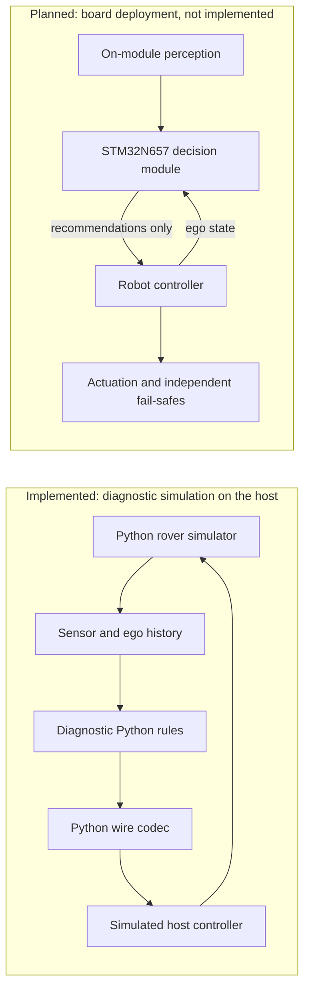

# micro_classifier

A rules-first robot decision-module project targeting the STM32N657
(Cortex-M55 and Neural-ART NPU), starting with a ground rover. It explores
Jev-like typed answers and probability distributions, not text generation.

**This is research tooling, not deployed robot firmware.** The simulator,
provisional protocol and host-side references work; a qualified rules baseline,
trained student, reviewed task dataset and board measurements do not yet exist.
Learned questions and distillation are future work, not prerequisites for the
current deterministic pilot.

## The Rover Pilot

The active catalogue contains three questions:

| Question | Type | Ordered options |
| --- | --- | --- |
| `path_blocked` | `noul` | false, true |
| `clear_sector` | `choice` | left, centre, right, none |
| `speed_tier` | `score` | 0, 1, 2, 3 |

`mode` is excluded and remains unlabeled. The [provisional contract][protocol]
uses catalogue 1, model version 0 (no trained model), and requires all three
answers for `OK`. Host state frames are 92 bytes; complete active-catalogue
decision frames are 100 bytes. Legacy four-question frames remain compatibility
fixtures, not the active pilot. ToF and history are module-side inputs, not
part of the host state frame. CRC detects corruption, not authentication.

Rejection, fault, missing or late decisions are not usable recommendations.
One-hot diagnostic outputs and codec-derived confidence are not calibrated
correctness probabilities or proof of clearance.

## Architecture and Ownership



The host-tested C libraries are separate references, not linked board firmware
or a hidden C implementation of the Python simulation loop. The experimental
C1 input/wire path is fixture-only and emits rejection/fault diagnostics, not
usable `OK` decisions; it is not the normal sensor profile or a maneuver executor.

The robot's own controller retains actuation, inner loops, interlocks and
fail-safes. Module output or silence must never cut a drone's motors in flight.
An on-device feature must actually run on the module; host simulation and
teacher inference do not establish on-device capability.

## What Exists

| Area | Implemented | Not Established |
| --- | --- | --- |
| [Rover simulator][rover] | Seeded CPU dynamics, synthetic 8x8 point-ray ToF, noise/dropout/delay, masked history and wire export. | A VL53L8CX emulator, physical error bounds or representative task quality. |
| [Diagnostic rules][rules] | Observation-based heuristic and simulated wire/control loop, with retained failure and ambiguity cases. | Qualified clearance, calibrated confidence or safe closed-loop performance. |
| [Coverage and navigation studies][diagnostics] | Conditional synthetic C1 experiments and an [ideal-geometry reference][navigation]. Unknown evidence abstains. | Qualified input sources, physical coverage or a complete admitted baseline; identical-input counterexamples remain. |
| [Protocol][protocol] and [C references][firmware] | Python/C codecs, CRC and stream recovery; C state history, decision math and artificial heads, with host checks and Cortex-M55 object builds. | Linked firmware, production model, complete runtime, full stack/RAM fit or board execution. |
| [Review and evaluation tooling][teacher-tools] | Blank observation-only review packets, fake-teacher cache tests, synthetic metrics and declared split-overlap checks. | Reviewed task labels, accepted dataset/families, locked task splits or trained models. |
| [Teacher tools][teacher-tools] | Pinned Decision 3.0 and Vela loaders, numerical/resource validators and exact prompt drafts. | Live-labeling or task-quality clearance. Cached assets need restoration/verification; full-history prompt budgets remain unresolved. |
| [Export preparation][export-tools] | Untrained ONNX/INT8 QDQ probes and dry-run-by-default ST orchestration. | A qualified transformer QDQ probe, actual ST mapping, deployment timing/memory or board measurements. |
| Student and Neural-ART runtime | Planned only, after justified questions, reviewed data and deployment gates. | A trained student, distilled robot capability or on-module NPU inference. |

The active next deliverable is a qualified simulation rules baseline. Sensor
response/coverage, admissible source evidence and independently supported
startup/actual-command/fallback behaviour remain gates. Always rejecting does
not satisfy useful task performance. Licensed ST tools and board/ToF readiness
are parallel prerequisites for later target work; arithmetic optimizations and
teacher work do not replace these gates. See [the milestones][milestones].

## Development

Use the [development-container guide][container-guide] for CPU/CUDA profiles,
the Python environment, hash-locked dependencies, certificate trust and
user-supplied licensed tools. The default test suite uses synthetic fixtures
and requires neither model downloads nor a GPU. Repository verification is:

```sh
python -m pytest -q
ruff check .
git diff --check
```

Native sanitizer and Arm checks have their own tool prerequisites. Follow the
[workflow][workflow] for focused checks, changed-file formatting and current
execution limits before running commands. Model inference, new collection,
training and hardware access are separately scoped, not default test actions.
Prior bounded experiments do not authorize repeating them. Reports and logs
are not automatically accepted labels or datasets.

## Documentation

- [Design and contracts][design]: architecture, question meanings, interfaces,
  evidence requirements and milestone gates; detailed APIs are in the linked
  source and headers.
- [Review and evidence][review]: decisions, commands, measurements, failed
  checks, provenance and current handoffs. Historical results retain their limits.
- [Environment setup][container-guide]: reusable container, dependency and tool
  setup instructions.
- [Contributor workflow][workflow]: scope, verification, commits and approvals.

## Licensing

Repository code is licensed under [Apache-2.0][license]. External model weights,
release code, datasets and ST tools retain their own licences and access terms.
The repository licence does not establish third-party training-data provenance
or commercial-use clearance. Hosted Jev outputs are not a permitted training
or label source; see [the design's licensing boundaries][design] and the
[provenance review][review] before teacher or dataset work.

[protocol]: interface/protocol.py
[rover]: sim/rover.py
[rules]: sim/rules.py
[diagnostics]: sim/diagnostics.py
[navigation]: sim/navigation.py
[firmware]: firmware/
[teacher-tools]: teacher/
[export-tools]: export/
[milestones]: DESIGN.md#12-implementation-milestones
[design]: DESIGN.md
[review]: REVIEW.md
[container-guide]: .devcontainer/README.md
[workflow]: AGENTS.md
[license]: LICENSE
