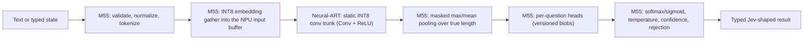

# Research Review: Jev-like Classifier on STM32N6

Status: Independent review of [DESIGN.md](DESIGN.md) and the repository state.
Review date: 2026-10-13. Update 2 (2026-10-14, §12) covers the robot
decision-module clarification and an external AI analysis; it corrects F1, F2,
and §7.2 in place. Update 3 (2026-10-19, §70) is a whole-repository code,
design and process review. Section 71 records the subsequent independent code
repairs; product decisions remain deferred.
Scope: feasibility, verification of design claims, landscape changes, design
gaps, alternatives, risks, and concrete next steps.

Method:

- Read DESIGN.md, README.md, and the `.devcontainer` setup.
- Re-checked hardware and compiler claims against ST Edge AI Core 4.0.1
  documentation, ST product pages, and ST example projects.
- Re-checked teacher claims against Hugging Face model cards, usage documents,
  configurations, and the published custom model source.
- Established what "Jev" is from TypeSafe's documentation, API reference, and
  customer agreement.
- Surveyed recent open "Jev-style" models, tiny-NLP research, and published
  STM32N6 measurements.
- Ran local arithmetic and an ONNX export/INT8 QDQ check inside the devcontainer.
- After the review, with your approval, implemented and measured an INT8 Vela
  2.0 9B teacher loader on the devcontainer's 12 GB GPU (F2).

Not done, and why:

- No NPU compilation: ST Edge AI Core is not installed (`/opt/st-tools` is empty).
- No board measurement: no hardware attached.
- Teachers other than the INT8 Vela 2.0 9B were not executed: Vela and Decision
  models require `trust_remote_code`, i.e. running third-party Python, which
  needs code review and your approval per release.
- The PDF (Idea0.pdf) is not in the workspace, so PDF-derived statements in the
  design could not be rechecked against their source.

Estimates in this document are labelled as estimates. Everything else is cited.

## 1. Executive Summary

**Verdict.** The design's direction is correct and the document is careful. The
new evidence strengthens its central conclusion:

- **Feasible:** Jev's *interface and decision semantics* (choice, yes/no, score,
  with calibrated probability distributions) over a **fixed, trained question
  catalogue**, served by a small task-specific student (roughly 0.1–1 M
  parameters) entirely from STM32N6 internal SRAM, at sub-millisecond to tens of
  milliseconds per decision.
- **Not feasible:** general Jev behaviour (arbitrary runtime questions, zero-shot)
  inside the N6. The smallest open general "Jev-style" models found are 32 M–150 M
  parameters ([Crivo-32M][crivo-32m], [Crivo-150M][crivo-150m]), at least ~30x the
  design's 1 MiB constant budget even at INT8, and they still degrade sharply on
  unseen domains.

Key findings, by priority:

| # | Severity | Finding | Action |
| --- | --- | --- | --- |
| F1 | High | TypeSafe's [customer agreement][typesafe-mca] §2.3(b) forbids using Jev outputs to "perform model distillation" or "train a model to imitate" the service | Never use the Jev API as teacher or label source; use open Apache-2.0 teachers; add a licensing gate |
| F2 | High | Teacher landscape changed: Vela 2.0 0.8B was omitted, and the multimodal [Decision 3.0][d3-collection] family (0.6B–26B, Apache-2.0) was published days before this review; the 9B runs on a 12 GB GPU with INT8 weights (measured: 6.6 GiB, no decision changes in a 25-request parity check) | Replace the fixed teacher table with a teacher bake-off; use the INT8 loader in `teacher/` for the 9B |
| F3 | High | Vela 0.3B reads all questions in one bidirectional sequence (no isolation), so a label can depend on the co-asked questions; the decoder teachers isolate questions | Add labeling-contract tests; align teacher input with what the student sees |
| F4 | High | Jev and Vela define `confidence` differently; the design's "top-two margin" statement is Vela-specific | Choose and document the on-device contract explicitly |
| F5 | Medium | NPU efficiency rules matter for 1-D text (line buffer `W x C_in <= 2048`, pooling windows <= 3, Gather in software) | Put embedding, pooling, and heads on the M55; compile two tensor layouts and compare |
| F6 | Medium | 800 MHz CPU / 1 GHz NPU are *overdrive* clocks; nominal is 600 / 800 MHz | Budget latency and energy at nominal clocks |
| F7 | Medium | The question catalogue can be data, not firmware | Freeze a shared NPU trunk; ship per-question heads as versioned blobs |
| F8 | Medium | Boot details missing: signed FSBL/application, weight copy cost, update path | Add to M5; consider ST's runtime-loadable models |
| F9 | Medium | ST's validation projects target the STM32N6570-DK, not the Nucleo | Start M1 on the DK with external memories disabled |
| F10 | Low | DESIGN §11 says no devcontainer exists; it does and passes its smoke tests | Update the design |
| F11 | Strategic | If the target is robotics with a camera, vision is the N6's strength, and decision models fail on direct multi-way motor choices | Revisit modality in M0; decompose control into atomic questions |

Update 2 adds F12-F17 for the robot decision module: the module contract, label
sources per question, closed-loop data, exclusion of Jev-derived teachers, the
two-GPU d3 teacher, and the definition of European sourcing (§12).

Update 3 adds F18-F36 from a whole-repository code, design and process review
(§70): no rover v0 question needs learning, the undefined `mode` blocks `OK`,
the simulated ToF does not match the VL53L8CX, Arm evidence used the soft-float
ABI, the framing can drop frames, and most recent work is off the critical
path.

Recommended path in one paragraph: resolve M0 (one task, modality, latency,
error costs). Install ST Edge AI Core in the devcontainer and run compile-only
nmapping experiments, which need no board. Build M55-only baselines (rules,
hashed n-grams, pruned static embeddings). Then train a convolutional student on
an NPU-friendly trunk with heads on the M55, distilled from an open teacher
selected by a measured bake-off.

## 2. What "Jev-like" Means

### TypeSafe Jev (the reference)

[Jev][typesafe-models] is TypeSafe's hosted, closed "System One" decision model
(`jev-1.13.0`, alias `jev-latest`). The [API][typesafe-api] takes a `state`
(string, object, or array) and a map of named typed questions:

| Type | Input | Output |
| --- | --- | --- |
| `noul` | yes/no instructions, optional true/false criteria | `noul` = P(yes) |
| `choice` | up to 255 options with descriptions | `choice`, `probabilities` (sum to 1), `confidence` |
| `score` | 2–10 ordered levels | expected level `score`, `legend`, `probabilities`, `confidence` |

Documented properties: text only; 64 k tokens per request; English is the primary
language; the same weights serve every account; "trained with RLCD to return
calibrated decisions"; "Jev ingests the `state` once and evaluates every question
against it in parallel." That last property maps naturally onto a shared encoder
with multiple heads on a microcontroller.

### The open "Jev-style" ecosystem

Several open models implement the SystemOne request/response shape:

- [Vela 2.0][vela-blog] (vLLM Semantic Router and KR Labs): 0.3B encoder, 0.8B,
  4B, 9B hybrids; adds `span` and `set` questions.
- [Decision 3.0][d3-collection] (vLLM Semantic Router): d3-edge 0.6B, d3-lite
  0.9B, d3-nano 2B, d3-mini 5B, d3-flash 8B, d3 26B; text, JSON, images, video.
- [Crivo-150M][crivo-150m] and [Crivo-32M][crivo-32m]: small ModernBERT/Ettin
  encoders with an `[OPT]` readout.
- [autotrust/JEV-35B][jev-35b]: an independent open model; its card states it is
  not affiliated with TypeSafe. Its sibling JEV-27B describes itself as a
  student of TypeSafe Jev 1.13 (Update 2, F15).
- The [Decision Index][decision-index] leaderboard and open kit benchmark these
  models.

### Size ladder: why general Jev cannot fit

| Model | Parameters | Generality evidence | INT8 weights alone |
| --- | --- | --- | --- |
| Crivo-32M | 32 M (12.5 M transformer core) | Decision Index 0.3 public index 25.06 | ~32 MB |
| Crivo-150M | 149 M | Full score 22.21; private new-domain tasks only 9.77 | ~149 MB |
| Vela 2.0 0.3B | ~307 M (196.6 M are embeddings) | Router and safety tasks | ~307 MB |
| d3-edge | 0.59 B | Decision Index 0.3.2 text board 20.2 | ~590 MB |
| Vela 2.0 0.8B | 756 M | Router + broad extraction | ~756 MB |
| d3-flash | 8.39 B | Decision Index 0.3.2 text board 55.8 | ~8.4 GB |
| **STM32N6 design budget** | — | — | **≤ 1 MiB constants, ≤ 3 MiB total SRAM** |

Conclusion: on the N6, "Jev-like" must mean the Jev *contract* (typed questions
in, calibrated distributions out) over a question catalogue trained in advance,
not Jev's open-ended capability. The design already says this; the size ladder
quantifies it.

## 3. Hardware and Toolchain Reality Check

### STM32N657 facts relevant to this project

| Item | Verified value | Source |
| --- | --- | --- |
| CPU | Cortex-M55 up to 800 MHz, Helium, FPU (half/single/double), 32 KB I-cache, 32 KB D-cache, 128 KB DTCM, 64 KB ITCM | [ST product page][st-n657] |
| NPU | Neural-ART up to 1 GHz, "600 GOPS", 288 MAC/cycle | [ST product page][st-n657] |
| NPU units | 4 CONV_ACC (72 8x8 MAC/cycle each, or 18 16x16), 2 POOL, 2 ACTIV, 4 ARITH, 2x5 stream engines, 2 weight-decompression units, epoch controller | [ST NPU concepts][st-concepts] |
| Arithmetic | Integer only, 8/16/24-bit datapaths, no floating point | [ST NPU concepts][st-concepts] |
| SRAM | 4.2 MB contiguous; NPU sees 4 x 448 KB fast NPU RAMs, plus 400 KB FlexMEM, 624 KB, and 1 MB system SRAM; 256 KB NPU-cache RAM usable as normal RAM when the NPU cache is unused | [ST NPU concepts][st-concepts] |
| Flash | None internal; boot from external flash or development mode | [ST getting-started][st-gs-ic] |

Clock modes from [ST's project guide][st-projects]:

| Domain | Normal (VDDCORE 0.8 V) | Overdrive (0.9 V) |
| --- | --- | --- |
| CPU | 600 MHz | 800 MHz |
| NPU | 800 MHz | 1000 MHz |
| NPU RAMs | 800 MHz | 900 MHz |
| CPU RAMs and AXI | 400 MHz | 400 MHz |

### Internal memory map in ST's default memory-pool example

From the [compiler documentation][st-compiler]:

| Region | Base address | Size | Use in ST's example |
| --- | --- | --- | --- |
| FLEXMEM | `0x34000000` | 400 KiB | Firmware; pool size set to 0 |
| AXISRAM1 | `0x34064000` | 624 KiB | Firmware; pool size set to 0 |
| AXISRAM2 | `0x34100000` | 1,024 KiB | NPU pool `cpuRAM2` |
| AXISRAM3–6 | `0x34200000`, `0x34270000`, `0x342E0000`, `0x34350000` | 4 x 448 KiB | NPU pools `npuRAM3–6`, fastest for the NPU |
| xSPI1 (DK) | `0x90000000` | 32 MiB | External RAM; excluded for internal-only |
| xSPI2 | `0x70000000` | 64 MiB | External flash; excluded for internal-only |

Implication: with ST's default split the NPU gets about 2.75 MiB of contiguous
SRAM and the firmware about 1 MiB. The design's budgets (≤ 1 MiB constants,
≤ 512 KiB activations) fit with margin. **For a sub-million-parameter student,
memory is not the binding constraint; task quality is.**

### Operator mapping relevant to text

From the [operator table][st-operators]:

| Operator | Mapping | Consequence |
| --- | --- | --- |
| Conv (1-D/2-D), constant weights | Hardware | Main building block |
| Gemm / MatMul | Hardware only if the second input is constant | Dense layers fine; attention products fall back |
| Gather | Software integer | Embedding lookup belongs on the M55 |
| Softmax | Hardware only with `--expand-softmax`; otherwise software | Keep final probabilities on the M55 |
| GELU, Sigmoid, Tanh | Hardware | Usable activations |
| ReduceMean / ReduceMax | Hardware only if convertible to global pooling | Masked pooling is better done on the M55 |
| GlobalAveragePool / GlobalMaxPool | "Limited window", software fallback | Pooling over long sequences may fall back |
| Div | Software unless the divisor is constant | LayerNorm-style normalization partly falls back |
| InstanceNormalization | Software float | Avoid |
| MaxPool | Decomposed if a window dimension exceeds 3 | Use small windows |

Efficiency rules from the same page: maximum kernel width 6 (stride 1) and height
3; kernels with a dimension of 1 run efficiently; for INT8, feature width times
input channels should be at most 2,048 or the compiler splits work; pooling line
buffers have the same 2,048 limit; avoid prime channel counts; 1x1 convolutions
are most efficient with input channels in multiples of 72–128 and output
channels in multiples of 16–24 (best 24).

### Runtime facts

- Software scheduling of hardware epochs costs roughly 10–15% MCU load; the epoch
  controller reduces it ([concepts][st-concepts]).
- There is no host NPU emulator and bit-exactness is not expected
  ([concepts][st-concepts]).
- Copying about 2 MB of weights from flash to internal RAM took 17–18 ms in ST's
  measurement, i.e. roughly 9 ms/MB ([runtime-loadable models][st-reloc]).
- A tiny model in that ST example ran in 0.218 ms in total, a useful floor for
  fixed overhead.

### Published STM32N6 measurements

| Workload | Result | Source |
| --- | --- | --- |
| Event-camera eye tracking CNN | 385 µs end-to-end, 52 MAC/cycle (≈18% of peak), 155 µJ | [arXiv 2508.13244][eye-tracking] |
| CubeSat image classifiers, pruned INT8 | 3.2–30.4 ms, 0.68–6.45 mJ per inference | [arXiv 2603.20174][cubesat] |
| Speech enhancement split into several NPU graphs | Splitting adds 2.2% latency; M55 policy 26 µs/frame | [arXiv 2609.29867][speech] |
| Line-segment detection | Attention, grid sampling, and normalization lack NPU primitives; decoder attention would need a 39 MB score tensor | [arXiv 2609.25022][nplsd] |
| YOLOv11 with attention | Needed a head-wise attention refactor for the NPU; 2.48 MB footprint, 10 FPS | [arXiv 2607.16222][argo] |
| Learned feature extractor | 9.0 ms, < 1.5 MB; replacing BatchNorm with affine layers improved INT8 robustness | [arXiv 2605.04282][gideon] |
| M55-only small INT8 CNN (ST example) | 1.08 M MAC in 0.986 ms, 0.73 cycles/MAC | [ST project guide][st-projects] |
| GAP9 vs STM32N6 vs IMX500 | N6 had the lowest latency but higher energy than GAP9 | [arXiv 2603.08725][edge-review] |

Derived (not reported directly): 155 µJ over 385 µs and 0.68 mJ over 3.22 ms
imply roughly 0.2–0.4 W while inferring. Treat this as an order of magnitude for
power planning, not a project measurement.

## 4. Verification of DESIGN.md Claims

Legend: ✓ verified, ⚠ correct but incomplete or needs qualification,
✗ incorrect or outdated, ? not verifiable here.

| Claim in DESIGN.md | Status | Evidence and notes |
| --- | --- | --- |
| N6x7 has Neural-ART, N6x5 does not | ✓ | Product page lists the NPU as "STM32N6x7 only" |
| CPU up to 800 MHz, NPU up to 1 GHz, ~600 GOPS | ⚠ | True, but only in overdrive; nominal is 600 / 800 MHz (F6) |
| About 4.2 MB banked SRAM | ✓ | See §3 for the bank map |
| No internal flash; SRAM development load is temporary | ✓ | ST getting-started boot modes |
| Static shapes; INT8 ss/sa per-channel; ONNX QDQ or TFLite | ✓ | [Quantization guide][st-quant] recommends static QDQ, QInt8, per-channel |
| MatMul in hardware needs a constant second input; Gather in software | ✓ | Operator table |
| Profile `--st-neural-art profile-internal-memories-only--default` | ✓ | Built-in profile list and `profile-<tool_profile>` syntax |
| `--expand-softmax` keeps the argmax but not exact probabilities | ✓ | Compiler guide; `--expand-softmax-full` is the more precise option |
| Application must copy SRAM-resident weights | ✓ | [Memory initializers][st-initializers] |
| No host NPU emulator | ✓ | NPU concepts |
| CM55 validation example assumes external-flash weights | ✓ | Project guide: "Weights are necessarily stored in the external flash" |
| `USE_EXTERNAL_MEMORY_DEVICES=0` | ✓ | Project guide (NPU validation project) |
| Vela 0.3B: 22 layers, width 768, intermediate 1,152, 12 heads, vocabulary 256,008 | ✓ | [config.json][vela-03b-config]; total ≈ 306.9 M parameters recomputed |
| Embeddings 196,614,144 parameters (187.5 MiB at 1 byte) | ✓ | Recomputed |
| ≈ 28.2 GOP linear projections for 128 tokens | ✓ | Recomputed: 28.24 GOP |
| Ternary 60.8 MB, 2-bit 76.75 MB for 307 M parameters | ✓ | Arithmetic correct |
| Vela 0.3B Torch path is FP32 only | ⚠ | Correct; also note the official ONNX FP16-encoder path (≤ 0.006 choice-probability difference, no decision changes on 230 rows) |
| Vela 4B ≈ 17 GB FP32 | ✓ | 4.2 B parameters x 4 bytes |
| Vela 9B ≈ 32 GB; loader rejects lower precision; `device_map="auto"` only moves to CUDA | ✓ | [Source][vela-9b-code]; F2 measures the INT8 route on a 12 GB GPU |
| Choice `confidence` is the top-two margin | ⚠ | True for Vela; Jev uses a different formula (F4) |
| Extra span questions and long inputs add sequences | ✓ | Vela usage documents |
| PDF student is ≈ 1.894 M parameters, not 4 M | ? | PDF unavailable; result depends on FFN width (see below) |
| No devcontainer examples in the workspace (DESIGN §11) | ✗ | `.devcontainer` exists with CPU, CUDA/Docker, and Podman/WSL profiles, CA handling, and passing smoke tests |
| Teacher table: 0.3B, 4B, 9B | ⚠ | Missing Vela 0.8B and Decision 3.0 (F2) |
| Task-specific distillation has published support | ✓ | [Tang et al.][tang]: single-layer BiLSTM comparable to ELMo with ~100x fewer parameters and 15x less inference time |

PDF student parameter count, recomputed with PyTorch modules for width 256,
3 layers, vocabulary 1,024, 64 positions, and 5 classes:

| `dim_feedforward` | Parameters |
| --- | --- |
| 512 | 1,861,125 |
| 1,024 | 2,649,093 |
| 2,048 (PyTorch default) | 4,225,029 |

The design's 1.894 M is close to the 512-wide result; the remaining ~33 k could
come from a small extra head or normalization layer. If the PDF code relied on
the `nn.TransformerEncoderLayer` default, its "four million" was correct.
Re-derive from the PDF's actual code before keeping the correction.

## 5. Findings in Detail

### F1 (High): Jev's terms prohibit distillation from Jev

TypeSafe's [Master Customer Agreement][typesafe-mca] (last updated 2026-09-23),
§2.3(b): the customer will not "use the Services or any Output … to perform model
distillation, train a model to imitate the output of the Services, or develop (or
to facilitate the development of) a similar or competing product or service."

Consequences:

- The hosted Jev API cannot be a teacher, label source, or imitation target.
- Even using Jev outputs to select or tune the student is a legal grey area;
  get legal review before any Jev-in-the-loop evaluation.
- Open alternatives exist and are licensed for this use: Vela 2.0 and Decision
  3.0 are Apache-2.0. Corrected in Update 2: this review also listed
  autotrust/JEV-35B, whose weights are Apache-2.0, but the JEV family trains on
  Jev-distilled labels (F15), so it is excluded.
- Crivo models are CC BY-NC 4.0 and therefore unsuitable for commercial use.
- Vela's training data includes CC-BY-SA sources, and the Vela 0.3B tokenizer
  carries Gemma terms. Do not reuse that tokenizer in the student: it is also a
  256 k vocabulary, far too large for the MCU.

Add a licensing gate to M0 and M3 that records the license of each teacher,
dataset, tokenizer, and generated label set.

### F2 (High): Teacher landscape update and selection

| Teacher | Parameters | Inputs | Question isolation | Documented memory | Documented speed | Host fit |
| --- | --- | --- | --- | --- | --- | --- |
| [Vela 2.0 0.3B][vela-03b] | 307 M | Text, 17 languages | No; one bidirectional sequence | ≈ 1.2 GB FP32 parameters (derived) | 0.09 s per full router request (A40) | Laptop GPU or CPU; ONNX path |
| [Vela 2.0 0.8B][vela-08b] | 756 M | Text, 17 languages | Yes ("bundled == single") | ≈ 3 GB FP32 parameters | 0.13 s (A40) | Fits the 12 GB laptop GPU in the devcontainer README |
| Vela 2.0 4B | 4.2 B | Text | Yes | ≈ 17 GB FP32 | 0.40–0.49 s (A40) | One 24 GB GPU, tight |
| Vela 2.0 9B | 7.9 B | Text | Yes | ≈ 32 GB FP32 | 0.60–0.71 s (A40) | 12 GB GPU with the INT8 loader in `teacher/` (measured below); 24 GB GPU with BF16 weights and a similar loader |
| [d3-edge][d3-edge] | 0.59 B | Text, JSON, images, video | Per-question forward passes | 5.2 GiB peak (one request) | 6.6 ms text, 58.6 ms image (MI325X) | Laptop GPU |
| [d3-lite][d3-lite] / [d3-nano][d3-nano] / [d3-mini][d3-mini] | 0.85 / 2.21 / 4.54 B | Multimodal | Same | 5.7 / 9.1 / 14.8 GiB peak (one request) | Not stated | Laptop GPU for lite and nano; mini needs more than 12 GB as released, but about 7.3 GiB of BF16 weights with host-side embeddings (estimate) |
| [d3-flash][d3-flash] | 8.39 B | Multimodal | Same | 23.8 GiB peak (one request) | 19.2 ms text, 166 ms image (MI325X) | 24 GB GPU, borderline as released; about 13.7 GiB of BF16 weights with host-side embeddings, 7.4 GiB with INT8 projections (estimates); planned first teacher on the 12 GB GPU |
| [d3][d3] | 26.09 B | Multimodal | Same | 61.8 GiB peak (one request) | 54.4 ms text, 290 ms image (MI325X) | Two 24 GB GPUs with INT8 projections (planned, §12) |
| [JEV-35B][jev-35b] | 35 B MoE, ~3 B active | Text, images | Not stated | 66.5 GiB BF16; 23.3 GiB NVFP4 | 204 ms median (B200) | Excluded (F15) |

Notes:

- Decision 3.0 model cards were still being updated on the review date. Pin
  revisions and expect churn.
- Prefer teachers with question isolation: labels then do not depend on which
  other questions were asked in the same call.

#### Running the 9B teacher on a 12 GB GPU

An 8-bit 9B fits a 12 GB GPU; it is just not plug-and-play. Update after the
review: the loader below is implemented and measured, with full tables in
[DESIGN.md](DESIGN.md) §4 and the raw
[report](teacher/reports/vela-2.0-9b-int8-g128-rtx-a3000.json).

Why the published path does not fit: the custom `from_pretrained` refuses any
dtype other than FP32, builds and loads the model itself (so Transformers
quantization options such as 8-bit loading never apply), casts every tensor to
FP32, and then moves the whole model to CUDA ([source][vela-9b-code]). That needs
about 32 GB of GPU memory and about as much CPU RAM while loading. No quantized
Vela 2.0 9B was published on Hugging Face as of the review date.

Weight memory, computed from the published [config][vela-9b-config] (hidden size
4,096, 32 layers of which 8 use full attention and 24 Gated DeltaNet, MLP width
12,288, vocabulary 248,320). The config states that backbone Linear and conv1d
weights are stored in BF16 and everything else, including the embedding table,
in FP32.

| Weight format | GPU weight memory |
| --- | --- |
| Official load, all FP32 | 31.8 GB |
| As stored (Linear BF16, rest FP32) | 18.0 GB |
| All BF16 | 15.9 GB |
| INT8 Linear, BF16 embeddings | 9.0 GB |
| INT8 Linear, INT8 embeddings | 8.0 GB |
| INT8 Linear, embeddings kept on the CPU | 7.0 GB |
| GGUF-style Q8_0 (8.5 bits per weight) | 8.5 GB |
| About 4.5 bits per weight, INT8 embeddings | 5.0 GB |

Of the 7.95 B parameters, 6.91 B sit in large backbone projections and 1.02 B in
the embedding table; heads, norms, gates, and convolutions total about 20 M.
Activations are small at teacher-sized inputs: the largest transient (the MLP)
is about 0.04 GiB at 512 tokens and 1.1 GiB at the 16,384-token maximum. The
measured run needed more: about 1.1 GiB for the CUDA context and workspaces, and
peak allocations of 7.1 GiB for short requests, 10.1 GiB at 12.3 k tokens, and
11.2 GiB at 16.3 k tokens. That is 4.6 GiB above the weights, several times the
MLP-only estimate; the FP32 PyTorch Gated DeltaNet kernel is the likely cause
but was not profiled. F3 already requires the teacher to see the student's
short, truncated view, so long-context activations should not arise during
labeling.

Implemented recipe ([teacher/vela_int8.py](teacher/vela_int8.py), weight-only
INT8 with BF16 compute):

1. Build the model skeleton on PyTorch's meta device, then stream tensors one at
   a time from the safetensors files. Peak host memory was 5.1 GiB.
2. Quantize only the large projections: MLP gate/up/down, attention q/k/v/o, and
   Gated DeltaNet `in_proj_qkv`, `in_proj_z`, and `out_proj`, as symmetric INT8
   with one BF16 scale per 128 input columns. Keep conv1d, the
   `in_proj_a`/`in_proj_b` gates, `A_log`, `dt_bias`, norms, and all heads FP32
   as released. Per-row scales doubled the largest probability change (0.029
   versus 0.013) and saved only 0.1 GiB.
3. Dequantize to BF16 right before each matmul in a small custom Linear. FP16
   compute is avoided: Vela states FP16 is not supported, and older bitsandbytes
   LLM.int8() releases cast BF16 activations to FP16.
4. Keep the FP32 embedding table in host RAM and copy only gathered rows to the
   GPU.
5. Leave Vela's tokenizer, rendering, windowing, calibration, and SystemOne
   engine unchanged; only backbone storage changes.

Measured on the devcontainer's RTX A3000 12 GB laptop GPU under WSL2, with
Transformers' PyTorch Gated DeltaNet kernel (flash-linear-attention is not
installed):

| Measurement | Result |
| --- | --- |
| GPU memory after load | 6.6 GiB of parameters (6.44 INT8, 0.10 scales, 0.08 FP32); 7.7 GiB in use with the CUDA context |
| Short SystemOne requests | Median 0.85 s each; 2.0 rows/s batched at a 2,048-token budget |
| Long single inputs | About 1,240 tokens/s up to 12.3 k tokens; 16.3 k tokens exceeded GPU memory and took 85 s |
| INT8 vs streamed BF16 reference, 25 requests, 273 probabilities | Max abs difference 0.013, mean 0.0009; no decision, label, or span changes |
| INT8 and BF16 reference vs the release's recorded outputs | Max abs difference 0.009 and 0.002 |

Validation, revised: instead of a 24 GB GPU or 32 GB of host RAM, the BF16
reference streams the release's stored BF16 projection weights from the
safetensors shards into the same kernels, which is exactly the evaluated
computation. Its 0.002 agreement with the recorded outputs also shows that the
fallback Gated DeltaNet kernel, which the source calls not parity-tested on GPU,
reproduces the release on these examples. Still required before using INT8
labels:

- The same comparison on the project's 300–500-row reviewed set, adding KL
  divergence per question type.
- A calibration re-check: Vela's temperatures and thresholds were fitted on the
  BF16-autocast path.
- The bake-off: judge the INT8 9B like any other teacher, by accuracy, NLL, and
  calibration error against human labels. Parity explains differences; task
  quality decides.

Throughput: the earlier estimate (13.8 GFLOP per token, roughly 0.35–0.7 s per
512-token sequence) matched. Long inputs ran at about 1,240 tokens/s, and short
requests took a median 0.85 s including fixed overheads. At 2 short rows per
second, a 20,000-example pilot takes about 3 hours. Keep the batch budget at
2,048 tokens: at 4,096 the allocator reserved 13.6 GiB, WSL2 spilled to system
memory instead of failing, and throughput fell to 0.63 rows/s.

Why not a GGUF Q8_0 file: llama.cpp could at most run the Qwen3.5 backbone (if
it supports that hybrid architecture). Vela's readout heads, prefix-sharing tree
forward, rendering, and calibration would have to be rebuilt around per-token
hidden states. That is possible, because each question is documented to equal
the single sequence of the shared prefix plus its own block, but it is far more
work than a PyTorch loader for the same roughly 8.5 GB of memory.

4-bit weights (about 5 GB) carry more quality risk; use them only if 8-bit does
not fit, for example with large batches. Teachers that fit 12 GB without
quantization: Vela 0.8B (about 3 GB FP32), d3-edge (5.2 GiB peak), and Vela 4B in
BF16 (about 8.4 GB, also needing a custom loader).

Recommendation: replace the fixed teacher table with a bake-off on the reviewed
evaluation set. Measure accuracy or macro-F1 against human labels, NLL, Brier
score, calibration error, per-class recall, and cost. A larger teacher is not
automatically better for a specific domain, as the design already notes.

### F3 (High): Labeling contract details

1. **Cross-question dependence in Vela 0.3B.** The published
   [layout][vela-03b-config] places all questions before the state in one
   sequence (`<bos> ([Q] q ([O] name: desc)* …)* … [SEP_SCHEMA] ([SEG_role] part)* <eos>`),
   and the [model source][vela-03b-code] calls the encoder with a plain padding
   mask. Every question can therefore attend to every other question. Test single
   versus bundled versus permuted questions; if results differ materially, label
   one question per call or fix and record the bundle.
2. **Teacher-student view alignment.** If the student sees only the first T
   tokens, the teacher must label exactly that truncated text. Otherwise the
   student is trained to predict information it never receives. Crivo-32M's
   recipe does exactly this: "Teacher logits were precomputed once on exactly the
   tokens the student sees (same rendering and truncation)."
3. **Rendering provenance.** Record state serialization (JSON key order),
   question text, option descriptions and order, model revision, calibration
   flags (for example Vela's optional `noul_calibration`), and thresholds.
4. **Store logits where available.** The Vela 0.3B ONNX path returns
   `opt_logits`; logits allow consistent temperature handling during
   distillation.
5. **Option order.** Permute options during labeling and training so neither
   model learns position.
6. **Loss reference.** [Crivo-32M][crivo-32m] used
   `L = 0.5·[CE(gold) + 0.5·Brier(gold)] + 0.5·τ²·KL(teacher_τ ‖ student_τ)`
   with τ = 2 for three or more options and τ = 1 for binary questions, and
   gold-only loss where the teacher is weak. This is a reasonable second
   experiment after the design's temperature-1 baseline.
7. **Transfer set.** [Tang et al.][tang] build distillation data with simple
   augmentation (masking, part-of-speech-guided word replacement, n-gram
   sampling). Label in-domain unlabeled and augmented text with the teacher, not
   only the human-labeled set.

### F4 (High): Define the on-device Jev-compatible contract

The two reference systems compute `confidence` differently:

| Answer type | TypeSafe Jev ([docs][typesafe-confidence]) | Vela 2.0 ([usage][vela-03b-usage]) |
| --- | --- | --- |
| Choice | (p_max − 1/n) / (1 − 1/n) | p_1 − p_2 (top-two margin) |
| Score | max(0, 1 − Σ p_i·\|i − m\| / MAD_uniform), m = mode | "One minus the normalised variance"; 1 − Var(p) / Var(uniform) reproduces Vela's example |
| Noul | None returned; suggests \|2p − 1\| | None returned |

Worked example from Vela's own output, choice probabilities (0.727, 0.217,
0.056): Vela reports 0.51; Jev's formula gives 0.59. Score probabilities
(0.469, 0.336, 0.194): Vela reports 0.118; Jev's formula gives 0.

Recommendation: state in the design which semantics the device implements. If the
goal is drop-in Jev API compatibility, implement TypeSafe's formulas on host and
device. Always return the full `probabilities`, keep Jev's limits (≤ 255 options,
2–10 score levels), report the versioned model ID, and keep the design's rule that
`confidence` is a distribution statistic, not a probability of being correct.

### F5 (Medium): NPU-friendly text trunk

Recommended data path:

Why this split:

- Gather is software on the NPU anyway; writing INT8 embeddings straight into the
  input buffer costs only T x d bytes (12 KiB for T = 128, d = 96).
- Masked pooling on the M55 removes padding artifacts exactly and avoids
  global-pooling window limits. Reading a 128 x 128 INT8 feature map is 16 KiB.
- Heads on the M55 cost K x C MACs, microseconds, and make the question catalogue
  replaceable data (F7).
- The NPU graph becomes Conv + ReLU only: static, fully mappable, and simple to
  validate.

Layout experiment. ST's line-buffer rule (`feature width x input channels <= 2048`
for INT8) suggests that `[1, C, 1, T]` with 1x3 kernels splits work when
`T x C > 2048` (for example 128 x 128 = 16,384), while `[1, C, T, 1]` with 3x1
kernels keeps the width at 1. Both kernel shapes have a dimension of 1, which ST
says is efficient. This is a hypothesis; compare epoch counts and estimated
cycles in the compiler reports (`--mapping-recap`, `--csv-file`).

Local check run for this review: both layouts exported from PyTorch at opset 13
and quantized with ONNX Runtime static QDQ (QInt8, per-channel, asymmetric
activations) produce only `Conv`, `QuantizeLinear`, and `DequantizeLinear` nodes,
static input shapes, and per-channel axis 0, which matches ST's documented
requirement. Whether the ST compiler maps them efficiently still needs the tool.

Other trunk guidance: prefer channel counts aligned with the conv units (for
example 96 or 128 inputs and 24, 48, or 96 outputs), avoid prime channel counts,
use kernel widths of 3 or 6 and small dilations, fold BatchNorm, and avoid
LayerNorm and attention in the first version.

### F6 (Medium): Clocks, power, and energy

The headline 800 MHz / 1 GHz figures require overdrive at VDDCORE 0.9 V. Budget
latency at nominal clocks (600 MHz CPU, 800 MHz NPU) and treat overdrive as an
optional gain measured separately for energy and thermals. ST also notes that in
the recommended asynchronous runtime mode the core executes `WFE`; the NPU, NPU
RAMs, and any memories used must stay clocked in low-power modes or inference
never completes.

### F7 (Medium): Make the question catalogue data, not firmware

Freeze a shared trunk on the NPU and store per-question heads as small versioned
blobs evaluated on the M55. To add or change a question:

1. Label in-domain data for the new question with the chosen teacher.
2. Train only the head on frozen trunk features.
3. Calibrate it on held-out data through the deployed numeric path.
4. Pass the same gates as any other release, then ship the blob.

No NPU recompilation is needed. Trunk updates can use ST's
[runtime-loadable model][st-reloc] support (relocatable binaries installed without
reflashing the application) or a normal firmware update.

The limit: frozen features must contain the information a new question needs.
Train the trunk multi-task on a diverse set of in-domain questions. This gives
runtime configurability *within a domain*; it is not zero-shot.

### F8 (Medium): Boot and persistence specifics

- ST's flash boot uses an FSBL, a signed application
  (`STM32_SigningTool_CLI … -t ssbl -hv 2.3`, programmed at `0x70100000` in ST's
  example), and separately programmed network parameters ([ST
  getting-started][st-gs-ic]).
- Copying weights into internal SRAM costs about 9 ms/MB (§3), negligible at
  boot.
- Memory initializers can be C arrays copied by startup code, provided the target
  RAM is enabled and clocked first, or raw images placed by a loader
  ([initializers][st-initializers]).
- The NPU is not TrustZone-aware; isolation uses RIF compartment IDs, and RISAF
  defaults block accesses that are not secure, privileged, CID 1
  ([project guide][st-projects]). Plan RIF/RISAF configuration as part of M5.

### F9 (Medium): Board choice for M1

ST's NPU validation and CM55 validation projects live under
`Projects/STM32N6570-DK/Applications/`, and the runtime-loadable evaluation
environment supports only the STM32N6570-DK ([project guide][st-projects],
[runtime-loadable models][st-reloc]). The NUCLEO-N657X0-Q is supported by ST's
image-classification application but will need porting for the validation
tooling. Start M1 on the DK with `USE_EXTERNAL_MEMORY_DEVICES=0`, then move to the
Nucleo if its form factor is preferred.

### F10 (Low): Housekeeping and numerical parity

- DESIGN §11 is outdated: the devcontainer exists and its README records passing
  CPU and Podman/WSL GPU smoke tests.
- Pin one ST Edge AI Core release. ST's image-classification example uses 4.0.0,
  the design cites 4.0.1 documentation, and mismatched generated code fails with
  "Possible mismatch in ll_aton library used".
- The distro Arm compiler is GCC 13.2.1. The relocatable-model flow builds with
  `arm-none-eabi-gcc` from `PATH`; pin the toolchain ST tests against.
- ST's [quantization guide][st-quant] warns that ONNX Runtime on x86-64 with AVX2
  or AVX-512 can saturate in U8S8 kernels. Treat the host INT8 reference as an
  approximation and check for saturation before attributing mismatches to the
  NPU.
- EmbBERT's reported 8-bit result used weight-only block quantization with FP16
  activations; it is not evidence for full-INT8 NPU deployment.

### F11 (Strategic): Modality and task decomposition

The STM32N6 is a vision-first MCU: its ISP output can be DMA'd into the NPU, and
ST's image-classification examples run in 1–44 ms. Decision 3.0 now offers open
multimodal Jev-style teachers. If the robotics application in the PDF uses a
camera, a vision student answering fixed questions about frames may be a better
fit than text.

The [JEV-35B card][jev-35b] adds a design lesson: in a simulated pick-and-place
task, a binary-decision servo (two binary questions per step: left or right,
above or below) reached 75% success, while "direct choice among 8 motor actions"
scored 0%; the card advises to "decompose control into simple visual questions."
Atomic binary and small choice questions are also the easiest to distill into
tiny heads.

## 6. Feasibility Analysis

### 6.1 Capability tiers

| Tier | Delivers | N6 internal SRAM | Notes |
| --- | --- | --- | --- |
| T0: one fixed question | Jev-shaped answer for one trained question | Credible | Design milestones M1–M4 |
| T1: fixed catalogue, shared trunk, K heads | Many questions per encoder pass, like Jev's "state once" | Credible | Head cost K x C MACs on the M55 |
| T2: host-compiled heads | New in-domain questions without firmware or NPU changes | Credible if trunk features transfer | Each head passes the same gates (F7) |
| T3: fixed-label span tagging | Per-token labels, for example fixed PII types | Credible for lexical labels | Grounded hallucination spans need pairwise reasoning: not credible |
| T4: on-device option scoring | Runtime option text scored on the device | Research | Crivo's `[OPT]` readout is the reference design, but at 32 M+ parameters |
| T5: general zero-shot Jev | Arbitrary questions | Not credible internally | See the external-memory estimate below |

External-memory estimate for T5 (order of magnitude, not measured): a Crivo-32M-
class encoder (12.5 M-parameter core) at 256 tokens needs about 3.2 G MAC of
projections plus about 0.5 G MAC of attention products per question. With
attention on the M55 at ~1.1 G MAC/s, projections on the NPU, and weights streamed
from external flash, this is roughly 0.5–1 s per question, and Crivo-style models
need one sequence per question. Combined with weak new-domain quality, this is a
research stretch only.

### 6.2 Compute and memory for candidate students

Estimates computed for this review. Assumptions: INT8; M55 at 800 MHz and 0.73
cycles/MAC (ST's measured CM55 example; real kernels vary roughly 0.5–2); NPU at
1 GHz with 30–100 effective MAC/cycle (published N6 work reached ~52). Excludes
nepoch overhead, preprocessing, and I/O.

| Candidate | Parameters (INT8) | MACs | Peak activations | M55 only | NPU compute |
| --- | --- | --- | --- | --- | --- |
| A: hashed n-gram bag 16 k x 64 + MLP | 1.06 M (≈ 1.0 MiB) | 0.03 M | ≈ 16 KiB | ≈ 0.02 ms | Not needed |
| B: byte CNN, T = 512, 4 conv blocks with pooling | 155 k | 18.9 M | ≈ 48 KiB | ≈ 17 ms | ≈ 0.19–0.63 ms |
| C: subword CNN, vocabulary 4,096, d = 96, T = 128 | 587 k | 23.6 M | ≈ 32 KiB | ≈ 22 ms | ≈ 0.24–0.79 ms |
| D: transformer d = 128, 2 layers, T = 128 | 937 k | 50.3 M dense + 8.4 M attention | ≈ 112 KiB | ≈ 54 ms | Dense ≈ 0.5–1.7 ms; attention on M55 ≈ 8 ms |
| E: numeric-state MLP 64-256-256-8 | 85 k | 0.08 M | < 1 KiB | ≈ 0.08 ms | Not needed |
| [EmbBERT][embbert] (paper, 256 tokens) | 357 k | ≈ 136 M | ≈ 128 KiB | ≈ 124 ms | Attention-bound |

Observations:

- Memory is comfortable for every candidate. Embedding tables, not layers,
  dominate parameter counts.
- Small CNN students would run in tens of milliseconds on the M55 alone. The NPU
  gives roughly 25–90x on the trunk (compute only), which matters for tight
  deadlines, battery life, or larger trunks, but an M55-only fallback is viable
  for first baselines.
- For transformer students, the software-fallback attention dominates latency
  (Amdahl's law), yet ≈ 10 ms total may still be acceptable. The design's
  "CNN/MLP first, profile transformers" stance is quantitatively sound.

### 6.3 Expected task quality

- [EmbBERT][embbert] (2 MB total memory, FP32 accounting) on narrow tasks
  (TinyNLP): EmbBERT 87.19%, a 10x larger BERT-Tiny 86.99%, an embedder-only model
  86.41%. On pairwise and reasoning tasks (GLUE): EmbBERT 63.50, BERT-Tiny 63.16,
  embedder-only 56.92. Simple models suffice for routing and intent-style
  questions; questions comparing two text parts benefit from token interaction.
- [pQRNN][pqrnn]: 1.3 M INT8 parameters reached AUC 0.963 on civil_comments
  versus 0.976 for a 110 M-parameter BERT, without pretraining. Its projection
  layer hashes tokens to ternary features and has no embedding table.
- [Crivo-150M][crivo-150m]: 27.74 on private same-skill tests, but 9.77 on
  private new-domain tasks. Small decision models do not generalize across
  domains; validate per task.

## 7. Alternatives

### 7.1 Model alternatives

| Option | Runs on | Strengths | Weaknesses | Recommendation |
| --- | --- | --- | --- | --- |
| Rules and keyword logic | M55 | Deterministic, auditable | Brittle with paraphrase | Mandatory baseline (design already requires it) |
| Hashed n-gram linear model (fastText-like) | M55 | No vocabulary file, tiny compute, robust baseline | No word order beyond n-grams | First learned baseline |
| [Model2Vec][model2vec]-style static embeddings, pruned vocabulary and reduced dimension + linear head | M55 | Distilled from sentence encoders; trivial compute | Smallest listed model is 7.5 M parameters; needs vocabulary pruning; inherits the source tokenizer (WordPiece for the listed English models) | Strong baseline after pruning |
| Projection network ([PRADO/pQRNN][pqrnn]) | M55, conv parts on NPU | No embedding table, < 200 k–1.3 M parameters | QRNN recurrence is not NPU-friendly; replace with convolutions | Good fit for the memory budget |
| 1-D CNN student (design's choice) | NPU trunk, M55 rest | Fully mappable, fast | Limited long-range interaction | Primary candidate |
| Tiny transformer / [EmbBERT][embbert] | NPU dense, M55 attention | Better pairwise reasoning | Attention falls back to software | Second candidate if CNN quality fails |
| Ternary / BitNet | — | Smaller storage at rest | The NPU computes INT8: weights occupy INT8 SRAM during inference regardless of storage format | Do not pursue for SRAM savings |
| Binary (ST DQNN) | M55 only | Very small | No NPU path | Not recommended |

The ternary point deserves emphasis: for NPU execution, SRAM holds INT8 weights.
Ternary training could only reduce flash storage, unless ST's hardware weight
decompression (present in the silicon, not exposed in the 4.0.1 documentation
reviewed) becomes usable.

### 7.2 Hardware alternatives

| Option | Relevant facts | When to consider |
| --- | --- | --- |
| STM32N6, internal only (current plan) | §3 | Default |
| STM32N6 with external memory (DK) | External NOR flash and PSRAM; NPU cache for external regions | Larger trunks or T5 research; breaks the internal-only constraint |
| [Alif Ensemble E4][alif-e4] / [E8][alif-e8] | Cortex-M55 up to 400 MHz; three NPUs (E8: Ethos-U85 plus two Ethos-U55; Ethos-U85 has native transformer support per [Arm][ethos-u85]); E4 has "over 15 MB of on-die memory"; E8 adds dual Cortex-A32 | If attention-based students become necessary or more on-die memory is needed; US company, so not a European-sourcing option (corrected in Update 2) |
| [Infineon PSoC Edge E84][psoc-edge-e84] | Cortex-M55 at 400 MHz, Ethos-U55 NPU, up to 6 MB SRAM, CAN-FD | European vendor (Germany); smaller NPU than the N6 |
| [NXP i.MX RT700][nxp-rt700] | Cortex-M33 325 MHz, eIQ Neutron NPU, up to 7.5 MB SRAM | Larger SRAM; European vendor; no Helium |
| Linux-class MPU with NPU and DRAM | Runs 100 M+ parameter decision encoders | If general Jev behaviour is a hard requirement |

### 7.3 System alternatives

- **Cascade with explicit deferral.** The MCU answers confident cases; uncertain
  cases defer to a larger open Jev-style model when a link exists, otherwise to a
  safe fallback. This keeps the primary path on-device while being honest about
  the boundary, consistent with the design's rule against hidden host inference.
- **Feature producer.** The MCU computes typed features or embeddings, and a host
  makes final decisions. This is not on-device classification and must be labeled
  as such.

## 8. Risk Register

| Risk | Likelihood | Impact | Mitigation | Earliest test |
| --- | --- | --- | --- | --- |
| Task and ground truth stay undefined | High | Blocks everything | M0 template (§10) | M0 |
| Licensing breach (Jev MCA, share-alike data, Gemma tokenizer, NC models) | Medium | High | Licensing gate; open teachers; own tokenizer | M0 |
| Teacher weak on the domain | Medium | High | Bake-off against human labels (F2) | M3 |
| Label artifacts (bundles, truncation mismatch, option order) | Medium | Medium | Contract tests (F3) | M3 |
| NPU mapping surprises (fallbacks, column splits) | Medium | Medium | Compile-only experiments before training | M1a |
| INT8 hurts rare classes or calibration | Medium | Medium | Per-class checks; QAT fallback; calibrate the deployed path | M4 |
| Hard to debug numerics without an emulator | Medium | Medium | Golden vectors; NPU validation intermediates; host saturation check | M1b |
| Boot, signing, RIF complexity | Medium | Medium | Cold-boot a dummy model early | M1b |
| ST tool or runtime version drift | High | Low–Medium | Pin versions; vendor tools in `.devcontainer/tools` | M1a |
| Overdrive power or thermal limits | Low | Medium | Budget at nominal clocks | M4 |
| Confident wrong answers on out-of-domain inputs | High | High | OOD sets, rejection, deferral, interlocks | M4 |
| Fresh teacher releases change | High | Low | Pin revisions and hashes | M3 |
| INT8 teacher shifts labels or calibration | Low (smoke check found no changes) | Medium | Parity on the reviewed set against the streamed BF16 reference; calibration re-check | M3 |
| Teacher host limits (12 GB GPU, WSL2 memory spill) | Medium | Low | 2,048-token batch budget; flash-linear-attention or a larger GPU for inputs above about 12 k tokens | M3 |
| Teacher trained on Jev outputs | Medium | High | Exclude the JEV family; written data statement for Decision 3.0 (F15) | M0 |
| Student drifts into unseen states in closed loop | High | High | DAgger rounds in simulation, then arena (F14) | M3 |
| Sensor pose or frame differences break transfer between robots | Medium | Medium | Embodiment profiles validated per frame; fixed sensor mounting (F12) | M6 |
| Interface faults (stale, lost, or malformed packets) | Medium | High | Versioned contract, liveness checks, host fail-safes (F12) | M5 |

## 9. Recommended Next Steps

For the robot decision module, §12.5 updates steps 1 and 4.

1. **M0 decisions** using the template in §10.
2. **M1a, compile-only (no board):** install the Linux ST Edge AI Core under
   `.devcontainer/tools/stedgeai`, then compile with
   `profile-internal-memories-only--default`:
   - Layout `[1, C, 1, T]` with 1x3 kernels versus `[1, C, T, 1]` with 3x1.
   - Global pooling inside the graph versus returning feature maps.
   - Gather inside the graph versus M55 embeddings.
   - One transformer block, to quantify software fallback.
   - Record epochs, software operators, pool usage, and estimated cycles.
3. **M1b, board:** STM32N6570-DK, NPU validation project with
   `USE_EXTERNAL_MEMORY_DEVICES=0`, golden vectors, latency at nominal and
   overdrive clocks, and a cold boot with a signed FSBL and application.
4. **Teacher work:** the Vela 2.0 9B release code is pinned and reviewed, and
   the INT8 loader is implemented and smoke-tested (F2). Next: run it on the
   reviewed set, then the bake-off and the question-isolation and truncation
   tests. Other teachers' remote code still needs review and your approval.
5. **Baselines (M55 only):** rules, hashed n-gram linear model, pruned static
   embeddings, evaluated on the locked test set.
6. **Student:** CNN trunk with heads on the M55; supervised versus distilled
   comparison; PTQ; board parity; calibration; rejection curves.

## 10. M0 Decision Template

Updated in Update 2 for the robot pilot; recorded as provisional defaults on
2026-10-14. The user confirmed the recorded defaults on 2026-10-15, with
current implementation restricted to teacher tooling. The original dated
proposal table is retained below; interface contract v0 is not yet frozen.

| Decision | Provisional default (2026-10-14) |
| --- | --- |
| First frame and question bundle in Jev form | Ground rover; per tick: `path_blocked` (noul), `clear_sector` (choice: left, centre, right, none), `speed_tier` (score 0-3), `mode` (choice: explore, approach, avoid, dock, halt) |
| Inputs and sensors | Ego-state from the host (FLU body axes, SI units); 8x8 ToF (`VL53L8CX` model) and an 8-tick history window on the module; camera in a later profile; text only for optional operator commands (English, ≤ 128 UTF-8 bytes) |
| Label source per question | `path_blocked`, `clear_sector`, and `speed_tier` ceiling deterministic from ToF range and speed; `mode` (and perceptual/policy refinements) from reviewed human labels plus Decision 3.0 distributions |
| Confidence semantics | TypeSafe Jev formulas on host and device (`(p_max − 1/n)/(1 − 1/n)` for choice, MAD-based for score, `\|2p − 1\|` for noul), alongside full probabilities |
| Simulator | Minimal Python/NumPy 2-D rover simulator with an 8x8 ToF model, noise, dropouts, latency, and a scripted expert first; PX4 software-in-the-loop with Gazebo later |
| Ground-truth owner and policy | Project lead reviews ambiguous episodes |
| Error costs | A missed obstacle is 20x worse than a false stop |
| Required metrics | `mode` macro-F1 ≥ 0.85 at ≥ 80% coverage; no collisions in the simulator and arena scenario suites |
| Decision rate, latency, and power | 20 Hz; decision within 20 ms of the state packet at nominal clocks (600 MHz CPU / 800 MHz NPU); module below 1 W |
| Host interface and fail-safe | UART at 1 Mbaud with interface contract v0 (CRC-protected binary packets); the rover brakes on rejection or after 150 ms without a decision |
| Memory policy | No external RAM during inference; external flash allowed for boot and initializers |
| Update policy | Heads as signed versioned blobs; trunk via firmware release or ST relocatable model |
| Board and European sourcing | STM32N6570-DK for M1b; vendor and wafer-fab level for the MCU (`STM32N657`) and ToF sensor (`VL53L8CX`), with country of origin recorded per part |
| Commercial use and licensing | Commercial product; Apache-2.0 teachers without Jev-derived labels |

## 11. Suggested Edits to DESIGN.md

Status: applied to DESIGN.md on 2026-10-13, together with the measured INT8
teacher results (DESIGN §4).

- DESIGN §1: add "Hosted Jev as teacher or label source: not permitted by
  TypeSafe's customer agreement" to the capability table.
- DESIGN §3: note nominal versus overdrive clocks; add the memory-pool map; add
  ST's feature-width and pooling rules for 1-D sequences.
- DESIGN §4: add Vela 0.8B and Decision 3.0; replace the teacher table with a
  bake-off plan; add question-isolation and teacher-view alignment requirements;
  note the official Vela 0.3B ONNX FP16 path, the BF16-stored 9B backbone, and
  the INT8 weight-only route that fits the 9B on a 12 GB GPU.
- DESIGN §5: re-derive the PDF student's parameter count from its actual code.
- DESIGN §6: move embedding gather, pooling, and heads to the M55; define the
  confidence formulas explicitly; add the host-compiled heads mechanism.
- DESIGN §8: add the AVX2 saturation caveat to numerical parity; prefer the DK
  for M1.
- DESIGN §9: add EmbBERT, pQRNN/PRADO, Model2Vec, Crivo, and hardware
  alternatives; state that ternary weights do not reduce NPU SRAM use.
- DESIGN §10: add the licensing gate, including Crivo's non-commercial license.
- DESIGN §11: replace with a description of the existing devcontainer.
- DESIGN §12: split M1 into compile-only M1a and board M1b; add modality and
  task decomposition to M0.

## 12. Review Update 2 (2026-10-14): Robot Decision Module

Status: applied to DESIGN.md on 2026-10-14.

Inputs: your clarifications and an external AI analysis ("STM32N6x7 Robot
Project Architecture Review", a Gemini conversation provided as a PDF). Every
claim used here was rechecked against primary sources: model and dataset cards,
the d3 release code (read at revision `fc2d74b`, not executed), and ST,
Infineon, and PX4 documentation. No new measurements were made; estimates are
arithmetic from published configurations.

### 12.1 Clarified scope

- The product is a decision module: an independent "mini-brain" on a
  European-sourced STM32N6x7 that attaches to different robot frames (first a
  land rover, later a mini-drone) and makes the robot's tactical decisions. The
  rest of the robot is a separate concern that the module must support.
- The wire format is open. JSON or text is not required on the device, so the
  design's typed decisions stay.
- Any suitable open teacher is acceptable. Most of the time the teacher host is
  the 12 GB RTX A3000 laptop GPU; a host with two NVLinked RTX 3090s (and an
  unused GTX 1080 Ti) is only occasionally available. The first teacher is
  therefore d3-flash in INT8 on the 12 GB GPU (clarified after the first draft
  of this update), with d3 in INT8 across the 3090s when that host is free.
- Out of scope: a custom flight controller or ESC on an STM32L4R5. The drone
  should run an established flight stack such as PX4 or ArduPilot.

### 12.2 Assessment of the external analysis

Sound and adopted:

- The module decides and the host acts: the host controller keeps inner loops,
  interlocks, and fail-safes, which differ per frame (a rover brakes; a drone
  holds position or lands and never cuts its motors).
- A versioned binary state and decision protocol with an embodiment ID and a
  validity bitmask.
- Information equivalence between teacher and student inputs; numeric and
  spatial student inputs, with text only for optional tags.
- Atomic question bundles per tick, per-embodiment heads on a shared trunk, and
  relocatable trunks per frame.
- DAgger-style closed-loop data collection.
- Decision 3.0 rather than Vela for visual robot decisions (Vela is text only),
  d3's architecture facts, and its two-GPU INT8 memory map.
- The warning about Jev-derived labels in the JEV family (confirmed in F15) and
  leaving the GTX 1080 Ti out of the teacher host.
- Infineon PSoC Edge E84 as a European MCU alternative.

Corrected:

| Claim in the external analysis | Finding | Evidence |
| --- | --- | --- |
| Vela 9B (41.09) compared directly with d3-mini (54.90) | Different Index editions (0.2.1 versus the 0.3 public suite); not comparable | [Vela 9B evaluation][vela-9b-eval]; [d3-mini card][d3-mini] |
| d3 board score 65.45, vision 69.9, new-domain 56.6, and "64.7 / 71.6" | 65.45 is the public-suite score; on the Index 0.3.2 boards d3 has 66.3 (text), 71.3 (vision), and 60.5 (new-domain) | [d3 card][d3] |
| d3-mini "65.87 raw"; d3-flash "57.8-59.0" | Not found on the cards | d3-mini and d3-flash cards |
| d3-mini fits a 12 GB GPU in BF16 | As released, its one-request peak is 14.8 GiB; it fits only with host-side embeddings (about 7.3 GiB of weights, estimate) | [d3-mini card][d3-mini]; config arithmetic |
| d3-flash fits a 3090 comfortably in BF16 | Its peak is 23.8 GiB of 24 GB; it fits with host-side embeddings (about 13.7 GiB of weights) or INT8 (7.4 GiB), estimates | [d3-flash card][d3-flash]; config arithmetic |
| INT8 Vela 9B needs about 9.5 GB | Measured: 6.6 GiB of parameters, 7.7 GiB in use | F2 |
| Keep the CandidateHead in FP32 | Already the case in `teacher/vela_int8.py` | F2 |
| Rent hardware to run JEV-35B in NVFP4 | Contradicts its own note that NVFP4 needs Blackwell (SM100); moot given F15 | [JEV-35B card][jev-35b] |
| NVLink moves split activations in under 50 µs and is needed | A split moves about 25 MB for 8 x 300 tokens: about 1 ms over PCIe 4.0 and less over NVLink, against seconds of compute per pass; NVLink is optional | Estimate |
| A pre-hook on layer 32 places the second stage | d3's `PromptEncoder` passes rotary embeddings and masks built on GPU 0 to every layer; all second-stage layers need the move, and the output must return to the readout's GPU | d3 `d3_runtime.py` |
| Make `backbone.to` a no-op | The runtime calls it only from `D3.to()`; a silent no-op hides placement errors | d3 `d3_runtime.py` |
| Normalize weight names heuristically; inject with `patch.object` | Keys are exactly `language_model.*` and `visual.*`: map them explicitly and fail on leftovers. `backbone_class()` imports `Qwen3_5Model` inside the function, so patch what `D3.__init__` resolves, only during construction, and test it | d3 weight index and runtime |
| Four robot states validate the INT8 teacher | Too few and without a reference; compare with the streamed BF16 reference and recorded outputs on the reviewed set, as for Vela | F2 |
| NPU-friendly operators guarantee 100% NPU offload; about 3 TOPS/W | Only the compiler report establishes mapping (F5); ST's page gives 600 GOPS and no TOPS/W figure | [STM32N657][st-n657] |
| A 128-byte state packet carrying history, a ToF grid, and a mission tag | Its own fields add up to about 600 bytes; keep the history and the ToF sensor on the module | Arithmetic (F12) |
| Teacher labels from high-resolution frames while the student sees 64 x 64 | Privileged information, contrary to its own equivalence rule; label at the student's crop or measure the benefit | F13 |
| Teacher labels for geometric questions | Computable; use deterministic code or simulator ground truth | F13 |
| Hugging Face as a Paris-based European source | Hugging Face is a French-American company based in New York; hosting says nothing about a model's origin | F17 |
| European origin asserted for parts | Needs country-of-origin data per part | F17 |
| PSoC Edge E84 with 5 MB SRAM | Up to 6 MB | [Infineon][psoc-edge-e84] |

### 12.3 New findings

#### F12 (High): Define the module contract before training

The host interface is now part of the model's input definition. Specify module
and host duties, the state and decision packets (versions, embodiment profile,
sequence, timestamps, validity bits, sensor ages, SI units in one body frame,
status codes), liveness, and frame-specific fail-safes in M0. Keep the history
buffer and the perception sensors on the module, so the per-tick packet stays
small. PX4's offboard mode already expects a proof-of-life stream of at least
2 Hz and otherwise runs its configured fail-safe ([PX4][px4-offboard]); a rover
host needs an equivalent watchdog. Applied: DESIGN §2, §6, §8, §12.

#### F13 (High): Choose the label source per question

Geometric questions (an obstacle inside the braking distance, the clearest
sector) are computable from ToF range and speed: label them deterministically
or from simulator ground truth, and often compute them at run time instead of
learning them. Use the teacher for perceptual and semantic questions and
reviewed human labels for policy. Information equivalence covers images too:
d3's processor upscales images below 65,536 pixels, and each 32 x 32-pixel
patch is one token, so teacher accuracy at the student's resolution must be
measured. Applied: DESIGN §4, §6.

#### F14 (High): Collect data in closed loop

A student trained only on expert trajectories drifts into states it never saw
once it steers ([DAgger][dagger]). Plan rounds: seed data, run the student in
simulation, label the visited states, retrain, and then repeat in a safe arena.
PX4 software-in-the-loop with [Gazebo][px4-gazebo] covers rovers and
multicopters. Applied: DESIGN §7, §8, §12.

#### F15 (High): Exclude Jev-derived teachers; get Decision 3.0's data statement

- [JEV-27B-VL][jev-27b-vl] and JEV-27B list [jev-distill-corpus-v3][jev-corpus]
  as training data. Its largest stream, `yuri_v3` (498,010 of 740,957 rows), was
  labeled by "Jev 1.13 via the OpenRouter Decisions API". The JEV-27B card calls
  the model a "student of TypeSafe Jev 1.13", and the JEV-27B-VL card reports a
  KL divergence of about 0.017 from Jev's distributions.
- [JEV-35B][jev-35b] names no training data. It comes from the same publisher
  and family, so its provenance is unresolved.
- Apache-2.0 weights do not settle whether a model trained on Jev outputs
  carries the restriction in TypeSafe's terms (F1). Exclude the family as
  teacher and label source.
- The [Decision paper][decision-paper] states that its documented Sol, Nox, and
  Lux mixtures do not use official Jev predictions as labels, but the Decision
  3.0 cards do not disclose training data. Ask the vLLM Semantic Router team for
  the same statement on Decision 3.0 before commercial use.

Applied: DESIGN §4, §10.

#### F16 (Medium): Teacher selection and the two-3090 plan

Decision 3.0 on the Index 0.3.2 boards (dated 2026-10-12), from the model
cards:

| Model | Parameters | Text board | Vision board | Perception Test | One-request GPU peak |
| --- | --- | --- | --- | --- | --- |
| [d3][d3] | 26.09 B | 66.3 (first of 149) | 71.3 (first of 33) | 77.4 | 61.8 GiB |
| [d3-flash][d3-flash] | 8.39 B | 55.8 | 66.9 | 73.3 | 23.8 GiB |
| [d3-mini][d3-mini] | 4.54 B | 52.6 | 63.2 | 70.3 | 14.8 GiB |
| [d3-nano][d3-nano] | 2.21 B | 38.9 | 54.7 | 63.5 | 9.1 GiB |
| [d3-lite][d3-lite] | 0.85 B | 32.3 | 42.1 | 59.3 | 5.7 GiB |
| [d3-edge][d3-edge] | 0.59 B | 20.2 | 36.6 | 46.6 | 5.2 GiB |

On ERQA (embodied reasoning), autotrust measured d3 at 58.8 in one pass
([JEV-27B-VL card][jev-27b-vl]). On the 12 GB GPU, d3-flash in INT8 (about
7.4 GiB) is the strongest member that fits. Its text backbone has the same
dimensions as Vela 2.0 9B, whose INT8 conversion changed no decisions in the
smoke check (F2). d3-mini fits unquantized in BF16 with host-side embeddings
(about 7.3 GiB), an exact-precision comparison. On the 3090s, d3 needs INT8 as
well: all-BF16 weights (46.2 GiB even with host-side embeddings) leave no room
for activations on 2 x 24 GB, whereas the INT8 split needs about 12 GiB per
card (estimates, DESIGN §4). The sharding corrections are in §12.2. Two more
points from the release code: d3 defines `confidence` as one minus the
normalized entropy, a third formula next to Jev's and Vela's (DESIGN §6), and
its runtime downloads `http(s)` media URLs, so label from local files.
Leaderboards do not measure robot-state questions; the bake-off on reviewed
robot states decides. Estimated labeling cost: about 1.3 s per five-question
state for d3-flash in INT8 on the 12 GB GPU, and 0.4-0.5 s per question for d3
on the 3090s.

#### F17 (Medium): Define "European sourced"

A headquarters location does not establish origin. Define the levels that
matter (vendor, chip design, wafer fab, assembly and test, board components,
software and IP) and collect country-of-origin data per part. Context:
STMicroelectronics, Infineon, and NXP are European vendors; Alif Semiconductor
is a US company; the Cortex-M55 and Ethos NPUs are Arm IP; the Decision 3.0
teachers build on Qwen backbones; and [Mistral Small 3.1][mistral-small]
(Apache-2.0, from France) is an option if a European teacher is ever required.
Drone flights also fall under aviation rules (in the EU, the
[EASA framework][easa-drones]). Applied: DESIGN §9, §10.

### 12.4 Corrections to the first review

- F1 and §2 presented autotrust/JEV-35B as a clean open alternative; see F15.
- §7.2 listed Alif without noting that it is a US company.
- F2 left d3-lite, d3-nano, and d3-mini unchecked; filled in.
- §10's M0 example was a text task; replaced with a rover pilot.

### 12.5 Next steps

1. M0 with the updated template (§10): rover first, interface contract v0,
   sensors, label source per question, simulator, and the European-sourcing
   definition.
2. Teacher: port the INT8 loader to d3-flash on the 12 GB GPU (DESIGN §4) with
   `verify="full"` and a streamed BF16 reference, and compare it with d3-mini in
   BF16. Add d3 on the two 3090s when that host is available, then run the
   bake-off on reviewed robot states.
3. Ask the vLLM Semantic Router team for a training-data statement on Decision
   3.0 (F15).
4. Simulation: a rover scenario in PX4 software-in-the-loop with Gazebo, or an
   equivalent, that logs state packets in the contract format.
5. M1a as before, adding a depth-grid CNN and a small camera CNN to the
   compile-only experiments.

## 13. Tooling Restart Check (2026-10-15)

The user confirmed the recorded M0 defaults, then restricted current work to
teacher tooling. The interface and product implementation remain unfrozen.
After source review, restricted in-process execution of the two approved d3
revisions was approved: no optional HTTP server, video decoding or remote
image URLs. The reviewed inference path contains no subprocess, pickle or
`torch.load` calls. The encoded-video temporary-file path is not used.

The d3-flash INT8 loader passed 10 CPU-only tests (13 repository tests), Ruff
lint and formatting, and a fully hashed offline load plus a two-question
`system_one` call on the RTX A3000. It used 7.416 GiB allocated after load
and peaked at 8.438 GiB reserved. DESIGN §4 records the timing and limits.
Image processing initially needed the missing torchvision dependency; image
parity and INT8-versus-BF16 validation were pending at that smoke checkpoint.
The subsequent results are recorded below. No student, board, compiler,
task-accuracy or safety evidence follows from this teacher smoke test.

### Subsequent Teacher and Simulator Checks (2026-10-15)

The user approved torchvision 0.25.0 with PyTorch 2.10.0. Both hash locks
were regenerated without upgrading existing dependencies. The matching
official CUDA wheel passed TLS/hash verification, `pip check`, an operator
test, and both teachers' actual local-image inference.

The 25-request d3 suite covers text, synthetic rover states and local 64x64
images, with 31 questions and 85 probability values. Flash INT8 versus
streamed BF16: maximum absolute delta 0.019836, mean 0.002114, zero decision
flips. The largest difference was an ambiguous rover score distribution;
its winning level was unchanged. Mini BF16 matched its streamed projection
and GPU-lookup reference exactly. DESIGN §4 and the two JSON reports record
resources and throughput. These smoke fixtures do not establish label quality,
calibration, commercial data clearance or deployability.

The user clarified that a working trainer simulation is needed without
hardware, and approved configurable toy physics, sensor faults/latency,
goal-progress reward and an interim JSONL schema. The implemented CPU-only
environment passes 21 focused tests. A privileged SciPy map-planning expert
completed 32 seeded smoke episodes without collision or timeout. The separate
sensor-only reactive baseline collided in obstacle and slalom scenes. Ground
truth is kept separate from model inputs; neither controller's outputs are
reviewed policy labels. DESIGN §7 records assumptions and limitations. Binary
contract export remains blocked on the unfrozen interface, and no board gate
is satisfied by this work.

Final verification: `python -m pytest -q` passed all 39 CPU tests; `ruff
check .`, changed-file `ruff format --check`, `pip check`, Markdown reference
and local-target checks, and `git diff --check` passed. The two real GPU
validation commands are recorded in README.md and their JSON reports. A fresh
container rebuild, ST compilation and physical-board run were not performed.

## 14. Decision 3.0 Training-Data Statement Request (Draft, 2026-10-15)

Draft for the project lead to send; no contact has been made.

Subject: Decision 3.0 training-data provenance for commercial distillation

Hello vLLM Semantic Router team,

We are evaluating Decision 3.0 as a teacher for a small commercial embedded
robot decision module. Our current candidates are `vllm-sr/d3-flash` revision
`b92769d85908bb3ee737ef9c765e1c08b887aca6` and `vllm-sr/d3-mini` revision
`6d8971f464d6f9d4c5af7d9a8d75f3aa03be4f59`.

The [Decision paper][decision-paper] says the documented Sol, Nox and Lux
mixtures do not use official Jev predictions as labels. Could you confirm
whether the same statement applies to these specific Decision 3.0 releases,
including any upstream models, synthetic labels or intermediate teachers
used to produce them?

In particular, we would appreciate a written statement about any training or
distillation inputs derived directly or indirectly from TypeSafe Jev hosted
outputs, including the autotrust JEV family and Jev-distilled datasets, and
any additional restrictions affecting commercial use of generated teacher
distributions to train and redistribute a separate student. An applicable
data/model provenance document or release-specific statement would help us
complete our review. We understand Apache-2.0 weight licensing alone does
not answer third-party training-data restrictions.

Thank you.

## 15. Provisional Interface Tooling (2026-10-15)

The user requested Conventional Commit subjects for all new commits. The rule
is persisted in AGENTS.md; earlier commits were not rewritten. The user then
approved a provisional host-side contract and simulator export without
freezing physical safety, labeling policy or hardware integration. Student
training and firmware implementation remain outside current scope.

[Python definitions][wire-python] are the single source for little-endian
state/decision codecs and the generated [C offset header][wire-header]. State
frames are 92 bytes; full decisions are 128 bytes; empty rejection/fault is
36 bytes. Versions, sequence, timestamp, validity, ages and CRC are explicit.
Host state excludes module-side ToF/history. Status gates recommendation
usability, while raw distributions and selections remain separate.

The codec validates values, layouts, identities, order and Jev statistics.
It does not enforce physical bounds, staleness, calibration, smoothing,
liveness or actuator fail-safes. Wire options are not reviewed labels. The
[five golden frames][wire-golden] are synthetic fixtures; dummy model ID 1
in the `OK` fixture is not an actual student or deployment claim.

Verification: 62 focused tests passed, including single-byte corruptions,
valid-CRC malformed frames, arbitrary stream boundaries/recovery, golden
round trips and generated-header equality. Host GCC and `arm-none-eabi-gcc`
compile the header; independent host C encoding matches the state golden
bytes. Ruff lint/format and editor diagnostics passed. No dependencies,
board, UART hardware or ST compiler measurement was added. DESIGN.md §2
records the draft and application duties.

### Simulator Contract Export

The approved export is now available via `python -m sim.rover --wire`.
Versioned JSONL logs contain exact state-frame bytes as hex and an explicit
provisional contract manifest, while module-side ToF/history and diagnostic
truth remain separate. FLU planar ego-state/goal and timestamps map to the
same bytes tested by the codecs. Health is invalid/unknown, not fabricated
healthy state. There is no trained model, so no decisions or reviewed labels
are invented. Default logging and exclusive creation remain supported.

Nine new export tests cover input equivalence, isolation from truth/actions/
ToF/history, wraparound, reproducibility, JSONL round trips, invalid samples
and the CLI. Four real wire-enabled episodes at seed 20261015 completed with
the privileged map expert: clear/obstacle/corridor/slalom in 133/140/133/156
ticks, no collision or timeout. All 566 state frames (52,072 bytes) passed
CRC, byte equivalence and stream decoding. DESIGN.md §7 records JSONL hashes.

Final verification: `python -m pytest -q` passed 110 tests; `ruff check .`,
changed-file `ruff format --check`, editor diagnostics and `git diff --check`
passed. No packages were installed, no weights downloaded, no teacher/GPU
inference or student training run, and no ST compilation, physical UART,
firmware integration or board validation performed. Tasks 5 and 7 meet their
approved tooling exits; Task 6 still needs approved computable label
definitions and reviewed mode policy, with simulation-only rules proposed
as the next default rather than physical safety specifications.

[wire-python]: interface/protocol.py
[wire-header]: firmware/include/micro_classifier_protocol.h
[wire-golden]: interface/golden_vectors.json

## 16. M1a Host Preparation (2026-10-15)

The user requested continued autonomous work with periodic local commits.
Task 6 still requires approved label policy, and student training/firmware
remain outside scope. Task 14 explicitly permits script preparation while
ST tools are missing. [CPU tooling][m1a-script] uses existing dependencies,
without package changes, downloads, training or GPU work.

Nine untrained probes cover both 1-D Conv layouts, fixed pooling, Gather,
a numeric MLP, ToF/camera convolutions and a standard transformer block.
Float ONNX and signed per-channel QDQ use fixed shapes and distinct synthetic
calibration/evaluation seeds. Float outputs agree with PyTorch within
4.77e-7 in the [real report][m1a-report]. All 27 artifacts were independently
hash-checked. DESIGN.md §12 records numerical results and the report digest.

Transformer limitations remain explicit. A wrapper keeps the legacy exporter's
optional causal boolean from becoming a tensor; standard shape inference
avoids an ORT symbolic-Reshape assertion. Both float/QDQ execute, but INT8
error exceeds the diagnostic-only 0.15 bound: 0.264466 then 0.245311 in the
unit fixture using 3 then 16 calibration samples, and 0.206992 in the full
16-calibration/8-evaluation run. Stop this tuning path for now. Its numerical
test is explicitly expected to fail; no bound was raised or quality claimed.

Verification: 133 passed plus one expected failure; Ruff lint/format and
editor diagnostics passed. Legacy-exporter deprecation/tracing warnings
remain for a future approved framework upgrade. This is not reviewed
calibration, task accuracy, target parity, SRAM fit, NPU mapping, board latency
or safety evidence. Task 14 and M1a still await real ST compilation. ST primary
documentation requires QDQ through `stedgeai generate`, not directly `atonn`.

[m1a-script]: export/m1a.py
[m1a-report]: export/reports/m1a-cpu-20261015.json

## 17. ST Compiler Orchestration Preparation (2026-10-15)

[Compile tooling][st-compile-script] consumes the host manifest without model
framework imports. Default planning verifies all three ONNX hashes per case,
without processes or output creation. Opt-in `--execute` rechecks inputs and
requires an explicit expected release and available executable. Unknown banners
and prereleases fail closed. Executable SHA-256 and full version/module logs
are retained; hashing the complete vendor installation remains open.

The [ST CLI][st-cli-401] and [compiler primer][st-compiler] route QDQ through
`stedgeai generate` for STM32N6 with the built-in internal-only memory profile.
No direct `atonn`, validation, firmware build, loader or board command is used.
Default pools do not establish the final firmware/NPU partition. Custom
profile/CSV instrumentation and metric parsing await the real release/reports.

Exclusive fresh outputs preserve raw vendor files, logs and a hashed inventory.
A zero exit without the documented generation report and C-info file fails.
Case failures allow independent cases to continue; interruption stops the
matrix. Timeout/interruption kills the POSIX process group and descendants.
Even full generation is only `generated_reports_pending_review`, with M1a,
board and metric acceptance false. Transformer numerical flags remain visible.

Verification: a real nine-case CLI dry plan started no ST process and created
no compiler output. Eighteen mocked runner tests pass; full-suite results are
151 passes plus the known transformer expected failure. Lint/format, editor
diagnostics and doc references pass. Mocks prove no actual vendor compatibility,
NPU mapping, SRAM fit or cycle estimates. No tools, dependencies or licences
were installed/accepted, and no training or board work occurred.

All remaining task-list work is blocked on label-policy approval, data/models,
tooling-only scope, ST software or a board. Task 6's proposed next decision
remains simulation-only computable labels derived from Config, with `mode`
left for human review; that proposal has **not** been approved.

[st-compile-script]: export/st_compile.py
[st-cli-401]: https://dev.st.com/edge-ai-docs/st-edge-ai-core/4.0.1/en/docs/user-manual/core-cli.html

## 18. Simulation Label Policy Draft (2026-10-15)

The user explicitly selected **Approve a policy draft and tests**, not the
alternative allowing simulator label generation, and confirmed that ST tools
remain unavailable. This authorizes a narrow Task 6 preparation increment;
it does not approve reviewed labels, teacher labeling, training, physical
thresholds, deployment or actual ST compilation. §17's historical blocker
statement is superseded only for implementing this draft and its tests.

[Catalogue data][sim-catalogue-draft] preserves the four wire identities and
option order. [Draft code][sim-label-draft] proposes an envelope of radius
plus speed times (ToF age plus one tick), plus squared speed over twice the
Config acceleration. Left/centre/right columns are 0-2/3-4/5-7, with minima
over valid returns and coverage required in every column. Centre clearance
defines the blocked proxy and the four Config-relative speed ceilings;
clearest qualifying sector wins with centre/left/right tie priority.
DESIGN.md §7 records exact formulas, boundaries and limitations for review.

Unavailable/stale samples, missing coverage and beyond-range envelopes cause
explicit abstention, never fabricated clear observations or `none` from
missing data. `mode` always requires human review. Non-finite/malformed or
timestamp-inconsistent observations are rejected. Records are marked
`unreviewed_draft`, `tooling_and_unit_tests_only`, training-disabled and not
physical safety evidence. Canonical policy/config/input hashes and source
hashes track identity. No world truth, future frames, expert actions or
history are read; the simulator CLI, episode logs and wire codecs are unchanged.

Verification: 37 draft tests and all 67 simulator tests pass; full suite:
188 passed plus the existing transformer numerical expected failure. Ruff,
changed-file formatting, editor diagnostics and documentation references pass.
The tests exercise arithmetic, boundaries, sensor masks/ages, orientation,
provenance and no input mutation/leakage. Only unit fixtures were evaluated;
no labeled episode dataset, smoke labeling run, teacher call, training job,
dependency change, ST execution or board action occurred.

Task 6 remains blocked on review of the proposed policy, including its sector
partition, one-tick reaction assumption, freshness/tie rules and tier meanings.
Radial noisy rays do not certify collision-free swept motion, especially when
turning. Proposed next approval is a simulation-only reviewed-policy smoke
suite with `mode` left for human review; it has not been granted. Task 8 still
requires a reviewed catalogue/policy; training and firmware remain out of scope.

[sim-catalogue-draft]: sim/catalogue.json
[sim-label-draft]: sim/labels.py

## 19. Bounded Simulation Label Smoke (2026-10-16)

The user approved the existing draft unchanged for a small seeded simulation
smoke suite, followed by teacher-pipeline tooling tested with **fake teachers
only**. This supersedes §18's generation prohibition only for that bounded
smoke. No live teacher labeling, training, reviewed production dataset,
new dependency, ST execution or hardware action was approved.

The labeler now records the narrower approval in catalogue scope metadata
and offers a separate four-scene smoke CLI. Rules and wire identities did
not change. Exclusive labeled logs remain ignored; `mode` remains absent,
training disabled, and the draft remains unreviewed for production quality.

The [seed-20261016 report][sim-label-smoke-report] records clear/obstacle/
corridor/slalom at 133/141/133/156 ticks, all successful with no collision or
timeout. There are 567 observations, including eight warmup abstentions per
computable question. All 559 usable blocked values are false and all speed
tiers are 3. Sector labels include left/centre/right but no `none`; mode is
human-review/absent for all 567. This explicitly lacks positive-blocked and
lower-speed coverage; it is plumbing evidence, not quality or safety evidence.

All four log hashes, report equality and observation counts were independently
checked. DESIGN.md §7 records the report digest and exact limits. Four new
tests cover exclusive outputs, replay and scope invariants. Full verification:
192 passed plus the known transformer expected failure, 71 simulator tests,
Ruff lint/format and clean editor diagnostics. Task 6 still needs reviewed
training labels and human mode examples; Task 8 host preparation can proceed
with fake teachers but cannot generate genuine teacher labels yet.

[sim-label-smoke-report]: sim/reports/label-smoke-20261016.json

## 20. Fake-Teacher Pipeline Host Tooling (2026-10-16)

The §19 approval now has a [host implementation][teacher-label-pipeline] and
30 [CPU-only tests][teacher-pipeline-tests]. This completes Task 8's approved
tooling portion only. No real adapter, teacher invocation, training dataset,
new dependency, firmware, ST execution or hardware work was added.

Requests deterministically combine the exact simulated host state, current
ToF and complete masked history. Supplied wire frames must match reconstructed
observations; plain logs explicitly synthesize frames. Privileged truth,
expert actions and proxy labels never enter the rendered state. Source-byte,
renderer, catalogue, config and frame hashes retain provenance. The only
question is the ordered `mode` supplement; outputs remain synthetic and require
human review, not a replacement for approved human mode labels.

An exclusive, model-free CLI prepares bounded observation prefixes without
inference. The injected fake-only API validates complete named choice results,
option identities and finite normalized probabilities. SQLite commits each
successful record separately, preserving original probabilities/raw responses
and criteria order. Full request, option order, source and teacher revision,
artifact hash/settings determine cache identity. Reopening revalidates checksums
and answer consistency; interrupted runs reuse committed records. Test identity
metadata is caller-supplied, not verified real-model provenance or a sandbox.
Caches/plans remain ignored; unrelated database schemas are refused.

Two eight-observation prefixes of existing wire-v0 and label-smoke clear logs
were planned without calling a teacher. Maximum state strings were 9,689 and
9,842 characters; DESIGN.md §7 records artifact hashes. Token counts and fit
within the teacher budget remain unverified. The CLI's limit bounds rendered
requests, not source-file memory, and does not audit unselected observations.

Full verification: 222 passed plus the known transformer numerical expected
failure, Ruff lint/changed-file format and clean editor diagnostics. Live
labeling still requires explicit approval, prompt/token-budget checks and
adapter provenance; policy/coverage/human-mode review and locked splits still
block training and evaluation. No quality or physical safety claim follows
from the fake-teacher tests.

[teacher-label-pipeline]: teacher/label_pipeline.py
[teacher-pipeline-tests]: tests/test_label_pipeline.py

## 21. Pipeline Provenance Isolation (2026-10-16)

A focused check found that newly emitted fake-teacher records shared nested
teacher identity/settings with the running batch. Mutating a returned record
therefore changed later provenance/cache keys without changing the teacher.
Two regression cases reproduced this: a fresh start changed later settings;
a cached start lost an expected later cache hit after editing a fresh result.

Each new record now receives an independent identity copy. The same regressions
pass and verify original caller identity, stored provenance and expected cache
hits. All 32 pipeline tests and 224 repository tests pass plus the existing
transformer numerical expected failure; Ruff lint/format and editor diagnostics
are clean. Source-bound keys invalidate when this module changes, as designed.
No model, dataset, policy, dependency, training or hardware scope was expanded.

Only blocked tasks remain under the current approvals. Proposed next scope is
synthetic-fixture CPU evaluation metrics and split-validation tooling, pending
user approval. This would not approve real labels, training, dataset generation,
new metric thresholds or a claim of locked task splits.

## 22. Synthetic Evaluation Preparation (2026-10-16)

The user explicitly selected `Approve synthetic-only evaluation tooling`:
CPU metrics and split-validation fixtures, with live labeling, task datasets
and training still disabled. This supersedes §21's pending approval only for
that tooling. Baseline fitting, actual split locking, deployment thresholds,
dependencies and hardware scope remain unchanged.

The [implementation][teacher-evaluation] computes macro-F1 over all declared
options, per-class recall, natural-log NLL, summed multiclass Brier, equal-width
top-label ECE and inclusive tie-preserving risk/coverage curves. Missing-class
denominators and zero-coverage accuracy/risk are explicit nulls; zero target
probability is infinite NLL, represented as null with a flag rather than
silently clipped. Decimal-edge regression tests reproduced two ECE binning
errors before explicit edge search repaired them. DESIGN.md §7 records all
conventions; none defines a new application rejection rule.

Five-purpose synthetic manifests keep train, development, quantization
calibration, confidence calibration and test distinct. Duplicate sample IDs,
cross-purpose declared input/source/episode/template overlap, wrong scope and
unexpected manifest identity are rejected. Same-purpose groups can repeat.
Declared groups/hashes are not attested against files; no production grouping
contract, representative dataset or actual test lock is claimed.

The exclusive CLI runs only a built-in fixture. Its [report][synthetic-evaluation-report]
records four toy probability rows and five disjoint one-row placeholder
partitions: accuracy 0.75, macro-F1 7/9, Brier 0.395, ECE 0.05. This is
arithmetic/plumbing evidence, not rover accuracy, calibration or coverage.
The report source/environment/input/manifest hashes and exact artifact digest
are recorded in DESIGN.md §7.

Verification: 36 [focused CPU tests][evaluation-tests], 260 repository passes
plus the known transformer numerical expected failure, Ruff lint/changed-file
format and clean editor diagnostics. No teacher call, task dataset generation,
baseline fit, training, download, dependency or hardware action occurred.
Task 9 remains blocked on reviewed task data and locked splits; live labels,
student training, firmware and hardware remain outside this approval.

[teacher-evaluation]: teacher/evaluation.py
[synthetic-evaluation-report]: teacher/reports/evaluation-synthetic-20261016.json
[evaluation-tests]: tests/test_evaluation.py

## 23. Offline Prompt Budget: Measured Blocker (2026-10-16)

The user approved tokenizer/template-only offline preflight using already-
cached approved d3 revisions, explicitly excluding downloads, weights/model
loading, inference, labels and training. The [tool][prompt-budget] verifies
pinned manifest identity and consumed prompt/tokenizer assets, not model
weights or the complete inference package. Only the reviewed pure formatter
runs; model runtime/constructors and loaders are not invoked. Fast-tokenizer
loading is local-only with remote code disabled; answer-code parity is checked.

Complete mode-choice text sequences use the release formatter/chat template,
including question/options/generation prefix, with no truncation or padding.
Reports bind tool source, tokenizer/library assets, request hashes and original
episode/tick provenance. Fake CPU tests cover inclusive ceilings, scope flags,
hash tampering, local-only loading, forbidden model paths, answer-code mismatch,
metadata isolation and exclusive failure reports.

Both [flash][prompt-budget-flash] and [mini][prompt-budget-mini] tokenizers
were run offline with GPUs hidden on sixteen identical requests, eight each
from existing clear wire-v0 and label-smoke prefixes. All sixteen exceed the
2,048-token ceiling: 3,421 minimum, 6,788 wire maximum and 6,936 label-smoke
maximum, identically for both tokenizers. This replaces the earlier unmeasured
budget status with a concrete failure, not a new resource allowance. DESIGN.md
§7 records artifact hashes and scope. Fresh request/tool hashes and count-list
parity were independently verified; no labels were generated.

Verification: 15 [focused tests][prompt-budget-tests], 275 repository passes
plus the known transformer numerical expected failure; Ruff lint/changed-file
format and clean editor diagnostics. No weights/model runtime, inference,
training, download, dependency change or hardware action occurred.

The current renderer is not budget-qualified for live labeling. Proposed
default: keep the ceiling and full input/history unchanged while reviewing a
budget-compatible representation. No automatic rounding, feature removal,
history truncation or budget increase is authorized. Human/policy/data review,
live-label approval and the existing ST/board gates remain unresolved.

[prompt-budget]: teacher/prompt_budget.py
[prompt-budget-flash]: teacher/reports/prompt-budget-d3-flash-20261016.json
[prompt-budget-mini]: teacher/reports/prompt-budget-d3-mini-20261016.json
[prompt-budget-tests]: tests/test_prompt_budget.py

## 24. Lossless Row-Table Draft: Still Over Budget (2026-10-16)

The user approved a separate lossless compact-prompt draft, CPU round-trip
tests and offline comparisons on existing logs. The default renderer, complete
input/history and 2,048-token ceiling must remain unchanged. No inference,
labels, training, downloads, dependency or live-use approval was granted.

The [renderer][teacher-label-pipeline] adds per-request row interning and an
inverse decoder. It reuses only byte-identical JSON numeric/boolean rows,
retaining every literal value, mask, outer/time order and host-state field.
The compact text includes a row-reference legend. The factory verifies exact
canonical-state reconstruction against the original state hash; invalid index
types/ranges or expected-identity mismatches fail. Questions and option order
are unchanged, and separate draft metadata keeps live-use approval false.

The [preflight][prompt-budget] compares forms only with the explicit
`--compare-compact-draft` flag. Both pinned cached tokenizers were run offline
with GPUs hidden on 80 observations: the first 16 from wire-clear and each of
the four existing label-smoke logs. Every input round-trips exactly. Full
prompts take 3,421-10,855 tokens, all over budget; the draft takes 772-9,698,
with **65/80 still over budget**. Only ticks 0-2 fit in every prefix. Both
tokenizers agree, and warm-history requests remain unqualified. These are
bounded-prefix measurements, not whole-episode maxima or model-quality tests.

[Flash][row-draft-flash] and [mini][row-draft-mini] reports bind original and
draft request hashes, episode/tick provenance, exactness and source/asset
identities. All 80 reconstructions and source/request identities were checked
independently; DESIGN.md §7 records per-prefix counts and artifact hashes.

Verification: 42 pipeline and 18 preflight tests, 288 repository passes plus
the known transformer numerical expected failure; Ruff lint/format and editor
diagnostics clean. No weights/model runtime, inference, labels, new episode,
training, download, dependency or hardware action occurred. Row interning helps
startup size but does not solve the live-label budget gate. Keep this draft
opt-in/unreviewed; a further input-strategy and teacher-quality decision is
needed before any promotion. No rounding, feature/history removal or ceiling
increase is authorized by these results.

[row-draft-flash]: teacher/reports/row-draft-budget-d3-flash-20261016.json
[row-draft-mini]: teacher/reports/row-draft-budget-d3-mini-20261016.json

## 25. Typed Float32 Draft: Exact but Still Over Budget (2026-10-16)

The user approved a second offline-only draft using shortest float32
round-trip strings for exactly representable values, CPU tests and cached
tokenizer comparisons. Nonrepresentable rows must stay literal. Complete
original reconstruction, defaults and the 2,048-token ceiling stay unchanged;
no inference, labels, training, downloads, dependencies or live-use approval.

The [codec][teacher-label-pipeline] now offers a separate typed-row schema and
explicit `float32_rows=True` option. An all-float row uses decimal strings only
when casting to binary32 and promoting back reproduces every original canonical
float, including signed zero. Otherwise the entire row stays literal. The
legend requires binary32 parsing; this is not ordinary double-precision parsing
of the shortened decimal and does not reduce binary precision. Exact canonical
reconstruction and original hashes remain checked. The literal-row draft and
default full renderer are unchanged; malformed/nonfinite typed rows fail.

The [preflight][prompt-budget] exposes mutually exclusive comparison flags and
a distinct typed-comparison schema. Offline/GPU-hidden runs used both approved
cached tokenizers on the same 80 existing observations as §24. **All 80 states
round-trip exactly, but 63/80 typed prompts still exceed the unchanged ceiling**.
Both tokenizers agree: 811-6,016 tokens, versus literal rows' 772-9,698. Seventy
typed requests are smaller, but only two extra startup requests fit (tick 3 in
the two clear prefixes). Other scenes fit only ticks 0-2. No sampled
full-eight-tick-history prompt fits; smaller size is not a live-use gate pass.

[Flash][float32-draft-flash] and [mini][float32-draft-mini] reports bind original
and typed request/state identities, source/asset hashes and exactness. All 80
reconstructions and source bindings were independently checked; original state
hashes/counts match §24. DESIGN.md §7 records per-prefix metrics and report
hashes. These are bounded-prefix observations, not whole-episode maxima or
evidence of teacher interpretation/quality.

Verification: 49 pipeline and 21 preflight tests, 298 repository passes plus the
known transformer numerical expected failure; Ruff lint/format and editor
diagnostics clean. No weights/model runtime, inference, labels, new episode,
training, download, dependency or hardware action occurred. Keep both drafts
unreviewed/opt-in, complete inputs and budget unchanged. Live labeling remains
blocked pending an input-strategy and teacher-quality decision; these results
do not authorize rounding, history removal or a larger ceiling.

[float32-draft-flash]: teacher/reports/float32-draft-budget-d3-flash-20261016.json
[float32-draft-mini]: teacher/reports/float32-draft-budget-d3-mini-20261016.json

## 26. Diagnostic Label Coverage, Not Dataset Clearance (2026-10-16)

The user approved CPU-only coverage tooling/tests, at most sixteen diagnostic
simulation episodes plus synthetic fault fixtures, and an unreviewed report.
No rules/defaults, safety policy, input/history or token ceiling may change;
production datasets, live teachers, training, dependencies/downloads and
hardware remain excluded.

The [label CLI][sim-label-draft] adds opt-in `--coverage-study` while keeping
the original smoke mode. A zero-inclusive counter reports every option and
abstention reason. Eight 32-tick diagnostics retain default physics, sensor
faults, latency and full history, overriding only the study horizon (default
400). Seven stationary probes and a map-aware approach/brake script generate
observations; the labeler never receives truth or actions. Metadata marks the
script's privilege and non-expert diagnostic purpose. Twelve current-only
synthetic sector/speed/fault fixtures remain separate from episode counts.

The [seed-20261016 report][sim-label-coverage-report] records **264 observations**:
blocked false/true counts **208/40**, sector left/centre/right/none counts
**88/21/105/34**, and speed tiers 0/1/2/3 counts **36/36/98/78**. Every computable
question abstains on sixteen no-sample warmups; mode abstains on all 264.
There are zero collisions and eight intentional horizon timeouts, with zero
goal completions: this is not a navigation or controller-success evaluation.

All computable options now appear in selected diagnostic scenes, but this does
**not** establish representative coverage or correct ground truth. Thirty-one
blocked positives are from the noisy near-wall stationary case with a clear
starting footprint, and nine from the moving brake probe. Radial noisy proxies
remain unreviewed. Synthetic fixtures separately exercise all options and
no-sample/stale/incomplete-centre/incomplete-sector abstentions; they supply no
mode labels and are neither episode data nor a reviewed task dataset.

Independent verification checked all eight log hashes, 264 relabeled states,
consecutive ticks, option identities, twelve synthetic fixtures and disabled
approval flags. AST comparison confirms the original catalogue/envelope/label
and smoke functions are unchanged; Config defaults, catalogue, wire contract
and prompt tooling were not edited. DESIGN.md §7 records exact counts and
report SHA-256. Logs remain ignored; the shareable report binds their hashes.

Nine new focused checks pass; the repository has 307 passes plus the known
transformer numerical expected failure (80 simulator tests). Ruff lint/changed
format and editor diagnostics pass. No real teacher, training, production
dataset, dependency/download, firmware or board action occurred. Task 6 stays
blocked on policy/data review, and Task 8 live use on the unchanged prompt and
teacher-quality gates. Keep the defaults and training-disabled scope unchanged.

[sim-label-coverage-report]: sim/reports/label-coverage-20261016.json

## 27. Proposed Target and Evaluation Review (2026-10-16)

The user approved two decision-preparation tasks only: a label-policy and
evaluation-set proposal, plus an offline prompt-cost study using existing logs
and approved cached tokenizers. No task labels/dataset, split lock, accepted
input/default/rule changes, teacher inference, training, downloads/dependencies
or licence actions were approved.

DESIGN.md §7 now contains an explicitly unaccepted review proposal. The three
current sensor targets measure rule conformance, not independently established
obstacle/steering/speed truth. A model reproducing them does not, by that fact,
outperform the direct rule or satisfy task-quality gates. Diagnostic class
coverage from §26 does not resolve that distinction.

The [catalogue/labeler][sim-label-draft] leaves `mode` to human review, but no
operational meanings or precedence for explore/approach/avoid/dock/halt have
been accepted. Simulated inputs provide goal/ego/ToF history rather than an
explicit mission or docking intent. Different intended modes may share the
same observed input. The proposal recommends keeping mode absent, defining
observable semantics and allowing reviewer abstention rather than deriving it
from expert actions or privileged/unrecorded context. This is a review question,
not a proof that every possible mode policy is unlearnable or an option change.

The proposed dataset procedure separates proxy agreement, reviewed task labels
and diagnostic truth; reviews full student-visible histories; groups related
episodes/source/templates before windowing; and separates the existing five
evaluation purposes. Reviewer provenance and attested group/input identities
are required before an actual split lock. No cohort size, new quality threshold,
record selection, labels or split assignments were created. The recommendation
is pending product review, not a new accepted requirement.

Verification checks reference/local-target resolution and unchanged catalogue,
labeler and input source files. This is documentation only, not a new runtime
test or task-quality result. The last complete executable gate remains 307
passes plus the known transformer expected failure. ST tools remain absent;
Tasks 6/9 and live teacher use retain their existing review/data/budget gates.

## 28. Offline Prompt Costs and Strategy Decisions (2026-10-16)

The second decision-preparation task adds an opt-in cost study to the existing
[preflight][prompt-budget]. It profiles only the unchanged full and two existing
lossless forms with approved cached tokenizers. No additional representation,
input/history removal, context increase, real teacher, dataset or training is
approved. The default preflight and complete-request budget checks remain intact.

`--profile-input-costs` is mutually exclusive with the two comparison flags.
It counts complete released prompts for every form, plus standalone state/JSON
fields with original/source/text hashes. Fragments include their own keys/braces;
their tokenization boundaries differ from a complete prompt. **Field counts are
not additive, savings estimates, lower bounds or budget-qualified requests**.
Fragments are never rendered as teacher requests. The CLI summary remains
explicitly the full/default budget summary, with per-form results in the report.

Offline/GPU-hidden runs used both cached pinned tokenizers on the same 80
existing observations. Full prompts remain 3,421-10,855 tokens (80/80 over
2,048); literal rows 772-9,698 (65/80 over); typed float32 rows 811-6,016
(63/80 over). All 45 full-eight-tick-history inputs fail in every form.
Both tokenizers agree on every complete, state and field count.

For those warm histories, independently tokenized full `history_tof_m` fields
cost 4,771-8,432 tokens and current ToF 624-1,074. Literal row tables cost
4,562-8,876; typed row tables 2,635-5,131. These diagnostics suggest that
numeric payload is the main pressure in these forms, not merely chat wording.
They neither prove another exact encoding impossible nor establish removal
savings, teacher interpretation or task quality.

[Flash][input-cost-flash] and [mini][input-cost-mini] reports retain full asset,
source, original/representation request and fragment identities. Independent
checks retokenized all complete/state/field texts, recomputed their hashes and
verified 240 representation rows/160 exact draft round trips per model. Existing
full/typed counts and original state identities agree with §25; DESIGN.md §7
records exact report hashes and diagnostic field ranges.

The proposed next decision is to resolve mode/target semantics (§27) and then
review an input/resource strategy: another exact draft, a separately approved
summary/visual input change, or explicitly measured budget/hardware/teacher
changes. None is selected or authorized here. Keep full inputs/history and the
2,048 ceiling; a larger labeling run remains blocked. Direct rules should still
be compared before assuming that the eventual task needs distillation.

Seven new tests pass; 77 focused pipeline/preflight checks and 314 repository
passes plus the known transformer numerical expected failure. Ruff lint/changed
format and editor diagnostics pass. No new episode, task label/dataset, model
weights/runtime, inference, training, dependency/download or hardware action.
Both approved decision-preparation tasks are complete; product and ST gates
remain open, not silently cleared by the reports.

[input-cost-flash]: teacher/reports/input-cost-d3-flash-20261016.json
[input-cost-mini]: teacher/reports/input-cost-d3-mini-20261016.json

## 29. Capped d3-mini INT8 Parity (2026-10-16)

**Scope:** the user approved cached/full-verified mini inference at revision
`6d8971f464d6f9d4c5af7d9a8d75f3aa03be4f59`, first on the existing diagnostic
suite at 2,048 tokens, then conditionally a full-input resource probe at
4,096/8,192/12,288 under a 10 GiB PyTorch allocation cap. Mode remains unlabeled;
live labeling, datasets, training, dependencies/downloads and hardware remain
outside approval. Normal input/history, representations and limits are unchanged.

The [parity report][mini-int8-parity] records the same 25 requests, 31 questions
and 85 probabilities as earlier validators; its fixture hash was independently
rechecked. SHA256:
`7d6e9d9480de5077aa93911f310bcb4bfd499fb3b7fb62c707ae59f882beabe7`.
Maximum/mean absolute delta versus streamed BF16: 0.0154966/0.00157733; zero
decision flips across 12 choice, 12 noul and seven score questions. These are
synthetic numerical diagnostics, not real task labels or teacher-quality proof.

Resident allocation fell to 4.006 GiB (earlier mini BF16: 7.368 GiB). Loading
peaked at 4.699 GiB reserved; candidate/reference peaks were 4.334/4.406 GiB.
Candidate requests took 20.42 s total/0.522 s median; streamed reference
84.31 s/2.104 s. Cold starts and streaming preclude interpreting these as a
controlled end-to-end speed comparison. No OOM/cap failure occurred. The cap is
configured from actual visible GPU bytes, restored afterward, and applies to
PyTorch's caching allocator, not all driver/native allocations.

**Review outcome:** zero flips and these measured deltas support continuing only
to the approved resource experiment; no new numerical acceptance threshold or
live-label approval is implied. Larger-context resource use remains unmeasured
at this checkpoint. The explicit cached-mini CLI writes fresh success/abort
reports and does not retry OOMs. Twelve new loader/cap/control tests pass;
27 focused d3 checks and 326 repository passes plus the known transformer
expected failure. Ruff, format and editor diagnostics pass.

[mini-int8-parity]: teacher/reports/d3-mini-int8-parity-capped-20261016.json

## 30. Full-Input Mini Context Resource Probe (2026-10-16)

The §29 parity review supported the already-approved, separately opt-in
resource experiment. Full cached package verification preceded inference at the
same mini revision; the 10 GiB PyTorch allocator cap was read back and checked.
The runner requires an explicit reviewed-parity report, validates its identity
and recomputed diagnostic comparison, and records its SHA256. This is operator
acknowledgement/provenance, not a signed attestation or automatic quality gate.

The [resource report][mini-context-resource] has SHA256
`07b9522e945bacbad9534d835c684e8c4fcde505cb279e5c9c26bf64109224e7`.
Three selected unchanged full inputs were wire-clear ticks 0/15 and existing
label-smoke slalom tick 15: 3,421/7,616/10,705 tokens and one/eight/eight valid
history ticks. Each was considered at 4,096/8,192/12,288 ceilings. Six admitted
cases completed, three were over-budget and skipped; no input was truncated.
All request/source/state/frame/renderer and complete token-ID hashes were
independently checked with the cached approved tokenizer/formatter on CPU.

The startup request took 6.935/2.519/2.087 s across the ceilings. Warm clear
took 5.301/4.847 s at 8,192/12,288; warm slalom took 7.328 s at 12,288.
Peak allocated/reserved across admitted cases: 6.478/7.313 GiB. No OOM or cap
failure occurred; cap configuration/readback and measured allocation were
checked. The cap excludes driver/native allocations. These are cold/cache-
sensitive individual observations on an RTX A3000, not a representative or
worst-case benchmark. In particular, no actual 12,288-token sequence was tested.

**Finding:** selected warm full-history inputs can run within the approved
experimental mini INT8 resource envelope. That removes neither the normal
2,048-token blocker nor target/data/quality gates. No larger-context BF16 parity,
comprehension or task-label accuracy is established. Original mode questions
were resource workloads only; numeric response checks ran, but all answer values
were discarded and zero mode labels were written. Mode remains unlabeled.
No new episode, dataset, training, dependency/download or hardware work occurred.

Both approved experimental stages are complete. Keep normal defaults and both
draft representations unchanged. Proposed next default: retain the 2,048 ceiling
and mode abstention pending a reviewed live-use/input strategy and observable
task/evaluation policy, rather than treating resource fit as labeling clearance.
ST/board gates remain blocked. Ten new tests cover input preservation, budget
admission, answer discard, whole-probe OOM abort and CLI/output admission.
37 focused d3 checks and 336 repository passes plus the known transformer
expected failure; Ruff/format/editor diagnostics pass.

[mini-context-resource]: teacher/reports/d3-mini-context-resource-capped-20261016.json

## 31. Longer-Context Mini Numerical Parity (2026-10-16)

The user approved a bounded comparison of mini INT8 with streamed BF16 on the
same three existing full inputs and 4,096/8,192/12,288 ceilings as §30. Approval
retained the pinned/full-verified cached package, 10 GiB PyTorch cap and whole-
run abort on OOM/cap failure. Only numeric deltas/flips, timings, memory and
provenance could be retained; no mode labels, task dataset, training, download,
dependency or hardware action. Normal BF16/2,048 and inputs/history/drafts remain
unchanged. This is a separate explicit CLI opt-in, not a resource-probe default.

The [longer-context parity report][mini-context-parity] has SHA256
`f2f14d97b76ef5447ebe59b3dd2a2281487da69e97bcba640a74636462d519c4`.
All source/request/state/frame/renderer and complete token-sequence hashes were
independently checked on CPU; input metadata exactly matches §30. The original
`mode` question is a five-option diagnostic workload, not reviewed task truth.
Six candidate/reference pairs completed, three cases were budget-rejected,
and no truncation/OOM/cap failure occurred. Peak allocated/reserved across both
phases: 6.498/7.313 GiB; the cap excludes driver/native allocations.

| Input | Tokens | Ceilings | Max absolute delta | Flips |
| --- | --- | --- | --- | --- |
| Startup clear | 3,421 | 4,096 / 8,192 / 12,288 | 0.0202917 | zero each |
| Warm clear | 7,616 | 8,192 / 12,288 | 0.0206704 | one each |
| Warm slalom | 10,705 | 12,288 | 0.0101652 | zero |

Across 30 compared values, maximum/weighted mean delta is
0.0206704/0.00752864, with two flips across six comparisons. Both flips repeat
the same warm-clear observation at different ceilings. There are only three
distinct inputs and one changed observation, not six independent samples or
two distinct failures. No noul/score, representative task population or actual
12,288-token sequence was tested. Candidate/reference times are in DESIGN §4;
cold/cache and streaming effects preclude a controlled speed claim.

**Finding and review:** the full-input path runs within this measured resource
envelope, but exact decision parity fails for the selected warm-clear state.
The short-suite maximum was lower on different requests; this is not evidence
of a causal context-length trend or a new universal tolerance. Responses were
used transiently for comparison, then discarded. Selected labels and top-two
margins were not retained, so neither correctness nor the cause of the flip is
established. No task-quality threshold is changed and no teacher winner or
labeling clearance follows. This is a reason to retain the review gate, not
silently accept INT8 labels or raise limits. Mode remains unlabeled.

Ten new cases cover both phases' OOM/cap abort, reference cleanup, response
discard, CLI admission/dispatch and weighted aggregate arithmetic. 47 d3 checks
and 346 repository passes plus the known transformer expected failure; Ruff,
format and editor diagnostics pass. Pylance's signature check found only the
deliberate non-boolean rejection test incompatible; actual callers remain
compatible. Proposed next default: keep normal BF16/2,048 and no mode labels
pending reviewed target/data and input/teacher strategy; ST/board gates remain
blocked. This approved experiment is complete, not a live-use promotion.

[mini-context-parity]: teacher/reports/d3-mini-context-parity-capped-20261016.json

## 32. Blind Human-Review Preparation (2026-10-16)

The user approved CPU-only tooling and at most 32 existing observations, with
blank assessments, complete input/history, source/group provenance and strict
format/fake-review tests. Actual annotations, reviewed datasets, task split
locks, teachers/training, new study episodes, dependencies/downloads, hardware
and accepted-default changes remain excluded. Three rules remain diagnostic
proxies; mode remains unlabeled. This prepares review, not product acceptance.

[The separate review module][blind-review-tool] consumes the existing renderer
without changing its file or source-bound request/cache identities. It exports
only exact student-visible state, source/provenance, question IDs/types/options
and blank assessment fields. Proxy suggestions/formulas, teacher responses,
truth and actions are excluded. Known source hashes remain visible; this is
blinding against suggestions, not anonymity or an independent source attestation.

The validator checks exact supported packet/state fields, blank scope, hashes,
catalogue parity and unresolved family/partition metadata. It reconstructs the
observation through the existing renderer to reject malformed numeric ranges,
array shapes, masks/history padding, host frames and provenance even after
packet hashes are recomputed. Fake-format tests require explicit opt-in and
`test/` identities; categorical option and abstention checks reject mode labels
and real reviewer identities. No real-review import or accepted-label pathway
is enabled, and caller-supplied test identities are not authentication.

The real bounded run read the unchanged clear/obstacle label-smoke logs, ticks
0-15: 32 packets, two known episode identities and 18 full-eight-tick histories.
All 128 assessment entries are blank, including all mode entries. Zero teacher
calls/actual annotations and no family-group review or locked assignments.
The [evidence report][blind-review-report] has SHA256
`4795fe33d996109a4276014b33e171350bb084ae615b8ecaec424da900d5f112`.
The ignored packet file is 1,238,526 bytes, SHA256
`eb0a1d087965fa970a0632adf69e8d715fdb6747a3accfcd9dff992655b8d7f2`.
All exact state/source/frame/provenance and packet identities were independently
audited on CPU, with no model runtime imported. Existing teacher/source paths,
renderer/rules and simulator defaults remain unchanged.

Twenty-eight new cases pass: 77 pipeline checks, 374 repository passes plus the
known transformer numerical expected failure; Ruff, format, editor diagnostics
and evidence/doc audits pass. VS Code's test tool is disabled; verification
used repository `pytest`. The reconstruction tests exposed missing simulator
schema/time metadata, repaired from the existing schema and host timestamp;
no physical parameter was invented. Temporary synthetic test episodes do not
constitute new study data. CLI record/source bounds and fresh packet/report
destinations are tested; packet and report schemas are distinct.

**Review outcome:** tooling preparation is complete, but Tasks 6/9 remain
review/data-blocked. Episode hashes are not a reviewed grouping policy;
source/template families and all partitions remain unresolved. Neither these
two selected episodes nor their class appearances define a representative
cohort. The next decision is still target definitions, permissible reviewer
evidence and family/cohort policy before actual annotation or evaluation.
Keep mode unlabeled, three rules diagnostic-only and normal BF16/2,048 while
those decisions and ST/board gates remain pending.

[blind-review-tool]: teacher/review.py
[blind-review-report]: teacher/reports/review-preparation-20261016.json

## 33. Review Metadata Type Parity Fix (2026-10-16)

Continuing within the approved CPU-only review tooling, four regression cases
reproduced a strict-format defect: Python structural equality accepted boolean
`true` or float `1.0` as catalogue question ID `1`, and integer `0` or float
`0.0` as the grouping's unreviewed boolean `false`. Recomputing the packet ID
did not reject those unsupported metadata types. Every regression failed with
"DID NOT RAISE" before the repair; this was format permissiveness, not evidence
of an actual annotation, scope promotion or dataset acceptance.

Fixed question/blank-assessment/grouping comparisons now use the existing
canonical JSON helper rather than Python numeric equality. No new dependency,
schema, option, policy or output value is introduced. All four reproductions
now reject; 81 pipeline tests and 378 repository tests pass plus the known
transformer numerical expected failure. Ruff lint, changed-file format and
editor diagnostics pass. Test discovery remains disabled; repository `pytest`
was used with CUDA hidden and Hugging Face/Transformers offline settings.

A read-only compatibility audit accepts all 32 previously prepared packets and
verifies their file hash against the unchanged evidence report. No packet or
report was regenerated or modified; the stored tool hash remains the original
export-version record, not an assertion that current validator source is
byte-identical. The full renderer and its request/cache provenance remain
unchanged. No actual labels/annotations, reviewed data, split lock, teacher
inference, training, new study episode, download/dependency or hardware action.
Tasks 6/9 and the remaining target/reviewer-evidence/cohort decisions stay blocked.

## 34. Review Boundaries Adopted; Navigation Targets Deferred (2026-10-16)

After the validator repair, the user answered three batched product questions:

1. **Target meaning:** "Keep targets unaccepted; define navigation truth first."
  The first three rules remain diagnostic proxies, not adopted sensor-proxy
  task targets. Mode remains unlabeled. No independent navigation meaning,
  numeric target threshold or physical safety behaviour was accepted.
2. **Reviewer evidence:** "Approve observation-only review policy."
  Use complete student-visible current input/history; require abstention if
  insufficient. Exclude privileged truth, actions and suggested teacher/proxy
  answers. This is policy-only approval, not annotation, reviewed-data acceptance,
  a real-review import pathway or training approval.
3. **Cohort policy:** "Approve diagnostic-only quarantine and grouping review."
  All current logs remain diagnostic-only. Retain episode identity and leave
  unknown families unresolved; review source/template families before accepting
  a task cohort or split. No family assignment, representative cohort or split
  was accepted merely by adopting that requirement.

DESIGN.md §7 records these adopted boundaries separately from its unaccepted
target proposal. It now lists the remaining definition questions per catalogue
entry: path/continuation, horizon and footprint; sector reachability/goal/ties;
tier meaning and assumptions; observable mode meanings/precedence. No choice
or numeric value is invented. A target unavailable from permitted observations
requires reviewer abstention, not hidden maps/actions/outcomes; changing evidence
or inputs would require another explicit product decision.

This closes the evidence-policy and quarantine-policy questions, not Tasks 6/9.
Target definitions, actual family/cohort review and reviewed task data remain
missing; real labeling, teacher inference and training remain unapproved.
Source code and the original 32-packet/report artifacts are unchanged by this
documentation-only update. Documentation references/local targets and whitespace
checks pass; the preceding code gates remain 378 passed plus the known expected
transformer failure. ST toolchain/board gates remain independent and unavailable.

## 35. Concrete Navigation Proposal and Synthetic Observability Checks (2026-10-16)

The user explicitly approved "concrete draft and synthetic-only checks" while
keeping target adoption and real-data use subject to further review. Scope
excludes episode generation, actual annotations/data, inference/training,
downloads/dependencies, hardware and accepted input/default changes. Adopted
observation-only review, abstention and current-log quarantine remain controlling.

DESIGN.md §7 now proposes explicit reaction/braking paths and swept footprints,
finite left/centre/right comparisons by goal distance, speed-capacity references
that retain current momentum, and mode abstention. Config-derived example
horizons/distances are candidates, not physical limits. `none` requires all turn
choices established blocked; unknown is an abstention, not `none` or tier 0.
Tier 0 is a reduction/stop recommendation, not proof a stop avoids collision.
The candidate path model does not represent the host's actual future commands.

Ten new cases in the existing simulator test file use artificial inputs only.
Two independently specified pairs have the same exact complete rendered state,
with eight valid history ticks and two-tick ToF delay, yet opposite swept-body
collision results. Both start collision-free; one obstruction falls between
rays and the other outside their angular view. Fixtures disable noise/dropout
only locally. No accepted simulator setting is changed. The other eight cases
check circle contact across an entire sweep, three nominal stopping examples,
and two cases where testing only a lower requested speed hides current-momentum
collision. No environment rollout, log export or label persistence is used.

These are synthetic counterexamples, not class coverage, reviewed ground truth,
accuracy or universal impossibility results. Geometry uses existing helpers;
curved-sweep execution, goal ranking and statistical/uncertainty bounds are not
implemented or qualified. The proposal explicitly leaves at-rest direction
semantics and sensor-to-current-frame registration unresolved. No surface model,
minimum obstacle size or bounded noise is assumed: a Gaussian standard deviation
does not certify a finite error bound. Strict proposed wall-contact semantics
also differ from existing arena-wall collision boundaries and need a distinct
oracle if adopted. No existing collision convention was changed.

Verification: ten focused cases and 90 simulator tests pass; full suite 388
passed plus the known transformer numerical expected failure. Ruff lint/format,
editor diagnostics and doc reference/local-target/whitespace checks pass. The
catalogue, proxy rules, simulator, interface, renderer and review runtime files
are unchanged. No new report/data artifact, actual reviewed input, annotation,
split, teacher/model runtime, training, dependency/download or hardware action.

**Outcome:** the approved concrete proposal/checks are complete, but target
definitions remain unaccepted. Reviewer evidence and diagnostic quarantine are
already adopted; do not re-ask those policy questions. Tasks 6/9 require review
of the candidate meanings and unresolved modeling/observability issues before
any target adoption or real annotation. The draft clears neither that gate nor
the independent missing-ST/board gates.

## 36. Simulation Semantics Adopted; Synthetic Geometry Reference (2026-10-16)

The user explicitly selected "Adopt simulation semantics and approve
synthetic-only oracle" after reviewing the concrete draft and observability
counterexamples. Adoption covers the first three geometric question meanings
for simulation, including complete braking sweeps, goal-ranked turn choices,
momentum-preserving tier references, contact/tangency and explicit abstention.
At-rest sector choice abstains; mode stays unlabeled. It does not qualify sparse
ToF uncertainty or approve episodes, actual labels/annotations/datasets/splits,
inference, training, dependencies/downloads or hardware work.

The isolated reference in `sim/navigation.py` requires an explicit synthetic
opt-in and Scenario geometry, not observations or episode files. It has no CLI,
log/cache reader or exporter. The flag asserts permitted caller use, not source
attestation. Results remain synthetic/artificial-only, training-disabled,
not reviewed data and not physical safety claims. Existing proxy labelers and
accepted input/default/token settings are unchanged; this is not their replacement.

Straight paths use analytic capsules; reaction/braking curved phases use bounded
midpoint integration and full chord sweeps with derivative-based expansion and
contraction. Numeric boundary ambiguity and computation-cap exhaustion return
unknown. Endpoint errors participate in ranking, with unresolved comparisons
abstaining; exact left/right mirror ties prefer left. No unknown is converted
to `none` or tier 0, and tier references cannot erase current momentum.
The local $10^{-5}$ m chord target and 4,096-segment cap are computational,
not physical thresholds. Floating-point allowances are engineering estimates,
not formal interval certificates or sensor-noise bounds. The strict wall-contact
convention is isolated from the simulator's existing boundary behavior.

Twenty-five new oracle cases pass, with 115 simulator checks and 413 repository
passes plus the known transformer numerical expected failure. Three endpoint
cases compare against separate 64-point Gauss-Legendre quadrature; other cases
cover every tier, scope/input rejection, bounded failure, ranking/contact
abstention, open/blocked/rest geometry and mirror ties. The original two exact
complete-input alias pairs also give opposite ideal oracle answers. That result
preserves, rather than clears, the observation-to-target evidence blocker.
Ruff lint/format, editor diagnostics and doc reference/local-target/whitespace
checks pass. No existing log, packet or report was regenerated or modified.

**Outcome:** the approved oracle increment is complete, not Task 6 or 9.
Three simulation meanings are adopted, but reviewed observation-based target
evidence/labels, observable mode semantics, actual cohort/family review and task
data/splits remain missing. Human review remains observation-only with abstention;
current logs remain diagnostic-only. No integration, labeling, inference,
training or physical deployment permission follows from this reference.

## 37. Bounded Diagnostic Source-Provenance Audit (2026-10-16)

The user approved bounded CPU-only provenance tooling/tests and a read-only
audit of at most 16 existing diagnostic logs, producing non-label evidence.
Current quarantine remains adopted; privileged source metadata is diagnostic
audit material, not reviewer input. No accepted family/cohort/split assignment,
episode generation, annotation/data, inference/training, download/dependency,
hardware or default/input change is approved by this increment.

`teacher/provenance.py` hashes complete source bytes in bounded-memory chunks
and parses only the first metadata record. It validates complete declared
Config/Scenario fields without silently filling defaults, rejects duplicate
keys/nonfinite JSON and caps the metadata header at 1 MiB. Admission allows
1-16 explicit files; total I/O remains dependent on their size. Body records,
observations, actions, existing diagnostic labels and truth are not validated
or reproduced. Output is exclusive/fresh. Metadata/file identities are not
attested source genealogy, and text lines are not reviewed task samples.

The report compares exact file/config/declared-geometry/name matches separately,
without transitive family assignment. Geometry excludes the scenario name but
retains exact JSON values and obstacle order. Rotation, reflection, reordered
obstacles and other variants are not normalized; different hashes therefore
do not establish independence. Every source/template family and partition is
unresolved and unreviewed. No source is promoted from diagnostic-only use.

Real run: eight coverage logs plus four label-smoke and four wire-smoke logs,
all pre-existing. Sixteen distinct file hashes cover 22,245,926 bytes and 1,413
lines. No byte-duplicate group; two config-match groups, three exact geometry
groups and four scene-name groups. Geometry repeats for open-hold/clear smoke/
clear wire, corridor smoke/wire and slalom smoke/wire. Obstacle smoke/wire have
matching names but not exact geometry. This is a concrete leakage-review
warning, not a complete family graph or a task leakage measurement.

All 16 file/metadata/config/scenario/geometry hashes and comparison memberships
were independently recomputed on CPU, along with strict quarantine/no-promotion
and no-payload-leakage checks. Report:
`teacher/reports/provenance-audit-20261016.json`, SHA256
`67527a5a2de38726dd3539467ba9f8f95b3b11634f7c14f20907ea63aa1d2ef3`;
tool SHA256 `d530cc49cb6ebc08ca072851c8a636d23028cc4cee01781cf416c41db3fceb09`.
Zero actual annotations/mode labels/teacher calls and accepted family assignments.

Eighteen synthetic checks pass, with 54 evaluation/provenance tests and 431
repository passes plus the known transformer numerical expected failure.
Lint, changed-file format, editor diagnostics and doc/reference/whitespace
checks pass. No existing log, review packet or historical report was modified;
runtime simulation/proxies/interface/renderer/review/oracle paths are unchanged.
Tasks 6/9 remain blocked on reviewed target evidence/labels, mode semantics and
actual family/cohort/task-data review. Candidate identity matches do not replace
those decisions, accept a cohort or lock any split. ST/board gates remain separate.

## 38. Synthetic Reference Large-Heading Repair (2026-10-16)

Continuing within the approved synthetic-only reference, two regression cases
compared initial headings +/-1e16 with bounded headings having the same
sine/cosine direction. Both failed: adding small yaw increments directly to the
large values lost the turn, yielding approximately 0.0236 m endpoint difference
against combined reported allowances of about 0.000000683 m. Scenario permits
finite headings, so this was an implementation defect, not invalid fixture data.

The reference now initializes its integration yaw with
atan2(sin(yaw), cos(yaw)); represented orientation is retained while subsequent
small updates remain resolvable. Both reproductions pass for every maneuver,
including answer parity. Existing zero-yaw Gauss-Legendre comparisons, ranking
abstention and geometry tests remain intact. The simulator and accepted inputs,
defaults and target semantics were not changed. This numerical repair does not
upgrade engineering allowances to formal bounds or qualify sensor evidence.

Verification: 117 simulator tests and 433 repository passes plus the known
transformer numerical expected failure; Ruff lint/format, editor diagnostics,
documentation references/local targets and whitespace checks pass. No existing
log, packet, report, proxy, renderer or provenance-audit runtime was modified.
No episode, actual annotation/task dataset, inference, training, dependency,
download or hardware work. Tasks 6/9 still need reviewed observation-based
target evidence, mode semantics and actual reviewed family/cohort/data.

## 39. Synthetic Positive Ray-Witness Feasibility (2026-10-16)

The user approved "synthetic-only evidence prototype and checks", explicitly
excluding existing-log use and actual annotations. The study keeps inputs,
history, simulator/proxy defaults, token ceiling and quarantine unchanged, with
no episode generation, task dataset/split, inference/training, dependencies,
downloads or hardware work. Zero noise/current-frame registration are artificial
fixture assumptions, not accepted production guarantees or input changes.

`probe_synthetic_ray_witness` in `sim/navigation.py` takes eight artificial rays
and boolean masks behind an explicit synthetic-only opt-in. Only declared zero
noise, zero latency/age and straight motion support geometric witnesses. Hits
strictly inside the adopted centre-braking capsule may return `blocked_witness`;
all other cases return `unknown`. Saturation is not a known surface, and masked
padding cannot create a hit. Numerical contact ambiguity abstains without
changing the oracle's contact meaning. No missing hit or unknown becomes clear.

Output contains synthetic-only scope, no-training/no-real-input-qualification/
no-physical-claim metadata, witness columns and reasons. This is not a
probability model, evidence-policy adoption, observation-to-label adapter or
reviewer ingestion pathway. Caller-supplied exactness/registration is not
attestation. Floating-point allowances are engineering safeguards, not formal
certificates or calibrated noise bounds. Normal noisy/delayed defaults abstain;
no threshold, registration model or feature removal was silently adopted.

Twenty-nine artificial cases pass. Scene comparisons against the adopted ideal
oracle include visible blocked/witness, clear/unknown and hidden blocked/unknown.
They establish limited fixture correspondence and preserve the ambiguity gate,
not accuracy, representative coverage or universal observability. Tests also
cover strict boundaries, masks, saturated returns inside the footprint, unsupported
assumptions, numerical scale, explicit opt-in, invalid values and nonmutation.
The study used no existing log, environment rollout or persisted artifact.

Verification: 146 simulator tests and 462 repository passes plus the known
transformer numerical expected failure. Ruff lint/format, editor diagnostics
and documentation reference/local-target/whitespace checks pass. Simulator,
proxies/catalogue, interface, renderer, teacher/review/provenance paths and all
historical reports are unchanged. No actual label/data or training was enabled.

**Outcome:** approved feasibility work is complete, but Task 6 still lacks
reviewed sensor uncertainty/registration evidence and observation-based target
labels, especially any qualified negative/clear evidence. Mode semantics remain
undefined and unlabeled. Task 9 still awaits accepted family/cohort review and
actual task data/splits; no quarantined log was promoted by these synthetic cases.

## 40. Synthetic Bounded-Error Witness Draft (2026-10-16)

The user approved "bounded-error draft and synthetic-only tests" without
existing-log application or real-input qualification. Explicit fixture range,
translation and heading-error bounds are assumptions, not measured values,
Gaussian-sigma conversions or an adopted uncertainty/registration policy.
Accepted inputs/history/defaults/token limits and diagnostic quarantine stay
unchanged; episodes, actual annotations/data/splits, inference/training,
downloads/dependencies and hardware remain outside this increment.

`probe_synthetic_bounded_ray_witness` is a separate additive diagnostic. It
inherits the exact probe's scope and data guards and cannot override noise,
default latency, age or curved-motion abstention. For assumed registered hit
$q=t+R(\eta)(z+\delta)d$, the triangle inequality gives displacement radius
$u=\epsilon_z+\epsilon_t+2(z+\epsilon_z)\sin(\epsilon_\psi/2)$, with
finite nonnegative bounds and heading bound at most pi. Range intervals must
stay strictly positive and unsaturated. A positive witness requires the whole
error ball strictly inside the adopted straight-braking capsule; ambiguous
contact or missing evidence is unknown, never clear or a negative label.

This is an exact-arithmetic sufficiency argument plus an engineering
floating-point allowance, not formal interval verification or calibrated
probability coverage. Ego-state/dynamics, footprint error, obstacle motion,
missed surfaces and outliers are not bounded by this hit-location model.
Caller-supplied exactness/registration and bounds are not attestation. Output
is tagged synthetic-only, training-disabled, real-input-unqualified and without
physical safety claims; no observation/log adapter, CLI, mode label or data
export path was introduced.

Twenty-six new cases pass, covering all error components, strict boundary,
unsupported intervals, invalid bounds, inherited rejection/scope and immutability.
A 72-point perturbation grid checks one positive fixture's predicted point ball
and footprint containment; it is finite sampling, not a universal empirical
proof or quality measurement. All existing navigation functions/signatures,
including the exact probe, are AST-identical to the prior commit. Verification:
172 simulator tests and 488 repository passes plus the known transformer
numerical expected failure, Ruff lint/format, editor diagnostics and doc
reference/local-target/whitespace checks. No existing log, report, review packet
or source beyond the approved navigation diagnostic/tests/docs was modified.

**Outcome:** the approved synthetic study is complete. Task 6 still needs
reviewed uncertainty/registration and observation-to-target evidence/labels;
negative/clear evidence and mode semantics remain unresolved. Task 9 still
requires accepted family/cohort review and actual task data/splits. No physical
evidence policy, label/data production or training was enabled by these bounds.

## 41. Range and Registration Qualification Plan (Proposed, 2026-10-16)

The user approved "documentation-only evidence plan": required measurements,
provenance, outlier handling, registration checks and acceptance decisions still
needing review. This does not approve measurements, numeric bounds, an adopted
uncertainty policy, code changes, log application, episodes, annotations/data/
splits, inference/training, dependencies/downloads or hardware execution.

DESIGN.md §7 now proposes six review stages, without selecting sample counts,
limits, confidence levels, physical conditions or reference equipment:

1. Specify claim/domain and check that a real zone's return supports the assumed
  surface/ray geometry; finite-zone or out-of-plane ambiguity cannot be silently
  treated as a known centre-ray point.
2. Plan independent range-reference records with raw failures, validity/status,
  sensor/configuration identity, surface association, reference uncertainty,
  calibration/procedure lineage and tool/file hashes.
3. Define acquisition/integration/delivery/reference times, clock offset/drift,
  skew/gaps/wrap, mounting transforms and independently referenced motion.
  Proposed static-world frame composition is explicit; neither timestamps nor
  motion references are invented as student inputs. Missing registration stays
  unresolved, and setting Config age/latency/noise to zero is not registration.
4. Separate deterministic assumptions from empirical quantiles: finite maxima
  and Gaussian sigmas are not hard bounds. Any probabilistic claim needs its
  own reviewed coverage/dependence/outlier conventions; undetected outliers
  cannot simply be removed from the claimed domain. Per-ray evidence alone
  does not establish per-tick/history coverage.
5. Review lineage before independent qualification groups; separate bound
  derivation from held-out qualification and task data. Reference geometry/pose
  remains privileged qualification evidence, excluded from observation-only
  reviewer and teacher/student inputs. No group or partition is assigned and
  no quarantined source is promoted.
6. Review the separate braking/ego-state/footprint/dynamics/moving-obstacle
  assumptions, then bind any future acceptance to versioned evidence and
  explicit reviewer decisions with change/requalification triggers.

**Outcome:** the approved documentation preparation is complete, not evidence
qualification or policy adoption. The next review must choose claim/domain,
independent references and authorized collection scope before measurements;
numeric uncertainty/failure conventions and any compatible adapter need separate
decisions. Recommended meanwhile: unchanged abstention, inputs/history/defaults,
token ceiling and diagnostic quarantine. Negative/clear evidence, mode, accepted
family/cohort/task data and Tasks 6/9 remain blocked. ST tools/board gates are
independent. No code or artifact was changed; documentation reference/local-target
and whitespace/scope checks validate this increment. The last code gate remains
488 passing tests plus the known transformer expected failure; it is historical
verification, not a new measurement or a test of physical uncertainty.

## 42. Synthetic Static-Point Registration Reference (2026-10-16)

The user approved "synthetic registration reference and tests": CPU-only
artificial planar poses, mounting transforms and explicit acquisition/reference
timestamps, with static-world point transforms checked against analytic fixtures.
This extends the previous documentation-only scope only to the isolated
reference/tests. It does not approve observation/log application, study episodes,
task annotations/data/splits, physical uncertainty claims, live teachers,
training, dependencies/downloads or hardware work.

`register_synthetic_points` in `sim/navigation.py` requires explicit synthetic
opt-in, artificial sensor-frame points and all three poses. DESIGN.md §7 defines
pose directions, SI units and the assumed common fixture time base. Composition
uses relative body translation before rotation, avoiding a lossy round trip
through large world coordinates, and evaluates yaw rotations independently.
Missing poses/timing stays unknown; malformed/nonfinite/boolean numeric inputs
or reversed time are rejected, and coordinate overflow stays unknown. Successful
`registered_fixture` results contain detached transformed points and timing,
with static-world/exact-pose/instantaneous-acquisition assumptions and no training,
real-input qualification or physical-safety claim.

Assumptions are not authenticated pose/time evidence. No integration,
extrapolation, clock/skew/exposure qualification, measured pose/error bound,
sensor-return association, moving-object handling or certified numerical interval
is implemented. In particular, this is not an 8x8/range adapter, error-ball
propagator, witness/labeler, CLI, wire decision or exporter. The witness probes
do not call it and keep normal noise/default-latency/age/curve rejection.
All existing navigation functions and signatures are AST-identical to the prior
commit; simulator, proxies/catalogue, interface, renderer, teacher/review tools
and historical artifacts remain unchanged.

Thirty-six new cases pass: six hand-computed frame/mount fixtures, composition
and inverse, a large common-coordinate offset, two large-heading equivalents,
missing/invalid evidence, explicit scope, overflow, immutability and retained
witness rejection. Full verification: 208 simulator tests; 524 repository passes
plus the known transformer numerical expected failure; Ruff lint/changed-file
format, editor diagnostics and doc reference/local-target/whitespace checks.
No existing log, new study rollout or persisted data artifact was used/created.

**Outcome:** approved reference work is complete. This validates artificial
transform arithmetic, not real timing/registration, uncertainty bounds, task
truth or deployment safety. Existing inputs/history/defaults/token ceiling and
diagnostic quarantine remain unchanged. Task 6 still needs reviewed uncertainty/
registration and target evidence/labels plus mode semantics; Task 9 still needs
accepted families/cohort and reviewed task data/splits. ST tools and board remain
independent blockers. The proposed qualification plan's physical claim/domain,
references, collection scope and numeric conventions still need review.

## 43. Registration Numeric Rejection Repair (2026-10-16)

Seven new regressions reproduced `OverflowError` for oversized integers in
artificial points, each pose and both timestamps. `math.isfinite` attempted an
unrepresentable integer-to-float conversion before the reference could issue its
documented `ValueError`. Numeric conversion boundaries now translate overflow
to `ValueError` and validate finiteness on the converted scalar/array. Shape,
boolean/type, sign, time-order, scope and missing-evidence checks remain intact;
no signature, transform, witness integration or approval boundary changed.

The exact failing check now passes all 22 cases. Full gate: 215 simulator tests,
531 repository passes plus the known transformer numerical expected failure,
Ruff lint/changed-file format, editor diagnostics and documentation reference/
local-target/whitespace checks. No existing logs, study episodes, artifacts,
labels/data/splits, live teacher/training, dependency/download or hardware action
occurred. Inputs/history/defaults/token ceiling and quarantine stay unchanged.
This is a synthetic-reference validation repair, not uncertainty/registration
qualification; all target, mode, cohort/data and ST/board gates remain blocked.

## 44. Synthetic Registration Error Propagation (2026-10-16)

After committing the validation repair, the user approved a separate CPU-only
increment for synthetic point/pose uncertainty propagation with analytic and
perturbation tests. Bounds remain explicit artificial assumptions, not measured
or adopted uncertainty limits. Exact registration and witness APIs/guards,
normal inputs/history/defaults/token ceiling and diagnostic quarantine remain
unchanged. No logs, study episodes, task labels/data/splits, live teachers,
training, dependencies/downloads or hardware work were approved or performed.

`register_synthetic_bounded_points` adds a required sensor-point error radius
and required translation/heading bounds for each mounting/acquisition/reference
pose. Strict fixed-key dictionaries and finite nonnegative binary64 values are
required; headings are at most pi. DESIGN.md §7 derives the exact-arithmetic
enclosure using translation-error sums and three rotation chord terms with
distinct nominal lever arms (sensor point, mounted point, full reference-relative
point). The triangle-inequality argument assumes all supplied bounds hold,
without requiring independence or establishing their real joint coverage.

Output is `bounded_fixture` with nominal points, algebraic radii and detached
assumed bounds; its assumptions do not falsely claim exact poses. Metadata
explicitly disclaims floating-point certification, training, real-input
qualification and physical safety. Missing nominal evidence stays unknown,
invalid bounds are rejected and nonfinite enclosures yield numerical unknown.
No temporal uncertainty, exposure/skew/clock, moving-surface or braking dynamics
qualification, interval proof, witness/label, adapter, CLI or exporter was added.
Zero algebraic radii do not certify zero numerical or physical error.

Thirty new cases cover zero-error parity, seven separate error components,
translated lever arms, 864 independently scalar-composed perturbations, malformed
bounds, missing/scope rejection, overflow and immutability. The grid samples one
artificial geometry, not all errors or a physical distribution. All seven prior
navigation functions/signatures are AST-identical to the repair commit; runtime,
proxies, interface, teachers/review tools and historical artifacts are unchanged.
Verification: 245 simulator tests, 561 repository passes plus the known
transformer numerical expected failure; Ruff lint/changed-file format, editor
diagnostics and doc reference/local-target/whitespace/scope checks pass.

**Outcome:** this approved synthetic increment is complete. Physical claim/domain,
independent references, collection scope and numeric uncertainty/failure policy
still require review; this propagation model supplies none of that evidence.
Tasks 6/9 still lack reviewed real uncertainty/registration/target evidence,
mode and accepted family/cohort/task data/splits. ST/board gates remain blocked;
no synthetic result was promoted into a task label or qualified real-input path.

## 45. Synthetic Registered-Point Positive Witness Study (2026-10-16)

The user approved the complete CPU-only synthetic work package, including
implementation, integration tests, independent geometric checks and evidence
documentation without pauses between substeps. Approval excludes existing logs,
episodes, task labels/data/splits, real-input qualification, uncertainty-policy
adoption, live teachers, training, dependencies/downloads and hardware.

`probe_synthetic_registered_witness` calls bounded registration on raw artificial
point/pose/time/error inputs rather than trusting editable output metadata. An
explicit obstacle-membership assumption is required; membership and exact fixture
motion/footprint are not real evidence. Normal Config noise/latency and nonzero
current turn abstain; existing exact/ray APIs and all eight pre-existing
navigation functions/signatures remain AST-identical. No observer/log/range
adapter, wire result, label, reviewer input, CLI or data exporter was introduced.

The new sufficient criterion puts the whole registered obstacle-error ball
strictly inside the straight braking capsule beyond a numerical allowance.
Only `blocked_witness` or `unknown` is returned; absence, contact and unsupported
evidence never imply clear/negative labels. At rest the segment reduces to the
current footprint. Explicit static-world poses may register nonzero elapsed
fixture time, not qualify real clocks/skew/exposure or bypass sensor-age guards.

Independent numerical checks exposed two cancellation false positives in the
uncommitted implementation: $10^{16}+1-10^{16}$ rounded to zero, although exact
rational arithmetic and independent geometry placed the point outside the sweep.
Including source-point and all pose-translation scales in the engineering
allowance now forces unknown. This is a reproduced local repair, not formal
floating-point certification; conservative abstention at large common offsets
is permitted. All supplied geometric/error/occupancy/motion assumptions remain
unattested, and no physical safety or probabilistic coverage claim is made.

Forty-one new cases pass: three independent visible/clear/hidden world comparisons;
2,592 scalar-composed perturbations with world-frame swept-collision checks over
three headings; required occupancy, boundary, input/scope/missing-evidence,
immutability, overflow, mixed unknown points, at-rest and exact-rational
cancellation checks. The finite grids are not a universal proof or physical
measurement. Full gate: 286 simulator tests, 602 repository passes plus the
known transformer numerical expected failure; Ruff lint/changed-file format,
editor diagnostics and doc reference/local-target/whitespace/scope checks pass.

**Outcome:** the approved synthetic package is complete, without processing
existing logs, generating study episodes or persisting a dataset/report artifact.
Inputs/history/defaults/token ceiling/quarantine are unchanged. Physical
claim/domain, independent references, authorized collection and numeric
uncertainty/failure conventions still need review, as do actual target evidence,
mode and accepted family/cohort/task data/splits. Tasks 6/9 and ST/board gates
remain blocked; this conditional synthetic positive is not a task label or
real-input qualification.

## 46. Bounded Simulator Sensor Diagnostics (2026-10-19)

The user approved this CPU-only tooling/test/run/audit package on 2026-10-16,
including at most four new 32-tick simulation prefixes. After the pause and
interruption, work resumed on 2026-10-19 from the recovered prototype/tests.
An initial failing noiseless-residual test had no uncensored surface in its
clear-scene fixture; switching that artificial check to the existing obstacle
scene produced actual residuals without changing production behavior.

[The separate collector][sensor-diagnostics] wraps sampling to retain privileged
acquisition poses/times and noiseless ray references. Seeded tests verify exact
observation/info/reward/termination and RNG-state parity with the unchanged base
simulator across three latency configurations. Current reference poses and
acquisition diagnostics remain outside student observations/history, blind
reviewer input and all teacher/labeling/witness paths. The references use the
same simulator ray/geometry model, not independent physical metrology.

The [real bounded simulation report][sensor-diagnostics-report] records four
fresh ignored JSONL logs, source/file/canonical-observation hashes, Config,
Scenario, seeds, policy and software versions. Seeds 20261019-20261022 cover
clear/obstacle/corridor/slalom. Config remains entirely normal, including its
400-tick limit; collection separately caps at 32. Clear/obstacle/corridor stop
censored at tick 32; slalom collides at tick 31. No goals or environment timeouts
occurred. This deliberately simple turn-schedule policy is not an expert or
operational controller. The collision is retained, not retried or hidden.

There are 131 full observations including eight no-delivery warmups, not 128
independent examples. Conditional range residuals have 3,535 selected valid,
unclipped, reference-surface zones: observed RMS 0.0199296 m, maximum absolute
0.0687828 m. Counters record 672 invalid (512 no-delivery), 2,108 valid clipped
and 4,177 valid reference-censored zones, with explicitly overlapping exclusions.
Selection and repeated/related rays bias empirical summaries; these are not
hard bounds, confidence levels, representative coverage or physical measurements.
The 451 surface-column unregistered displacements reach 0.184372 m; shared-model
round-trip error reaches 8.88178e-16 m and age-consistency error 1.38778e-16 s.
Neither arithmetic consistency nor independent scalar software checking qualifies
real sensor uncertainty, return membership, registration or braking dynamics.

CPU auditing independently verified all four file and observation hashes,
source hashes, normal Config, capture/reference times and poses, scalar ray
intersections, residual selection/denominators/statistics and displacement
arithmetic, without generating more episodes. Report SHA-256:
`e560c16d326a6d19c75ff6135ad32df881ab43374f023a34e77e8762b250f3bc`.
Eighteen new cases; all 304 simulator tests and 620 repository tests pass plus
the known transformer numerical expected failure. Ruff lint/touched-file
format, editor diagnostics and reference/local-target/whitespace checks pass.

**Outcome:** the approved bounded diagnostic package is complete. There is no
witness application, task label/dataset/split, accepted uncertainty bound or
family/cohort assignment, live teacher/training, dependency/download or hardware
action. Existing simulator/navigation/proxies, inputs/history/defaults/token
ceiling and quarantine remain unchanged. Task 6 still requires reviewed real
uncertainty/registration/target evidence and mode semantics; Task 9 still needs
accepted family/cohort review and actual reviewed task data/splits. ST/board
gates are independently blocked. No physical or real-input qualification follows.

[sensor-diagnostics]: sim/diagnostics.py
[sensor-diagnostics-report]: sim/reports/sensor-diagnostics-20261019.json

## 47. Diagnostic Output-Path Validation Repair (2026-10-19)

A local no-collection regression reproduced a preflight gap: with the episode
directory nested under the intended report path, the one-way containment guard
accepted both fresh paths. Directory creation turned the report destination into
a directory, and collection started before the eventual report write failed.
The reproduction used a collector spy, so it generated no study episode.

Resolved output/report destinations now reject equality and containment in
either direction before mkdir or collection. Three parameterized regressions
cover equal paths, a report inside the episode directory and an ancestral report
path; each asserts both no collector invocation and no output creation. Existing
fresh-output, hash, normal-Config and censoring checks remain intact. All 307
simulator tests and 623 repository tests pass plus the known transformer
numerical expected failure; Ruff lint/changed-file format, editor diagnostics
and documentation reference/local-target/whitespace gates pass.

The four-prefix study was not rerun, and its original logs/report/hash evidence
remain unchanged. Report source hashes still identify the original exporter in
`73a61e8`, not the repaired source. No physical/evidence qualification, witness
application, labels/dataset/splits, bounds/family acceptance, inference/training,
dependency/download or hardware work occurred. Inputs/history/defaults/token
ceiling/quarantine and all Task 6/9 gates are unchanged. The ST tools directory
was rechecked and remains empty; M1a and board gates are still blocked.

## 48. Simulation-Only Task-Data Protocol Proposal (2026-10-19)

The user selected **draft a concrete simulation-only task-data protocol** as
the next workstream. Approval is documentation-only: proposed cohort design,
admissible target evidence, observability/abstention and source-family gates.
It does not authorize generation, packet export, oracle/log application,
annotations/import, dataset acceptance, split locks, inference or training.

DESIGN.md §7 records `sim-task-data-protocol/draft-1`. An explicitly unaccepted
readiness pilot proposes eight new normal-Config episodes, two per existing
scene, seed `20261020 + 2 * scene_index + repeat`, using the existing privileged
map-aware controller. Candidate ticks 0/7/15/final provide at most 32 unique
complete observation/history windows; absent ticks are skipped, duplicates
removed and short/failed episodes retained without retries. These quantities
are proposals, not an execution approval, adopted sample-size requirement or
representative data claim. Current logs remain quarantined; fresh seeds do not
create independent scene families or qualify target evidence.

The proposal separates private source/geometry/provenance audit evidence from
blind reviewer input. A future projection would expose only complete student-
visible input and an opaque ID, not truth/maps/actions, future outcomes,
termination reasons or proxy/teacher/oracle suggestions. Such projection and
actual review/import are not claimed implemented. Two independent human passes
and same-evidence adjudication are proposed, not adopted staffing/policy.
Unresolved disagreements abstain rather than consulting privileged truth.

Per-question checks preserve the already-adopted simulation meanings: a supported
positive is distinct from whole-sweep clearance; no hit is not clear, unknown
sector is not `none`, unknown capacity is not tier 0, rest-sector abstains and
mode remains unlabeled. Exact eight-tick geometry aliases, sparse coverage and
unqualified normal range/registration evidence remain blockers. Observed residual
maxima and Gaussian sigma do not establish hard bounds. No oracle agreement or
extra collection can by itself establish observation-only identifiability.

The readiness pilot has at most four scene-parent candidates, possibly fewer
after review of shared lineage. It cannot supply five nonempty disjoint reviewed
families for training/development/quantization-calibration/confidence-calibration/
test. No family/purpose assignment, automatic seed-based independence or fake
production use of the synthetic split checker is proposed. A later accepted
cohort/split needs separate review and enough genuinely reviewed groups.

Six explicit gates cover simulation-only claim/domain/evidence conventions,
collection authorization and parent lineage, tooling/blank projection and review
approval, actual task cohort/evidence acceptance, five-purpose attestation and
separate baseline/teacher/training authorization. The first gate remains open:
no uncertainty/spatial-coverage/registration convention or actual label evidence
is accepted here. Keep observation-only abstention and all existing policies.

Documentation reference/local-target/whitespace, proposal arithmetic/scope and
existing-policy checks pass. No Python, source artifact, log or report changed
for this proposal; the latest code gate remains 623 passes plus the known
transformer expected failure from §47, not newly rerun code evidence. No new
episode, annotation, dataset/split, accepted family/bound, inference/training,
dependency/download or hardware action occurred. Tasks 6/9 and ST/board gates
remain blocked; this proposal is not an adopted protocol or task-data clearance.

## 49. Approved Readiness Pilot, Not Task-Data Clearance (2026-10-19)

After §48 the user explicitly authorized the **complete readiness-only CPU
package**, including source audit, window selector, blind projection, tests,
at most eight fresh normal-Config episodes and 32 blank windows, report/audit
and local commits without substep confirmations. The claim is simulator/input/
provenance/projection readiness only. Uncertainty and task evidence remain
unqualified; protocol-wide adoption, labels/review import, family/cohort/split
acceptance, oracle/witness use, teachers/training and hardware stay excluded.

[The isolated coordinator][readiness-tool] reuses unchanged simulator rollout,
renderer, strict review-packet validator and metadata audit. Collection has fixed
scene/controller/Config/seed limits; all output paths must be fresh, distinct and
noncontaining before simulation. It retains ticks 0/7/15/final where present,
deduplicating within a source without filling missing windows or retrying failures.
Complete histories and validity/age fields reconstruct exactly. No teacher budget,
student input, simulator default, label rule or historical artifact is changed.

The reviewer bundle contains only opaque random IDs, complete validated state,
questions, blank assessments and preparation flags. Private packet/source
provenance and exact-input comparisons are separate from reviewer input. All
JSON artifacts use exclusive mode-0600 creation; episode directory mode is 0700.
System randomness for IDs/shuffling is independent of simulator RNG. These are
separation measures, not an anonymity guarantee against recognizable input,
known trajectories or the same user's access to private metadata. No actual
reviewer was contacted and no annotation/import path was enabled.

The [measured report][readiness-report] records seeds 20261020-20261027 and eight
successes with the privileged map-aware controller, no collisions/timeouts or
retries. Final ticks by scene pair: clear 133/133, obstacle 138/140, corridor
133/133, slalom 156/156. There are 1,130 complete reset-inclusive observations,
32 blank projections and 24 full-history projections. This is simulator-tooling
evidence, not task quality, deployment performance or representative data.

**New leakage evidence:** only 25 selected rendered inputs are distinct. One
exact eight-member reset-input group spans all eight source episodes. Retaining
these windows and whole episodes would force a common purpose under the adopted
no-cross-purpose duplicate-input rule. No family or split assignment is made;
silently dropping warmup or changing input to manufacture independence is not
approved. The metadata audit also finds three exact geometry pairs and four
scene-name pairs, not accepted families. The pilot cannot supply five nonempty
independent-purpose groups; the earlier four-parent limitation remains as well.

An independent CPU audit checked all file/source/artifact and state/frame hashes,
Config, actual outcome counts, contiguous observations, complete rolling history,
selection and ID/source mappings, blankness, permissions and match membership.
A Python list/tuple assertion in the audit was corrected to canonical JSON
comparison at the codec boundary; values already matched, so no producer or data
repair/rerun was needed. Report SHA-256:
`41298178a15979d83eaab354f60a37a6202cd23a6e23789c65eaa0905cc42559`.
Twenty new cases; 101 pipeline tests and 643 repository passes plus the known
transformer expected failure. Ruff lint/touched-file format, editor diagnostics
and doc references/local targets/whitespace/scope checks pass.

All eight logs and both packet artifacts remain ignored/quarantined. No actual
annotation, mode label, reviewed task data, accepted bound/family/split, inference/
training, dependency/download or hardware action occurred. Both bounded collection
allowances are exhausted. Task 6 still requires an admissible simulation target-
evidence claim/domain and mode semantics; Task 9 requires actual reviewed data,
family/cohort review and valid splits. More seeds or successful privileged
rollouts cannot by themselves clear either gate; ST/board remain separate blockers.

[readiness-tool]: teacher/readiness.py
[readiness-report]: teacher/reports/readiness-pilot-20261019.json

## 50. Simulation Gaussian Coverage Proposal, Not Uncertainty Adoption (2026-10-19)

The user approved the complete simulation-only proposal and bounded model-free
synthetic checks, not risk-threshold adoption, log application, new study
episodes, labels/data/splits, inference/training or hardware. DESIGN.md §7
records the assumed Gaussian range-error model and all remaining qualifications.
Normal noise/defaults, input/history, token ceiling, runtime APIs and existing
positive-witness rejection guards are unchanged.

With $N$ prospectively bounded innovations, marginal normal assumption and
unaccepted failure allowance $\alpha$, the draft uses
$b=-\sigma\Phi^{-1}(\alpha/(2N))$. A union bound gives simultaneous innovation
coverage at least $1-\alpha$ in the exact assumed stochastic model, without
independence. It is not a deterministic bound, physical measurement, certified
floating-point enclosure or empirical claim about a fixed-seed run. Illustrative
unaccepted $\alpha=0.01$ gives widths 0.0756184/0.0854037/0.101479/0.109119 m
for 64/512/25,664/205,312 draws. The proposal adopts none of these numbers.

Counts distinguish 64 innovations per capture from eight repeated planar rays,
a preselected history from an adaptively chosen final/extreme window, and
pointwise from episode/study-wide scope. A prospectively declared whole-run
budget cannot be reduced after observing stopping/filtering. An independent
64-coordinate toy example has 0.4744035 probability of at least one failure
under a 1% pointwise rule, illustrating selection without claiming that the
actual correlated inputs follow this toy joint distribution.

Clipping preserves ideal range consistency on the coverage event, but masks,
saturation and interval contact remain unknown. A potential surface interval
must be strictly interior before truncation, with separately qualified numeric
error. The tested final float32 allowance is not a complete binary64/raycast/
PRNG or physical uncertainty bound. Gaussian tails can still produce an apparent
interior return from a censored range outside the event.

Uniform coverage is not posterior blocked probability or selected-positive
precision. A separate abstract all-negative selection counterexample has rare
unconditional errors but every selected positive false. Range coverage alone
does not establish occupied membership, delayed-frame registration, motion/
footprint, free-space coverage, sector ranking or capacity tiers. Unknown failure
ledger entries cannot be assigned zero; identical-input aliases and observation-
only human review remain controlling, and mode stays unlabeled.

Twenty new synthetic cases pass: 12 tail/budget combinations, count/monotonicity,
three 42-point clipping/float32 grids, masking and three failure/selection
counterexamples. They use `statistics.NormalDist` and scalar `erfc`, not Monte
Carlo, existing logs, new study episodes or runtime probability outputs. Full
gate: 327 simulator tests and 663 repository passes plus the known transformer
expected failure; Ruff lint/touched-file format, editor diagnostics and doc
reference/local-target/whitespace/scope gates pass. No source artifact, prior
report, teacher/renderer identity or accepted decision changed.

**Outcome:** the proposal/check package is complete, not a qualified uncertainty
policy or labeler. Next review must select an intended simulation-only claim,
prospective unit/domain and failure convention and address independent missing
evidence before any new tooling or application. No risk value was adopted,
cohort/family/split accepted or task annotation produced; all current logs stay
quarantined and Tasks 6/9, training, ST and board gates remain blocked.

## 51. Gaussian Convention Remains Unaccepted (2026-10-19)

After the completed §50 proposal/checks, the user explicitly selected **keep
it unaccepted; retain strict abstention**, rather than either illustrative
study-wide Gaussian failure allowance. No numeric risk value, prospective
claim unit or uncertainty convention is adopted. This confirms the existing
review/abstention boundary, not a change to simulation semantics or defaults.

No new collection, runtime/API or log application, labels/review import,
family/cohort/split acceptance, inference/training or hardware action is
unlocked. Both bounded collection allowances remain exhausted; mode stays
unlabeled, all logs remain quarantined and Tasks 6/9 plus ST/board gates remain
blocked. Further work needs a new claim/domain, evidence direction or separately
approved scope. Do not re-ask this same risk-choice question without new context.

This is documentation-only decision recording. References/local targets,
whitespace and exact three-file scope checks pass. The last code gate remains
663 passes plus the known transformer expected failure from §50; it was not
rerun for this decision note. No code or persisted data artifact changed.

## 52. Readiness Closing-Summary Validation Repair (2026-10-19)

Four synthetic-only regressions reproduced a readiness-selector gap: a missing
closing summary, a summary tick differing from the last observation, or boolean/
float tick aliases were all accepted. The [readiness selector][readiness-tool]
now requires a final summary with a strict integer tick matching the last
renderer-validated observation. Existing valid selection fixtures now include
closing summaries. The shared prefix-capable renderer and all rollout, input,
projection and policy code remain unchanged.

This is a syntactic completion guard, not independent action/truth-body
attestation or evidence qualification. No study, collection, historical-log
application or artifact regeneration occurred. The §49 readiness report and
its original `dc77a44` exporter hashes remain historical run evidence; they do
not claim this repaired selector generated those artifacts.

Verification: all four reproductions failed before the guard and pass after it;
24 readiness tests and 105 pipeline tests pass. Full CPU-only/offline suite:
667 passes plus the known transformer expected failure. Ruff lint, touched-file
format and editor diagnostics pass. No dependency, input/default/history/token,
label/data/split, uncertainty-policy, inference/training or hardware scope change.
The ST tools directory remains empty, both collection allowances exhausted,
strict abstention/quarantine in force and all remaining Task List gates blocked.

## 53. Approved Host-Only C Protocol Core (2026-10-19)

The user explicitly approved host-only portable C packet parsing, CRC and
bounded stream recovery, host tests using the existing golden frames, Arm
compile checks where available, documentation and local commits. Board
integration, broader firmware runtime, dependencies, labels/training, evidence
policy and interface freezing remain excluded. This partially opens Task 13's
protocol tooling, not its history/heads/inference or deployed firmware work.

The [C11 API][wire-codec-api] and [source][wire-codec-source] now decode strict
state and decision frames using explicit little-endian reads and float-bit
`memcpy`, reusing unchanged generated constants. They allocate no memory and
require no HAL, packed structs or unaligned native loads. Outputs remain
unchanged on error. Decision validation retains raw distributions separately
from selections, Python's first-mode confidence formulas/tolerances, complete
`OK` rules and diagnostic rejection/fault subsets. Decode success is not
permission to act on a non-OK decision. No new physical or stale-data policy is
introduced. Binary32 float and at least binary64 double precision are required;
fast-math builds explicitly fail rather than weakening finite-value checks.

Verification: 46 new compile-backed C checks pass, covering all five existing
golden frames, all 32 state-validity masks, float32 extremes/signed zero, all
rejection/fault answer subsets, tie/nonbinary distributions, header/CRC damage,
truncation, semantic rejection, null arguments and unchanged failed outputs.
Host GCC 13.3 and Arm GCC 13.2 produce real objects; Cortex-M55 uses
`-mcpu=cortex-m55 -mthumb`. All 108 interface tests and 713 repository tests pass
plus the known transformer expected failure; lint/touched-file formatting pass.
The deliberate compile-failure test initially needed explicit `check=False`
for Ruff; repaired and the full interface/lint gates rerun successfully.

Stream recovery remains the next approved portion. No linked board firmware,
board execution, compiler/NPU fit, timing, power, safety or model-quality claim
follows. No study/log/artifact generation, annotations, splits, model runtime,
training, dependency/download, ST installation/licence or hardware action took
place. Existing quarantine, strict abstention and exhausted collection limits
are unchanged; Tasks 6/9 and remaining firmware/ST/board gates remain blocked.

[wire-codec-api]: firmware/include/micro_classifier_codec.h
[wire-codec-source]: firmware/micro_classifier_codec.c

## 54. Bounded C Stream Recovery and Native Checks (2026-10-19)

The remaining portion of §53's explicit host-only approval is complete in the
same [API][wire-codec-api] and [source][wire-codec-source]. `mc_v0_stream_feed`
processes arbitrary byte chunks with a 128-byte framing buffer plus fixed
metadata, no allocation and callbacks only for complete validated packets.
Corrupt/unsupported candidates are discarded with bytewise magic recovery;
rejection counts saturate at `UINT32_MAX`. Multiple packets inside one bad
candidate are all delivered after that candidate is rejected, without needing
another input byte. Normal noise is not counted as a rejected frame.

Callback packets are borrowed until callback return. The caller must copy
retained data, serialize access and never feed/reset that stream from its
callback. Feed success means a chunk was processed, not that a packet or usable
recommendation exists. The transport owner chooses timeout behavior and calls
init to discard partial framing/counters; no timeout or fail-safe threshold is
introduced. Fixed-layout/version guards reject builds against unsupported
contract changes; the wire contract remains provisional, not frozen.

Verification:

- All two-chunk boundaries and bytewise delivery of the five existing golden
  frames match Python, including noise and consecutive frame kinds.
- A single-bit flip in every golden-frame byte recovers to subsequent valid
  packets with the same Python rejection count; semantic/length/header faults,
  nested recovery, 100,000 noise bytes, reset, saturation and argument guards pass.
- C/Python acceptance agrees for 2,000 seeded CRC-repaired mutations. A separate
  seeded mixed stream compares decoded packets, retained bytes and rejection
  counters after each chunk. Eight probability/confidence tolerance edges agree.
- An ASan/UBSan executable passes all golden prefixes/one-byte extensions using
  actual short allocations, 4,096 random buffers of lengths 0-256 and subsequent
  golden recovery. There is no reported address/undefined-behavior/leak error.
- Fast/finite-only math and representative changed version/capacity builds fail
  as intended. Host GCC 13.3 and Arm GCC 13.2 compile actual objects; the Arm
  check targets Cortex-M55, with no link, emulator or board execution.
- All 67 C checks and 129 interface tests pass. Full offline/CPU suite: 734
  passes plus the known transformer expected failure; lint/touched-file format
  and editor diagnostics pass.

Finite tests/sanitizers are not formal memory or numerical certification,
worst-case timing, SRAM fit, physical safety or NPU compatibility evidence. No
linked firmware, history, heads/inference, threshold policy, board integration,
study/log/artifact regeneration, labels/review import, accepted cohort/split,
model runtime/training, dependency/download, licence or hardware action occurred.
All existing abstention/quarantine, exhausted collection allowances and Tasks
6/9 plus broader firmware/ST/board gates remain. This completes the approved
host-C package only; further roadmap work still needs its recorded prerequisites.

## 55. Approved Host-Only C Encoder Core (2026-10-19)

The user explicitly approved extending host-only protocol tooling with C state/
decision encoders and round-trip tests against the unchanged Python codec and
goldens, host/sanitizer/Arm checks, documentation and local commits. No wire
freeze, transport driver, history/inference runtime, board integration, labels/
training, dependency or policy changes are included. This expands only the
host-protocol portion of Task 13.

The existing [C API][wire-codec-api] and [implementation][wire-codec-source]
now expose caller-buffer encoders with fixed local frames and explicit
little-endian field writes. State validation, decision prefix/schema and
confidence arithmetic are shared with decoding. Caller output bytes and
`written` are changed only on success; source objects are not changed.
`MC_V0_ENCODE_OK` aliases zero without changing existing error numbers.
Nonnull, valid, nonoverlapping source/destination/length objects and truthful
capacity are caller preconditions; null output is not a size query.

Decision answer masks select fixed slots; present identities/types/counts/
selections must match the schema. Input confidence is not trusted or serialized:
it is computed from binary32 probabilities, matching Python. Absent slots are
ignored. A received confidence within tolerance but not canonical may change on
re-encoding, just as in Python; only canonical frames promise byte round trips.
No smoothing, calibration, physical threshold or recommendation policy is added.

Verification: 30 new checks pass, covering all five golden encodings, every
supported status/answer subset, capacity boundaries, null arguments and invalid
native states/decisions with unchanged output/length/source. All 97 C checks,
159 interface tests and 764 repository tests pass plus the known transformer
expected failure; lint/touched-file format and real host/Cortex-M55 object
compilation pass. Existing parser/stream tests remain unchanged in behavior.
Encoder-specific exact-allocation sanitizer tests and seeded cross-language
round trips are the next approved checks, not yet claimed by this core result.

No linked firmware, board execution, data collection/log application, task
labels/review import/splits, teacher inference/training, dependency/download,
licence or hardware action occurred. Existing strict abstention/quarantine and
all broader firmware/ST/board and Task 6/9 gates remain in force.

## 56. C Encoder Native Safety and Round Trips (2026-10-19)

The remaining checks in §55's explicit host-only encoder approval are complete,
using the same [API][wire-codec-api], [implementation][wire-codec-source] and
existing interface test module. No runtime behavior changed after the core
checkpoint; this follow-up strengthens encoder verification and documents
completion, not broader firmware authorization.

Verification:

- All 32 state-validity masks, float32 extremes and signed-zero cases now also
  encode exactly. Separately seeded fixtures generate 500 synthetic wire states
  and 500 decisions: C bytes exactly match Python, native decode/re-encode is
  exact for canonical frames, and Python plus chunked C streams return the same
  packets. These are artificial protocol fixtures, not episodes or task labels.
- Four accepted noncanonical confidence cases canonicalize exactly like Python.
  Poisoned absent answer slots and unused probability cells are ignored; the
  source remains unchanged. Unaligned byte destinations retain prefix/suffix
  canaries and no bytes beyond the returned frame length are written.
- The existing ASan/UBSan executable now allocates actual output buffers at
  every capacity from zero through each golden length plus one. Short-capacity
  errors preserve bytes and length; successful calls match golden bytes and
  leave spare capacity untouched. All 256 u8 option-count values are checked
  against the fixed noul layout, with no writes on unsupported counts.
- The previous exact-input allocation, 4,096 random decoder/stream buffer and
  golden-recovery sanitizer checks continue passing. No address, undefined-
  behavior or leak error is reported.
- The extension adds 37 tests in total: all 104 C checks and 166 interface tests
  pass. Full offline/CPU gate: 771 passes plus the known transformer expected
  failure. Host GCC 13.3 and Arm GCC 13.2 compile actual objects, with Cortex-M55
  flags for Arm; lint/touched-file format and editor diagnostics pass.

Finite fixtures and sanitizers do not establish formal memory/numeric safety,
worst-case timing, SRAM fit, target execution or physical qualification. The
approved encoding package is complete; protocol/schema/goldens, simulator
defaults, input/history, policy and historical artifacts remain unchanged.
No simulator episode/log collection, task annotations/dataset/split, teacher
inference/training, dependency/download, licence, linked firmware or board action
occurred. Strict abstention/quarantine and exhausted collection allowances stay
in force; broader Task 13, Tasks 6/9 and ST/board gates remain blocked.

## 57. Approved Host-Only C State-History Core (2026-10-19)

The user explicitly approved a host-only eight-tick C state-history reference:
exact validated host-state retention, explicit caller-declared gaps, oldest-to-
newest snapshots with leading invalid slots/masks, synthetic tests, host/native
sanitizer/Arm checks, documentation and local commits. No inferred timeout,
ordering, interpolation or safety policy, ToF/tensor packing, inference, board
integration, data collection/labels/training, dependency or interface freeze
is authorized. This partially opens Task 13's history tooling only.

The [new API][state-history-api] and [source][state-history-source] provide init,
push, gap and copied snapshot operations over fixed arrays with no allocation
or HAL. Push reuses the newly exposed existing codec state validator, without
changing its rules or wire layout. Invalid states do not advance the ring;
explicit gap is the only missing-tick insertion. Snapshot mask bit 0 is oldest,
bit 7 newest. Unfilled/gap slots are zero placeholders, not usable packets.
Slot presence and sensor-validity bits are distinct. Source and snapshot copies
are detached; ages, sequence and timestamp remain unchanged. Repeated/backward/
wrapped metadata is retained, not interpreted as ordering or freshness proof.

The caller must initialize, preserve internal fields, serialize access and
supply valid nonoverlapping objects. Null state is an error, not an implicit
gap; init(null) is a no-op. `MC_V0_HISTORY_OK` aliases zero without changing
existing error values. Argument/validation errors leave history/output unchanged.

Verification: 13 new history checks cover initial masks, warmup, gap clearing,
multiple wraps, invalid pushes, separate masks, exact float32/signed-zero values,
copy ownership/reset, null pointers and corrupt cursors. Two new compile cases
include the history source with host GCC 13.3 and Cortex-M55 Arm GCC 13.2.
All 119 C checks and 181 interface tests pass; full CPU/offline gate: 786 passes
plus the known transformer expected failure, with clean lint/touched-file format.
Seeded history-model comparisons and native history sanitizers remain the next
approved checks, not claimed by this core checkpoint.

This is not complete student-visible history or ToF alignment, tensor/normalizing
preprocessing, application gap/timeout/sequence policy, linked firmware, SRAM
fit, timing, target execution or safety qualification. No simulator episode/log
application, task annotations/data/splits, teacher inference/training, dependency/
download, licence or hardware action occurred. Strict abstention/quarantine and
exhausted collection limits remain; broader firmware and Tasks 6/9/ST/board
gates remain blocked.

[state-history-api]: firmware/include/micro_classifier_history.h
[state-history-source]: firmware/micro_classifier_history.c

## 58. C State-History Reference and Safety Checks Completed (2026-10-19)

The separately approved host-only state-history package is complete. The
[history API][state-history-api] and [source][state-history-source] are unchanged
from the §57 core checkpoint; the follow-up adds verification, not timing,
ordering, input or safety policy.

A seeded CPU-only test compares 1,024 synthetic mixed operations against an
independent Python eight-element queue: resets, explicit gaps, valid pushes and
rejected nonfinite states. Each snapshot checks chronological masks, zero gap
storage and exact Python-encoded bytes for retained states. Poisoning source
and returned window storage does not alter retained history. States use varied
validity masks, ages, vectors, battery/fault fields and arbitrary sequence/time
metadata; no clock or ordering semantics are inferred.

The existing native ASan/UBSan executable now links both C sources. A further
1,024 deterministic mixed history operations check masks, detached snapshots,
gap/reset behavior, rejected-state atomicity and exact encoded values against
a separate shifted native queue. All 248 invalid uint8 cursors (8-255) reject
push/gap/snapshot with unchanged history/output; null argument checks also pass.
Existing decoder/encoder/stream sanitizer checks remain active. No library code
change was needed after the core checkpoint.

Verification: 14 history cases and two extra host/Arm compile cases bring the C
slice to 120 passes and interface tests to 182. Full CPU/offline suite: 787 passes
plus the known transformer numerical expected failure. Ruff lint/touched-file
format, editor diagnostics, reference/local-target/review-sequence/whitespace
checks pass. Both sources produce real GCC 13.3 host and GCC 13.2 Cortex-M55
objects. Finite tests and sanitizer runs are not formal certification, target
execution, timing or SRAM-fit evidence.

No ToF/history alignment, observation/tensor packing, automatic timeout/sequence
policy, normalization, inference/rejection runtime, linked firmware or board
integration is authorized or implemented. No episode/log generation/application,
task annotations/dataset/splits, teacher inference/training, dependency/download,
licence, physical threshold or accepted-input/default change occurred. Existing
wire bytes/goldens, simulator and historical reports remain unchanged. This
exhausts the bounded approval, not broader Task 13; Tasks 6/9 and ST/board gates,
quarantine, unlabeled mode and strict abstention remain unchanged.

## 59. Approved Host-Only C Decision-Math Core (2026-10-19)

The user explicitly approved host-only C stable softmax/sigmoid for existing
question sizes, shared unchanged confidence formulas, synthetic Python parity/
failure tests, ASan/UBSan, host/Arm compile checks, documentation and local
commits. No model/heads, calibration, thresholds/smoothing/rejection policy,
ToF/tensors, linked firmware/board work, task data/labels/training, dependencies
or interface freeze is approved. All other task/evidence gates remain.

The [math API][decision-math-api] and [source][decision-math-source] add bounded
standard-C maximum-shift softmax (2/4/5 logits) and sign-stable sigmoid returning
`[false, true]`. Fixed temporary arrays and double `exp` avoid overflow from
finite binary32 extremes; binary32 output can underflow/saturate to zero/one.
No allocation/HAL, probability floor, temperature or calibration is added.
Math links require the platform library (`-lm` in host tests). Actual target
linking/runtime, timing and SRAM-fit are not established by object compilation.

The codec's existing confidence computation is newly public as
`mc_v0_answer_confidence` and shared by encoding/decoding, with shape guards
before bounded probability access. Fixed ID/type/count/selected metadata and
finite [0,1] probabilities with the original sum tolerance are required; input
confidence/unused storage are ignored. Arithmetic, first raw mode, selected-
option independence and noul absent `-1` remain unchanged. Output is double;
normalization emits floats. `MC_V0_MATH_OK` aliases zero and existing errors keep
their values. Null/unsupported count, short capacity and invalid numeric/schema
inputs do not write output. Valid nonoverlapping objects, truthful sizes and
float-element capacities are caller preconditions, not arbitrary-pointer checks.

Core verification: 45 math checks cover equal/extreme/mixed logits, sigmoid
equivalence, confidence and score-mode ties, all metadata byte values, invalid
probabilities/counts/capacities/nulls and source/output preservation. Four new
build cases compile math to host GCC 13.3 and Cortex-M55 Arm GCC 13.2 objects
and reject fast/finite-only math. All 169 C checks and 231 interface tests pass;
full CPU/offline suite: 836 passes plus the known transformer numerical expected
failure, with clean lint/format. Prior codec/history checks remain active.
Seeded numeric/full-wire parity and native math ASan/UBSan are the next approved
follow-up; earlier codec/history sanitizers do not by themselves cover this math.

These are numerical plumbing tests, not probability calibration, teacher/task
accuracy, board execution, formal numerical/memory certification or physical
safety evidence. No episode/log application/generation, actual labels/data/
splits, inference/training, dependency/download, licence or hardware action
occurred. Wire/goldens, simulator, reports, defaults/history/token limits,
unlabeled mode, strict abstention, quarantine and collection caps are unchanged.

[decision-math-api]: firmware/include/micro_classifier_math.h
[decision-math-source]: firmware/micro_classifier_math.c

## 60. C Decision-Math Parity and Native Checks Completed (2026-10-19)

The separately approved numeric reference package is complete. The [math
API][decision-math-api] and [source][decision-math-source], including shared
codec confidence, are unchanged from the §59 core checkpoint. Follow-up work
adds synthetic verification and records limits, not calibration or robot policy.

A CPU-only seeded test checks 1,000 question distributions across 250 bundled
synthetic fault-status decisions. Inputs mix exactly representable bounded
logits, signed zero, subnormals and finite binary32 extremes. Stable Python
scalar references agree with binary32 outputs under test-only absolute/relative
assertions (5e-8/1e-7), not adopted task-quality thresholds. All outputs are finite,
bounded and satisfy the unchanged probability-sum tolerance. Public confidence
matches Python on those serialized probabilities, including arbitrary in-range
selections; no teacher/model was run and no labels were produced.

C-encoded frames exactly match Python, native decoding/re-encoding preserves
bytes, and both Python and C streams recover all 250 packets from the combined
wire, the latter using 31-byte chunks. Fixed 2/4/5-option fixtures additionally
check representable common-logit shifts and reversal equivariance. These cases
do not prove universal floating-point invariance or cross-platform `libm` parity.

The existing native ASan/UBSan harness now includes the math source. Exact input
allocations and output capacities from zero through option-count plus one check
softmax/sigmoid failure atomicity and untouched spare storage. Finite extremes,
every nonfinite position, all counts 0-255 plus `SIZE_MAX`, all 256 values of
each answer metadata byte, ignored confidence/unused probability storage and
null pointers pass. Source/output preservation is checked; prior codec/history
sanitizer coverage remains active. Library code still allocates no memory;
test allocations expose short buffers rather than assert arbitrary-pointer safety.

Verification: 49 math cases and four extra compile/unsafe-math cases bring the
C slice to 173 passes and interface tests to 235. Full CPU/offline suite: 840
passes plus the known transformer numerical expected failure. Lint, changed-file
format, editor diagnostics, references/local targets/review sequence and diff
whitespace pass. Host GCC 13.3 and Arm GCC 13.2 produce real math objects, the
latter for Cortex-M55. No target math-library link/execution, formal numerical/
memory proof, timing, SRAM-fit, calibration or physical-safety evidence follows.

This exhausts the approved host-only math package. No model/heads, calibration,
thresholds, smoothing/rejection policy, ToF/tensor preprocessing or linked
firmware/board integration is added. No episode/log generation/application,
actual annotations/task data/splits, teacher inference/training, dependency/
download, licence, physical-policy or accepted-input/default change occurred.
Existing wire/goldens, simulator and historical reports remain unchanged. Task
13's broader runtime and Tasks 6/9/ST/board gates, strict abstention, unlabeled
mode, quarantine and collection caps remain unchanged.

## 61. Approved Synthetic C Head and Verifier Core (2026-10-19)

The user explicitly approved a complete host-only synthetic C head reference
and reproducible verifier package: artificial weights/features, probability/
confidence/wire integration tests, Python parity, invalid/overflow/atomicity
checks, native sanitizers, host/Arm builds, an evidence report, documentation
and local commits. No trained model, production head/blob format, architecture/
input changes, ToF/tensor packing, timing/rejection/safety policy, real log/label/
task-data use, training, dependencies/downloads or linked board firmware/hardware
is approved. This supersedes the previous head exclusion only for that reference.

The [head API][head-reference-api] and [source][head-reference-source] add bounded
row-major binary32 affine arithmetic, with 1-256 features and 1-5 rows. These are
diagnostic bounds, not deployed dimensions. A compensated double sum preserves
small cancellation residuals in the tested fixtures; it is not a universal
rounding proof. Finite inputs and final binary32 range are required, underflow
is allowed. Fixed temporary logits make failure atomic across all rows. No
allocation/HAL, weights loader, normalization or policy is included.

Dimensions are checked before multiplying sizes. All counts/capacities are float
elements; lengths are truthful caller preconditions on valid nonnull nonoverlapping
objects. Short/null/invalid/numerically out-of-range inputs reuse existing errors
without output writes. Success writes only active rows; source/spare storage is
preserved and trailing input capacity is ignored. `MC_V0_HEAD_OK` aliases zero.

The [shared binding/build module][native-verifier] extracts the existing ctypes
ABI from tests, preserving codec/history/math coverage rather than duplicating
bindings for the forthcoming CLI. Fixed builds reject reused library output,
hash sources/headers/compiler driver/library and recheck source/compiler after
compilation. This is not complete-toolchain/library/environment attestation or
an arbitrary library loading/security boundary.

Verification: 56 head cases and four new host/Arm/unsafe-math build checks pass,
including ordinary affine rows, a retained unit residual between opposite
extreme products, later-row overflow atomicity, selected minimum/maximum shapes,
all selected nonfinite positions, lengths/nulls/dimensions and ignored storage.
All 233 C checks and 295 interface tests pass; full CPU/offline suite: 900 passes
plus the known transformer expected failure. Lint/format and real host GCC 13.3/
Cortex-M55 Arm GCC 13.2 objects pass. Standalone verifier/report and head-native
sanitizers remain next, not claimed by this checkpoint.

No simulator/log generation/application, actual annotations/task data/splits,
teachers/training, dependencies/downloads, licence or hardware action occurred.
No calibration/task quality, formal numerical/memory safety, timing, SRAM fit
or board-runtime evidence follows. Inputs/defaults/history/token limits, mode
abstention, strict risk rejection, quarantine and other blocked gates stay.

[head-reference-api]: firmware/include/micro_classifier_heads.h
[head-reference-source]: firmware/micro_classifier_heads.c
[native-verifier]: interface/native_verify.py

## 62. Synthetic Head Repair, Verifier and Evidence Complete (2026-10-19)

The full artificial-head/verifier package approved in §61 is complete. The
[reference][head-reference-source] and [verifier][native-verifier] stay outside
trained/production heads, preprocessing, policy and linked target runtime.

**Reproduced defect and repair.** Products `2^240, 2^120, 1, -2^120, -2^240`
sum exactly to one, but the initial single-correction accumulator returned zero.
The failing test was run before repair. A fixed partial-sum expansion now passes
that case and 128 shuffled multi-scale variants with positive/negative unit and
minimum-subnormal residuals. Scratch is 257 doubles and five floats, not measured
stack/SRAM fit. No universal correct rounding or formal error enclosure is claimed.
API bounds, row layout, atomic output and the byte contract are unchanged.

**Standalone CPU verifier.** Fixed builds use shared ABI bindings, record source/
header/compiler-driver/library hashes, compiler version/flags, runtime metadata
and scope/limits. The CLI accepts 1-1,024 cases and an unsigned seed. Artificial
dyadic features/weights/biases exercise heads, softmax/sigmoid, confidence and
Python/native codecs. Fixture argmax is not an adopted selection policy. Separate
synthetic state/history/stream checks do not pack history into head features or
define a student tensor layout. Fresh noncontaining report/work paths, source
stability and no success report on failure are enforced; partial failed build
artifacts may remain. Preflight and optimized-Python checks pass; evidence checks
are explicit exceptions, not removable `assert`s. Result identity excludes
timestamps/build paths, not all environment effects or cross-platform differences.

**Actual run and independent audit.** The [report][native-head-report] records
seed 20261019, 1,024 cases, 4,096 question outputs, 14,336 logits, 15,360
probabilities and 2,048 state/fault-decision frames. Feature counts
1/2/3/8/32/64/128/256 each occur 128 times. Maximum checked logit/confidence
errors were zero; probability error was 2.9798810863290726e-8 versus double
reference. These are diagnostic results, not task-quality/calibration thresholds.
All 1,024 input/logit/frame digests and all 225,280 wire bytes were independently
reconstructed in Python without native calls; source/compiler/library hashes,
counts, scope and canonical evidence identity match. Report SHA256:
`0dcf13896d3aa1f21f9133e8a28b2381f7109fb1f454b9044db83492fe8267ab`;
result SHA256:
`7f24377c218560fc4a81b49458b971203f8b48819fd7f45b01e8a2b2dc30a76f`.
These are local provenance checks, not whole compiler/math-library/environment
attestation or an arbitrary-code loading security boundary. Build artifacts stay
ignored under `.runs/native-heads-20261019/`; only the evidence JSON is versioned.

**Gates.** There are 61 head cases, 18 verifier cases and four extra build cases:
238 C checks, 318 interface tests and 923 repository passes plus known transformer
expected failure. Native ASan/UBSan tests actual feature/weight/bias/output
allocations at 1/3/256 features and every 1-5 row count, short-to-spare lengths,
ignored tails, nested cancellation, later-row overflow and null/nonfinite inputs.
Prior native checks remain active. Host GCC 13.3/Cortex-M55 Arm GCC 13.2 objects,
unsafe-math guards, lint/format/editor/doc checks and the evidence audit pass.
Sanitizers and Arm builds are separate pytest gates, not CLI claims. No target
link/run, formal numerical/memory/safety proof, timing or SRAM fit is established.

No simulator/log collection/application, actual labels/task data/splits,
teacher/model loading/training, dependency/download, licence, production blob
format, architecture/input/history/default/token change, timing/rejection/safety
policy or linked firmware/board work occurred. This exhausts the approved
package, not broader Task 13. Production/runtime/training and Tasks 6/9/ST/board
gates, unlabeled mode, strict abstention, quarantine and collection caps stay.

[native-head-report]: interface/reports/native-heads-20261019.json

## 63. Offline Host/Arm Build-Audit Core (2026-10-19)

**Approval.** After the completed artificial-head package and a clean pushed
baseline, the user approved the complete offline host/Arm build audit: existing
C references at `-O0/-O2/-Os`, synthetic host parity, object sections/dependencies,
compiler-reported per-function stack, raw evidence/hashes, strict fresh outputs,
tests, bounded real run, independent audit, documentation and local commits.
No target link/run, new budget, production model/blob, architecture/input/policy,
ToF/tensors, real logs/labels/task data, inference/training, dependencies/downloads,
ST/licence action or board work is authorized. `.devcontainer/tools` remains empty.

**Implementation.** The [audit][reference-build-audit] reuses the shared native
build/verification layer; its default stays `-O2`, with only the three approved
optimization values accepted. Three host libraries execute matching artificial
cases; canonical numeric/wire/history evidence must agree. Separate host/Arm
objects for four unchanged C modules at three levels form a 24-object matrix.
Compiler flags include `-fstack-usage`; Arm uses Cortex-M55/Thumb. No target link
or execution occurs. Tool-driver/source identities and every artifact are hashed.
Strict parsers preserve GNU SysV section sizes, undefined-symbol requirements and
GCC stack qualifiers/source locations. ELF identity rejects nonrelocatable or
wrong Arm objects; raw `readelf` attributes remain inspectable. Installed binutils
requires `--arch-specific` (`-A`), not `--attributes`, as verified in a probe.

**Failure semantics.** Report/work paths are fresh, noncontaining and not direct
symlinks; configuration/path/missing-tool failures precede output creation.
Command diagnostics survive launch failure, nonzero exit and timeout. Later
failures may leave build artifacts, never a success report. Source/tool drift,
optimization mismatch and symlink artifacts reject. Explicit checks work under
`python -O`; hashes/freshness are not complete-toolchain attestation or protection
against concurrent adversarial filesystem changes.

**Core gates.** Forty-two audit and seven native-build checks pass, including a
real eight-case/24-object matrix and optimized-Python CLI, parser/configuration/
path rejection, diagnostics, injected failures and provenance mismatches. All
367 interface tests and 972 repository tests pass plus the known transformer
expected failure; lint/format/editor and existing ASan/UBSan gates pass. Full
1,024-case-per-optimization run and independent report audit remain approved
follow-up, not completed evidence at this checkpoint.

Per-function stack reports are not complete call-chain bounds; external callees,
interrupt/runtime overhead, inlining and dynamic qualifiers remain unqualified.
Unlinked sections include metadata/duplicate helpers and are not deployed ROM/RAM
or memory-fit evidence. Undefined symbols are not a linked dependency closure.
No adopted size/stack/latency threshold, target math runtime, numerical/memory
certification or physical-safety claim. No C source, wire/golden, model/input/
history/default/token/policy change; mode abstention, quarantine, collection caps
and broader Tasks 6/9/13/ST/board gates remain in force.

[reference-build-audit]: interface/build_audit.py

## 64. Offline Build-Audit Matrix and Independent Evidence Complete (2026-10-19)

The full package approved in §63 is complete. The [report][reference-build-audit-report]
records 24 separate host/Cortex-M55 objects and three synthetic host verifications
at `-O0/-O2/-Os`, using installed GCC/binutils only. Each host run uses seed
20261019 and the same 1,024 artificial cases: 4,096 question outputs, 14,336
logits, 15,360 probabilities and 2,048 frames/225,280 frame bytes. Repeated
optimization runs are not independent examples, task data or model-quality
evaluation. No Arm code was linked or executed.

**Exact host parity.** All three complete evidence objects equal the prior
hash-pinned independently audited head report (§62), including every input/logit/
frame row, numerical diagnostics and wire digest. Canonical result SHA256 remains
`7f24377c218560fc4a81b49458b971203f8b48819fd7f45b01e8a2b2dc30a76f`.
Checked logit/confidence errors stay zero; maximum probability error versus double
reference stays 2.9798810863290726e-8, not an adopted task-quality tolerance.

**Observed resources, not budgets.** Summed `.text`/`.rodata` across the four
separate objects and GCC's dense-head individual stack report, in bytes:

| Target | Optimization | `.text` | `.rodata` | Dense-Head Stack |
| --- | --- | --- | --- | --- |
| Host GCC 13.3 | `-O0` | 11,287 | 200 | 2,240 |
| Host GCC 13.3 | `-O2` | 6,961 | 176 | 2,144 |
| Host GCC 13.3 | `-Os` | 4,959 | 176 | 2,144 |
| Cortex-M55 GCC 13.2 | `-O0` | 7,234 | 8 | 2,176 |
| Cortex-M55 GCC 13.2 | `-O2` | 4,636 | 8 | 2,192 |
| Cortex-M55 GCC 13.2 | `-Os` | 3,850 | 8 | 2,200 |

Every observed stack qualifier is `static`; this still excludes callee chains,
interrupts/runtime and other full-program requirements. Zero object `.data/.bss`
does not imply zero RAM: state/history and buffers are caller-owned, and stack
and linked runtime are excluded. Per-object undefined symbols include the shared
validator, `exp`, memory helpers and Arm `__aeabi_*` double/conversion helpers;
host objects also need `__stack_chk_fail`. These are not a resolved link closure,
qualified deployed ABI/libm, latency, SRAM-fit or full stack bound. No optimization
level or size/stack budget is adopted for deployment by this diagnostic.

**Independent evidence audit.** All 153 raw artifacts and all 12 source/eight
tool-driver byte counts/hashes match. A separate audit, without importing the
production parsers, directly unpacked all 24 ELF section/symbol tables and
matched every reported section size/address and undefined symbol, reconstructed
every raw `.su` entry, and verified command exits/flags/Cortex-M55 attributes.
Each complete host evidence object matches the prior independently reconstructed
baseline. Report SHA256:
`e08de9ddabbd4c038752bd13b318cf10f6b19c472cc912de64061fd488ba9351`.
Raw artifacts stay ignored in `.runs/reference-build-audit-20261019/`; the evidence
JSON is versioned. Source hashes remain exact after the run. Driver hashes are
not whole-toolchain/library attestation or adversarial filesystem protection.

**Exit and limits.** All 42 audit/seven optimization-helper checks and the last
full code gate pass: 367 interface tests, 972 repository passes plus the known
transformer expected failure, native ASan/UBSan, lint/format/editor diagnostics.
Documentation references/review sequence/whitespace and evidence checks pass.
No C/wire/golden source or historical report was changed or regenerated. No
simulator/log collection/application, actual annotations/task data/splits,
teacher/model inference/training, dependency/download, ST/licence, linked firmware
or board action; no accepted input/history/default/token, production blob,
architecture, timing/rejection/safety-policy or uncertainty-budget change. This
exhausts the approved package, not broader Task 13. Remaining production/data/
runtime/ST/board gates, mode abstention, quarantine and collection caps stay.

[reference-build-audit-report]: interface/reports/reference-build-audit-20261019.json

## 65. Native Compiler Descendant Cleanup Repair (2026-10-19)

**Reproduced defect.** A real synthetic command forked a pipe-blocked child and
timed out. The audit runner used `subprocess.run`, whose timeout killed only the
direct parent; Linux `/proc` showed the descendant still running. The regression
failed before the production change and cleaned up its survivor. Compiler drivers
can likewise spawn subprocesses, so returning on timeout did not ensure their
work had stopped. The existing ST runner already used group cleanup; it was not
executed or changed in this repair.

**Repair.** The shared [native tooling][native-verifier] now executes commands in
new POSIX sessions with stdin closed and stdout/stderr captured. Timeout,
interruption or other communication errors kill the process group, drain the
output pipes and reap the direct process before propagation. Version/identity
checks, host compilation and audit object tools reuse it. Normal completed-process
and checked/unchecked nonzero-exit semantics remain intact. Timeout diagnostics
are preserved; interrupted commands raise a `KeyboardInterrupt` subclass carrying
command/stdout/stderr. Audit command and host-build logs preserve interruption,
and no successful report is written after failed or interrupted compilation.

**Verification.** The exact failing timeout check passes after repair. Seven new
checks cover live descendant state for timeout, interruption and an already-exited
parent with a pipe-holding child; normal output/closed stdin; checked/unchecked
nonzero diagnostics; and interrupted host-build logs without a success report.
The descendant checks are Linux-specific (`/proc`), not claimed as cross-platform
execution evidence. Full CPU/offline suite: 979 passes plus the known transformer
expected failure, 374 interface tests. Lint/format, existing ASan/UBSan, actual
host/Arm compilation, matrix/parity and optimized-Python CLI gates pass.

This bounds cleanup for cooperating processes in the command's process group,
not arbitrary programs that deliberately escape it, a container sandbox or
formal process-lifecycle certification. Historical reports/artifacts and their
original exporter/source hashes are unchanged; no study/report was rerun to
replace historical evidence. No C, wire/golden, simulator/log/data/labels/splits,
model inference/training, dependency/download, ST/licence, linked firmware/board,
accepted input/history/default/token, architecture or robot policy change.
All production/data/runtime/ST/board gates, strict abstention, quarantine and
collection caps remain in force.

## 66. Approved Synthetic C Decision-Assembly Core (2026-10-19)

**Approval.** The user explicitly approved the complete host-only synthetic C
assembly package: four existing artificial heads, caller-buffer composition,
strict metadata/dimension validation, atomic failures, Python parity, native
sanitizers, host/Arm checks, reproducible evidence, docs and local commits.
Caller selections/status remain explicit inputs, not inferred rejection/safety
policy. Excluded: trained/production models or blob formats, trunk/ToF/tensors,
architecture/input changes, freshness/threshold/smoothing/fallback policy, real
logs/labels/task data/splits, simulator collection, real-model inference/training,
dependencies/downloads, ST/licence actions, target linking/execution and board
integration. This is not broader Task 13 or an interface freeze.

**Implementation.** The [assembly API][assembly-api] and [source][assembly-source]
accept complete four-answer metadata and exactly four independent head input
descriptors. Mask 15 and unchanged prefix/question/type/count/selection validation
are required before head access. Existing affine and normalization functions
compute outputs; existing encode/decode canonicalizes probability-derived
confidence and unused slots before atomic publication. Caller status/selections,
sequence/time/latency/versions survive; input probabilities/confidence are ignored.
All inputs stay unchanged and failure leaves output untouched. Valid initialized
nonnull nonoverlapping storage and truthful lengths are caller preconditions;
no heap, pointer-validity detector, ordering/freshness or recommendation policy.

The existing [native verifier][native-verifier] adds `--assembly-reference` only.
Default primitive evidence remains unchanged. Assembly fixtures deliberately
cycle statuses/selections independently of argmax, hash explicit metadata and
require exact Python/native frame parity plus source preservation. New source/
header inclusion automatically expands current build-audit tests to five modules
and 30 objects. Historical four-module reports/artifacts remain unchanged, not
recomputed assembly resource evidence.

**Core verification.** All 102 assembly cases and six verifier cases pass,
including preflight-before-head-access, all six statuses, caller nonargmax choices,
bad counts/nulls/metadata, all nonfinite roles, overflow, ignored input storage
and late-head atomic rejection. The existing native ASan/UBSan harness now uses
actual exact/short/spare weight/bias and descriptor allocations at 1/3/256 features,
all 256 selection/count bytes, huge counts and invalid evidence. Host `-O0/-O2/-Os`
both-mode parity, `python -O` CLI, actual host/Cortex-M55 objects and unsafe-math
guards pass. Full CPU/offline suite: 1,095 passes plus the known transformer
expected failure; 490 interface tests, lint/format/editor diagnostics clean.

The full approved 1,024-case assembly evidence run and independent audit remain
next. These finite fixtures do not prove universal numerical/memory safety,
timing, full stack/SRAM fit, target math/runtime, calibration, task quality or
physical safety. No real labels/data, production heads, model use, collection,
input/default/token or evidence-policy change occurred; quarantine, strict
abstention and all production/data/ST/board gates remain unchanged.

[assembly-api]: firmware/include/micro_classifier_assembly.h
[assembly-source]: firmware/micro_classifier_assembly.c

## 67. Synthetic Decision Assembly and Evidence Complete (2026-10-19)

The full host-only synthetic package approved in §66 is complete. The CPU-only
`--assembly-reference` run at seed 20261019 used fresh outputs and wrote the
[assembly report][assembly-report]: 1,024 artificial assembled decisions, 4,096
question outputs, 14,336 logits, 15,360 probabilities and 2,048 state/decision
frames (225,280 bytes). Feature counts 1/2/3/8/32/64/128/256 each appear 128 times.
Caller status counts are 171 each for 0-3 and 170 each for 4-5. Every option
selection occurs, including 2,840 deliberately nonargmax selections preserved
without adopting a robot-selection or rejection policy. Synthetic model version
1 and latency counters are fixture metadata, not a model or timing measurement.

**Independent audit.** Scalar Python regenerated all seeded features, row-major
weights/biases and binary32 logits, probabilities and existing confidence formulas.
Explicit little-endian structures and CRC independently reconstructed all 1,024
input/logit/frame rows and the complete wire stream, without calling C, the
verifier or production codecs. Full caller metadata and dimensions are covered
by input hashes. Every row and wire digest matches. The 13 source records,
compiler-driver bytes/version, library bytes/ELF identity and result digest also
match. Existing firmware/protocol source hashes and both historical report hashes
are unchanged. Compiler-driver identity is not complete toolchain/libm attestation.

Maximum checked logit/confidence errors are zero, with probability error
2.9798810863290726e-8 versus double reference. Feature/weight/bias inputs equal the
prior independently audited synthetic head fixtures; varied caller metadata is
not an independent task cohort, task quality, calibration or real-label evidence.
Report SHA256: `bfc9495aaa796dc0c105367b91a7bdac446532f2b68091c84c971224424caf7d`;
canonical result SHA256:
`a8dbd4a71ee81cfc4e06747a44b36fd254b320a406be4abd66e88b70f95d4221`.
Raw host artifacts remain ignored in `.runs/native-assembly-20261019/`.

No code changed after this run. The last full code gate is §66's 1,095 passes plus
the known transformer expected failure, 490 interface tests, lint/format/editor
checks, actual host/Cortex-M55 objects and native ASan/UBSan. Sanitizers and Arm
compilation are separate pytest gates, not actions by this CLI. Finite fixtures
do not certify numerical/memory safety, full stack/SRAM fit, timing, target runtime
or physical safety. Historical four-module build sizes do not measure assembly.

This exhausts the explicitly approved synthetic package, not broader Task 13.
No production/trained models or blob format, trunk/ToF/tensor preprocessing,
architecture/input/default/token changes, thresholds/freshness/fallback/safety
policy, real logs/labels/task datasets/splits, simulator collection, model runtime/
training, dependencies/downloads, ST/licence, target linking/execution or board
integration occurred. Strict abstention, diagnostic quarantine and all remaining
production/data/runtime/ST/board gates stay in force.

[assembly-report]: interface/reports/native-assembly-20261019.json

## 68. Approved Assembly Build-Audit Core (2026-10-19)

**Approval.** After confirming the prior package was complete and pushed, the
user explicitly approved the complete host-only assembly build-audit package:
opt-in mode in the existing CLI; compare 1,024 synthetic cases at `-O0/-O2/-Os`;
inspect all five modules' host/Cortex-M55 objects, sections, unresolved symbols
and compiler per-function stack; independently audit fresh evidence; update docs
and commit locally without intermediate routine confirmations. Excluded: target
linking/execution, production model, architecture/input/policy changes, real
logs/data/labels/splits, collection/training, dependencies/downloads, ST/licence
and board work. Historical reports remain unchanged. This does not reopen
broader Task 13, data, uncertainty or hardware approvals.

**Implementation.** The [existing audit][reference-build-audit] adds an explicit
`--assembly-reference` flag and boolean API argument, rejected before tools/output
creation if not truly boolean. Each optimization invokes the unchanged assembly
verifier when opted in, with explicit report scope and artificial-caller-policy
limits. The default primitive path stays default. Existing fresh-output,
source/tool drift, complete evidence parity, raw command diagnostics, object
inspection and artifact hashes are reused. No C, native verifier, wire, golden,
simulator or model code is changed.

**Core verification.** Eleven new cases extend real matrix and `python -O` CLI
checks to both modes, compare every host evidence object to the standalone
verifier, verify exact opt-in forwarding on failure, retain no-success behavior
under drift/mismatch, and reject implicit opt-in before tools or output creation.
All 57 audit checks and the full offline suite pass: 1,106 passes plus known
transformer expected failure, 501 interface tests. Lint, changed-file format,
editor diagnostics and all ten Pylance-resolved call signatures pass. Existing
native ASan/UBSan and actual host/Cortex-M55 compilation gates pass.

The approved full 1,024-case-per-optimization run and independent audit remain
next. Small test matrices are not that evidence run. Objects/individual compiler
stack frames are not linked ROM/RAM, full stack/dependency bounds, accepted
budgets, timing, target math/runtime or physical safety. All production/data/
policy/ST/board gates and strict abstention/quarantine remain unchanged.

## 69. Assembly Build Audit and Evidence Complete (2026-10-19)

The full host-only package approved in §68 is complete. The fresh
[assembly build report][assembly-build-report] records 30 separate objects
(five sources, two targets, three optimizations) and three opt-in host assembly
verifications at `-O0/-O2/-Os`. Each uses 1,024 artificial cases at seed 20261019,
4,096 question outputs, 14,336 logits, 15,360 probabilities and 2,048 frames.
Every complete evidence object equals the prior independently reconstructed
assembly baseline, including all 1,024 input/logit/frame rows and 225,280 wire
bytes. Reusing those fixtures is not three independent task cohorts. Canonical
result: `a8dbd4a71ee81cfc4e06747a44b36fd254b320a406be4abd66e88b70f95d4221`.
Maximum checked logit/confidence errors are zero; probability error remains
2.9798810863290726e-8 versus double, not model quality or calibration evidence.

**Independent audit.** All 189 artifacts and 14 source/eight tool identities
match their bytes/SHA256, including all three compiler/library/build/evidence
records. Raw ELF section and symbol tables were read directly with binary
structures, without production parsers; every section/address/size and undefined
symbol matches. Every GCC `.su` location/function/size/qualifier, command exit,
compiler flags and Cortex-M55 attributes matches. All three host results match
the hash-pinned independently audited baseline; old source/report hashes are
unchanged. Driver/tool hashes do not attest complete toolchains/runtime libraries.

| Target | Optimization | Summed `.text` Bytes | Summed `.rodata*` Bytes | Assembly Own Stack Bytes | Assembly Qualifier |
| --- | --- | --- | --- | --- | --- |
| Host GCC 13.3 | `-O0` | 12,362 | 204 | 480 | `dynamic,bounded` |
| Host GCC 13.3 | `-O2` | 7,591 | 180 | 464 | `dynamic,bounded` |
| Host GCC 13.3 | `-Os` | 5,428 | 180 | 432 | `dynamic,bounded` |
| Cortex-M55 GCC 13.2 | `-O0` | 7,876 | 8 | 376 | `static` |
| Cortex-M55 GCC 13.2 | `-O2` | 4,896 | 8 | 352 | `static` |
| Cortex-M55 GCC 13.2 | `-Os` | 4,078 | 8 | 344 | `static` |

An audit-only assertion initially assumed all stack records would be `static`,
as in the earlier four-module run. Raw host assembly records instead report
`dynamic,bounded`; the corrected independent check retains that evidence. The
production parser already preserves this qualifier, and no source/report/artifact
repair or rerun was required. All remaining function records are `static`, with
no unbounded `dynamic` entries. Arm dense-head own stack remains 2,176/2,192/2,200
bytes; assembly's record does not include those or other callees' frames.

Five-object section sums are not linked image sizes, and compiler function
records are not full call-chain/interrupt/runtime bounds. All object `.data/.bss`
are zero, not zero RAM: caller state/history/output buffers, stack and runtime
are excluded. Per-object undefined cross-module/libm/memory/software-double
symbols remain unresolved requirements, not a deployed dependency closure.
Report SHA256: `1326101be0f51c4e6443afee940b6c90cfece4b9bf07eb5f1cd9b6ebb80d5ba9`.
Raw outputs stay ignored in `.runs/assembly-build-audit-20261019/`.

No code changed after the run. The last full code gate is §68's 1,106 passes
plus known transformer expected failure, 501 interface tests, lint/format/editor/
signature checks and existing native ASan/UBSan/host/Arm gates. Documentation and
independent evidence checks pass; these are not new board measurements.

This exhausts the approved audit package, not broader Task 13. No target linking/
execution, production model/blob, architecture/input/default/token or policy
change, new resource budget, full stack/SRAM fit, real logs/data/labels/splits,
simulator collection, model runtime/training, dependencies/downloads, ST/licence
or board work occurred. Strict abstention, quarantine and all remaining
production/data/runtime/ST/board gates stay in force.

[assembly-build-report]: interface/reports/assembly-build-audit-20261019.json

## 70. Whole-Repository Code, Design and Process Review (2026-10-19)

**Scope and method.** The user asked for a deep review of the whole project, not
an approval package. Read DESIGN.md, REVIEW.md, AGENTS.md, README.md, every
Python and C source, the test layout and the git history (71 commits,
2026-10-13 to 2026-10-19). Ran the full offline suite, Ruff and the targeted
reproductions in §70.9, checked the Arm float ABI of the installed
`arm-none-eabi-gcc` 13.2.1, and checked VL53L8CX limits against ST's product
page and driver API. Reproductions used temporary files outside the repository.
No source, report, artifact, dependency or configuration was changed, and no
model, simulator study, ST tool or hardware was run. Finding numbers continue
from F17 (§12.3).

### 70.1 Verdict

The modules are carefully engineered: strict validation, exclusive writes,
pinned and fully hashed third-party code, deterministic seeds, candid
limitation statements, and an offline suite of 1,106 tests that runs in under
30 seconds with clean lint. The feasibility research in §§1-12 remains sound.

The project is not converging on its product, however. Six days in, and four
after the M0 defaults were confirmed, there is no defined learning target,
dataset, student, ST compiler run or board measurement. Every critical-path
task (6 and 9-15) is blocked on product decisions or user-side tool and
hardware actions, not on missing code. Since 2026-10-16 most commits have been
narrowly approved packages that move no gate: synthetic witness and
registration probes, a Gaussian coverage proposal, readiness and provenance
audits, and two build audits plus two verifier studies of about 1,000 lines of
reference C. The git history adds about 10,300 lines of source and 9,900 of
tests, against 124,000 lines of committed JSON evidence and 10,500 of
documentation. The four Markdown files now hold 80,000 words; AGENTS.md alone
is 95 KB.

Three issues dominate:

1. The rover v0 bundle gives the student and the teacher nothing to learn that
   a rule cannot compute (F18), and its fourth question blocks every `OK`
   decision (F19).
2. Label truth is conflated with label observability (F20). That conflation
   drove a week of certification-style evidence work that a probabilistic
   classifier does not need.
3. The process (per-package approvals, file-hash provenance and an
   append-only agent log) consumes most of the effort (F33-F35).

Concrete defects also need fixing before the code is reused: the Arm evidence
was compiled with the soft-float ABI (F22), the framing can drop valid frames
after line noise (F23), and the simulated ToF does not match the specified
sensor (F21).

### 70.2 Findings

| # | Severity | Finding | Action |
| --- | --- | --- | --- |
| F18 | Strategic | No rover v0 question needs learning or the teacher | Ship geometry as rules; choose a learnable question |
| F19 | High | Undefined `mode` is required for every `OK` | Drop it from catalogue v0 or allow per-question abstention |
| F20 | High | Observation-only labels discard simulator truth | Label simulation from privileged truth; learn calibrated posteriors |
| F21 | High | Simulated ToF does not match VL53L8CX; proxies would not transfer | Rebuild the sensor and scene model before generating data |
| F22 | High | Arm builds use the soft-float ABI | Compile with `-mfloat-abi=hard`; discard soft-float figures |
| F23 | High | Framing can drop valid frames after line noise | Header CRC with rescan on idle, or COBS |
| F24 | Medium | Python encoder emits frames its decoder rejects | Validate after binary32 rounding |
| F25 | Medium | `OverflowError` escapes validation contracts | One shared finite-float conversion |
| F26 | Medium | Evaluation lacks the accepted M0 metrics | Add cost-weighted, metric-at-coverage and ordinal metrics |
| F27 | Medium | Rover-state teacher path has no viable target | Park it; run the bake-off on camera questions |
| F28 | Medium | Whole-file source hashes key caches and shape the code | Version constants plus git-commit provenance |
| F29 | Medium | C reference math is not the deployed path; no firmware build | Freeze it; add CMake with hard float; real golden vectors |
| F30 | Low | Small simulator and validation inconsistencies | One cleanup change |
| F31 | Low | M1a matrix partly obsolete; ST success checks presence only | Rover-shaped probes when tools arrive |
| F32 | Low | Verified d3 sources may run from unverified bytecode | Disable or hash-check bytecode for the import |
| F33 | Strategic | Work is off the critical path | Clear user-side blockers; stop peripheral packages |
| F34 | High | AGENTS.md is an append-only log | Cut to rules, commands, short state and next actions |
| F35 | Medium | DESIGN.md and REVIEW.md have become changelogs | Separate design, evidence register and findings |
| F36 | Medium | Evidence bloat, no CI, no project configuration | Archive bulk reports; add `pyproject.toml` and CI |

### 70.3 Product and Design

#### F18 (Strategic): No rover v0 question needs learning or the teacher

`path_blocked`, `clear_sector` and `speed_tier` are deterministic functions of
the module's current ToF frame, speed and sample age. The [draft
labeler][sim-label-draft] computes them in a few dozen lines, and DESIGN §4
already says such questions are "often better computed on the M55 at run time
than learned". A student trained on these labels can at best reproduce the rule
with added error; as DESIGN §7 notes, agreement with the rule measures
imitation. The teacher adds nothing either: Decision 3.0 is a vision-language
decision model, and reading hundreds of noisy floats rendered as JSON is not
its strength (F27). The fourth question, `mode`, has neither semantics nor an
input that carries intent (F19). The distillation architecture therefore has no
question in this pilot on which M2 or M3 could show value, which is the "stop
or revisit" condition of DESIGN §12.

Proposed default for the product decision:

1. Ship the three geometric answers as deterministic, unit-tested M55 code in
   v0. Rules are the product for these questions and the M2 baseline.
2. Exercise the training, export and compile chain with one learned `noul` head
   whose label comes from future simulator outcomes rather than the current
   frame: for example, contact within 1.0 s if the current command is held.
   A time-to-contact rule is then a fair baseline instead of the label's own
   definition. Report calibration and error cost against that rule.
3. Start the teacher bake-off where Decision 3.0 is strong (F11): one or two
   perceptual camera questions, such as a docking marker or a person ahead,
   on frames at the student's resolution.

#### F19 (High): Undefined `mode` is required for every `OK`

`OK` requires all four answers and a nonzero model version
([protocol][wire-python] line 314, [C codec][wire-codec-source] line 277,
[assembly][assembly-source] line 17). `mode` has been deliberately unlabeled
since the policy draft of 2026-10-15; its five options have no observable
definitions, and the simulated inputs carry no mission intent. Under the
provisional contract the module cannot emit a meaningful `OK`: every such
decision would carry an untrained `mode` distribution. Either remove `mode`
from catalogue v0 (three questions, answer mask `0x7`) or let `OK` mean that
every question of the active catalogue is answered or explicitly abstained.
Both are provisional-contract changes that are nearly free now and costly after
host integration. Return `mode` in a later profile that adds a mission-phase
input.

#### F20 (High): Label truth is conflated with label observability

The adopted policy (§34) labels from student-visible observations only, with
human abstention. The witness, bounded-error, registration and Gaussian
coverage work (§§39-51) then tried to certify positive evidence from those
observations. For a probabilistic classifier this is the wrong target. Training
on the true outcome, available in simulation from privileged geometry that the
[synthetic oracle][review70-navigation] already computes, estimates the
posterior P(y | observation) under the simulated distribution. Input aliasing,
such as the two artificial worlds with identical eight-tick inputs and opposite
outcomes (§35), then becomes calibrated uncertainty, which is exactly what the
module's distributions are for, instead of a labelling defect. This is the
privileged-teacher asymmetry of [Learning by Cheating][lbc], already cited in
DESIGN §4. Human review of numeric arrays is slower and noisier and loses
information; the [blind packets][blind-review-tool] do not even render the ToF
history for reviewers.

Recommendation for the user to reconsider: in simulation, label geometric and
predictive questions from privileged truth with a documented horizon and
footprint. Reserve human review for semantic questions and real-robot data, and
judge models by calibration and error cost on held-out simulated and real
episodes. Freeze the witness, registration and coverage APIs; none has a caller
outside the tests.

#### F21 (High): The simulated ToF does not match the specified sensor

The pilot names the VL53L8CX, but [the simulator][review70-rover] differs in
ways that matter for data, labels and timing. Its 45-degree field of view does
match the sensor's 65-degree diagonal square field.

- **Rate.** ST's driver accepts 1-15 Hz at 8x8 and 1-60 Hz at 4x4
  ([ULD API][vl53l8cx-uld]); the [product page][vl53l8cx-page]'s 60 Hz is a
  4x4 figure. M0 sets 20 Hz decisions, and the simulator delivers a fresh 8x8
  frame every 50 ms tick. At 20 Hz at least one tick in four has no new frame,
  so sample ages must vary.
- **Geometry.** Eight planar rays are copied into all eight rows (line 136) and
  noise is then added per cell: seven-eighths of each 512-value history is
  redundant noise, which also inflated the teacher prompts measured in
  §§23-28. There is no floor, ceiling, mounting height or pitch.
- **No return.** A ray with no target becomes a valid reading near 4 m after
  noise and clipping (line 139). The sensor reports per-zone target status,
  sigma and possibly several targets; zones without a target are invalid.
- **Proxy transfer.** The draft proxy uses each column's minimum over all valid
  rows ([labels][sim-label-draft] line 108). On a forward-mounted sensor the
  lower rows see the floor, so `path_blocked` would be nearly always true.
- **Ego-state.** Speed and turn rate are exact and instantaneous (line 151);
  real odometry is noisy and delayed.
- **Scenes.** There are four fixed layouts and only `obstacle` uses the seed
  (±0.15 m). Every episode starts from the same pose, so eight readiness
  episodes shared one exact reset input (§49) and the provenance audit found
  repeated geometry (§37). Lineage review cannot create diversity that the
  generator never produces.

Before generating training data, add procedural scenes (obstacles, walls,
starts and goals), per-zone elevation with a floor plane and mounting pose,
target status and dropout per zone, 15 Hz sampling with variable age, and
noisy, delayed ego-state. Record a few minutes of real VL53L8CX frames on the
intended mount early; that calibrates the sensor model better than further
synthetic study. PX4/Gazebo software-in-the-loop (DESIGN §7) is the
alternative to growing the custom simulator.

#### F22 (High): Arm compile evidence uses the soft-float ABI

[The build audit][reference-build-audit] (line 193) and the interface tests
(line 2609) pass only `-mcpu=cortex-m55 -mthumb`. The installed Ubuntu
`arm-none-eabi-gcc` 13.2.1 then defaults to `-mfloat-abi=soft` (shown by
`-Q --help=target`), and [GCC][gcc-arm-options] emits floating-point
instructions only when the ABI is not soft. Every float and double operation
in the audited objects is therefore an `__aeabi_*` library call. Recompiling
the dense head at `-O2` shows the effect: soft float gives 708 bytes of `.text`
and 11 helper symbols; `-mfloat-abi=hard` gives 520 bytes and needs only
`memcpy`, and hard-float objects record FPv5/FP-D16 and MVE integer and float
attributes. The `.text` and stack tables of §§64 and 69 and their "unresolved
Arm software-double helpers" describe a configuration no STM32N6 build would
use. Compile with
`-mfloat-abi=hard` (and `-mfpu=auto`), matching the eventual ST project flags,
and do not cite the soft-float figures as M55 sizing evidence. Host results and
C semantics are unaffected.

#### F23 (High): The framing can drop valid frames after line noise

Both stream decoders wait for the payload length claimed by any header that
starts with `MC` ([Python][wire-python] line 423, [C][wire-codec-source] line
435). Reproduced with `FrameDecoder`: six noise bytes forming a plausible
decision header (104-byte payload) followed by a valid state frame return
nothing. The state is released only after 30 more bytes, which at 20 Hz means
the next tick's frame, about 50 ms later. DESIGN §2 tells the transport owner to
reset the decoder on an inter-byte timeout; under that rule the valid frame is
discarded. The C stream has the same structure. Line noise at connect, reset or
brown-out is common on UART links. Before host integration, choose either:

- a CRC-8 over the header, so false headers are rejected before waiting, and an
  idle-timeout action that rescans buffered bytes instead of discarding them;
  or
- [COBS][cobs] framing with a zero delimiter, which resynchronizes at every
  frame boundary for at most one extra byte per 254.

The contract is provisional, so either change is cheap now.

### 70.4 Code

#### F24 (Medium): The Python encoder can emit frames its decoder rejects

`encode_decision` validates double-precision probabilities and then packs
binary32 values ([protocol][wire-python] line 331); both decoders validate the
rounded values. Near the 1e-6 sum tolerance they disagree: of 200,000 random
four-option distributions with a double-precision sum of 1 − 0.99e-6, 55,414
encoded successfully and then failed to decode. The C encoder is consistent
because it already stores binary32. Round first, then validate and compute
confidence. Normalized softmax outputs are far from this edge, but a contract
should not contain the asymmetry.

#### F25 (Medium): `OverflowError` escapes documented validation errors

`encode_state(State(velocity_m_s=(10**400, 0.0, 0.0)))` raises
`OverflowError` because `finite` (line 172) catches only `TypeError`.
`probe_synthetic_ray_witness(..., speed=10**400)` does the same
([navigation][review70-navigation] lines 370, 474 and 718). This is the bug
class §43 repaired only in the registration path. Use one shared conversion
helper that maps unconvertible values to the documented error type.

#### F26 (Medium): Evaluation does not compute the accepted M0 metrics

M0 accepted "a missed obstacle is 20x worse than a false stop" and "`mode`
macro-F1 ≥ 0.85 at ≥ 80% coverage" (§10). [The evaluation
tool][teacher-evaluation] reports coverage against accuracy only (lines
115-140), with no cost-weighted risk, metric at a coverage level or ordinal
error for the `speed_tier` score. It ranks by maximum probability rather than
the deployed confidence statistic, which differs for score answers. Add
expected cost under an explicit cost matrix, macro-F1 and per-class recall at a
given coverage, and expected-level absolute error for ordinal questions.

#### F27 (Medium): The rover-state teacher path has no viable target

The live labelling path asks only `mode`, with every option's `criteria` set to
`None` ([pipeline][teacher-label-pipeline] line 96), so the teacher sees five
bare option names. The state is a JSON dump of over 600 numbers plus masks, and
full-history requests need 3,421-10,855 tokens (§§23-28). The compaction drafts
and long-context studies (§§24-31) optimize a path that F18 and F19 remove. The
d3-mini "BF16 versus streamed BF16" exact match (DESIGN §4) compares identical
weights at identical precision: a plumbing check, not a quantization result.
Park the rover-state teacher path. If a numeric-state teacher is ever needed,
render derived features (sector minima, speed, time to contact) with option
definitions, and measure teacher accuracy against simulator truth before
distilling.

#### F28 (Medium): Whole-file source hashes key caches and shape the code

Teacher requests embed the SHA-256 of `label_pipeline.py`, and cache keys
include it again ([pipeline][teacher-label-pipeline] lines 102 and 439-443).
Any edit, even to a comment, invalidates every cached teacher label, which
becomes expensive once labelling runs on the GPU. Labels and reports repeat the
pattern, and it has shaped the code: the [review][blind-review-tool] and
[readiness][readiness-tool] tools sit in separate modules so that hashed files
stay unchanged, and later reviews proved non-changes with AST comparisons. Key
caches on the canonical request content, the teacher identity and an explicit
renderer version that changes only with semantics; record the git commit for
provenance.

#### F29 (Medium): The C reference is not the deployed numeric path

The [dense head][head-reference-source] uses double-precision compensated
summation with a 257-element partial expansion (lines 17-56). It is accurate,
but the deployed path will be an INT8 NPU trunk with float32 or int32 heads,
whose outputs will differ from this reference anyway; meanwhile it costs about
2 KB of stack and data-dependent time. Golden vectors must come from the
exported model path (float ONNX, INT8 QDQ, then target) with explicit
tolerances (DESIGN §8). The library has no CMake or Make build (only the Python
harness compiles it) and no `extern "C"` guards. It also lacks every part that
carries design risk: ToF acquisition and history, normalization, the head blob
format and signing, and rejection policy. Freeze reference-math work. The next
firmware step should be a CMake library with a hard-float Cortex-M55 toolchain
file and, once M1a runs, integration of the ST-generated network.

#### F30 (Low): Small simulator and validation inconsistencies

- `swept_collision` treats wall tangency as free but obstacle tangency as
  contact ([rover][review70-rover] lines 288 and 302); the navigation oracle
  treats both as contact.
- `Config` accepts booleans for numeric fields; `Config(dt=True)` succeeds.
- `_observation()` appends to the history buffer (line 152), so a second call
  in one tick would corrupt history.
- `draft_labels` re-reads the catalogue and re-hashes its own source for every
  observation, and `prepare_request` computes labels only to validate inputs;
  both will be slow at dataset scale.

#### F31 (Low): The M1a matrix is partly obsolete

Five of the nine probes come from the earlier text design: four temporal
convolutions with C = 96 and T = 128, and a 256-token Gather ([M1a
script][m1a-script] lines 71 and 83). The rover profile has no text branch, and
the transformer probe's expected numerical failure does not affect it.
Rover-shaped probes are missing, such as an eight-tick stack of 8x8 ToF and
validity planes plus ego-state history. [The ST runner][st-compile-script]
reports `generated_reports_pending_review` once the report files exist, without
parsing them. That label is honest; parse epochs, fallbacks and memory use once
a real report exists.

#### F32 (Low): Verified d3 sources may run from unverified bytecode

`verify_package` hashes the snapshot's Python sources, then `importlib` imports
them ([d3 adapter][review70-d3] line 95). Python writes and reuses
`__pycache__` bytecode in the snapshot directory and validates it by source
timestamp and size, not hash, so a stale or replaced `.pyc` would go
unnoticed. Risk is low on a single-user workstation. Suppress bytecode writing
during the import and remove existing caches, or execute the verified bytes
directly.

### 70.5 Process

#### F33 (Strategic): Work is off the critical path

The critical path is: defined questions and labels, dataset, student, export
and ST compile (M1a), board (M1b). The first step is undecided; the last two
wait on user-side actions, since ST Edge AI Core has been absent since
2026-10-13 and there is no board. Rather than force those decisions, recent
sessions proposed narrowly scoped packages that were safe to approve and then
executed them with full audits:

- The six public functions in [navigation.py][review70-navigation] (788 lines,
  about 64 tests) have no caller outside the tests.
- The witness, registration and coverage work (§§39-51) answers a
  certification question that F20 removes.
- Two build audits measured soft-float objects (F22) of reference code that
  F29 recommends freezing.
- §§13-69 are 57 dated status sections (completions, proposals and repairs)
  written in five days.

None of these moved a task out of `blocked`. Before accepting a package, state
which task or gate it moves, and do not propose it if the answer is none.
Resolve the user-side blockers first (§70.7), time-box exploration, and prefer
an end-to-end vertical slice over deeper audits of one layer.

#### F34 (High): AGENTS.md has become an append-only log

AGENTS.md is 95 KB and 11,600 words. It changed in 62 of 71 commits and grew to
1,344 lines (1,518 added, 174 removed). Its Current State restates each
package's approval scope, counts, hashes and exclusions in compressed prose and
is loaded into every agent session, burying the rules and next actions. Its
structure also encodes the loop described in F33: each session records what
remains unapproved, and the next proposes the next narrowly approvable package.
Reduce it to about 150 lines: summary, rules, commands, a current state of at
most 20 lines, and the task list with one next action per task. History belongs
in git and REVIEW.

#### F35 (Medium): DESIGN.md and REVIEW.md have become changelogs

DESIGN.md (254 KB, 33,600 words) interleaves architecture with test counts,
report hashes and approval narratives; the wire-contract section in §2, for
example, lists C check counts and repository totals. The current design is
hard to extract, and the word "not" appears 446 times. REVIEW.md mixes the
findings register with daily completion notes. Restructure: DESIGN holds
current decisions and a short decision log; one evidence register lists
measurements with links to reports; REVIEW holds findings and dated reviews.
Completion detail lives in commits.

#### F36 (Medium): Repository hygiene

- About 124,000 lines of generated JSON are committed; the assembly build audit
  alone is 26,400 lines and each input-cost report 19,192. Keep summaries and
  hashes in git and archive full reports elsewhere, such as release assets.
- There is no CI, so the fast suite runs only on one workstation. A small
  workflow with pytest, Ruff and host plus hard-float Arm compilation would
  protect the codecs.
- There is no `pyproject.toml`, so Ruff and pytest have no project
  configuration. Ruff 0.17's `ruff format --check .` now also fails on the
  tab-indented Python blocks in README.md, alongside `.devcontainer/smoke.py`.
- The base image and apt packages, including `gcc-arm-none-eabi`, are
  unpinned, so toolchain identities recorded in reports can drift on rebuild.

### 70.6 Keep, Freeze, Retire

| Keep and build on | Freeze | Retire or archive |
| --- | --- | --- |
| d3 and Vela INT8 loaders and parity harness | Witness, registration and coverage APIs (F20) | Prompt-compaction drafts and cost studies (F27) |
| Wire contract and C codec, after F19 and F23-F25 | Build audit and native verifier (F22, F29) | Bulk JSON evidence in git (F36) |
| Simulator core, after F21 and F30 | Readiness, provenance and blind-review tooling | Per-package approval prose in AGENTS.md (F34) |
| Evaluation metrics, after F26 | C head and assembly reference (F29) | Text-era M1a probes, once ST tools arrive (F31) |
| ST compile runner and the fast offline suite | | |

### 70.7 User-Side Actions That Unblock the Most

1. **Install ST Edge AI Core and STM32CubeProgrammer** in `.devcontainer/tools`
   after accepting their licences. This unblocks Task 14 (M1a), pending since
   2026-10-13.
2. **Decide the pilot questions** (F18, F19); proposed defaults above.
3. **Revisit the simulation label-truth policy** (F20); proposed default:
   privileged truth for geometric and predictive questions, human review for
   semantic and real-robot data.
4. **Send the Decision 3.0 training-data request** drafted in §14, the cheapest
   commercial blocker to clear.
5. **Obtain an STM32N6570-DK and a VL53L8CX evaluation board** to record real
   frames early (F21) and start M1b.

### 70.8 Suggested Sequence

1. Fix F19 and F22-F25 and clean up F30, each with a regression test.
2. Make the simulator credible (F21). Add a software-in-the-loop harness: the
   host-built C library consumes simulator frames, computes the rule answers
   and returns decisions to a simple host controller that brakes on rejection
   or timeout. This exercises the contract, staleness and fail-safe path in
   closed loop and yields the first M2 baseline.
3. Train the first learned head (F18, item 2) on simulator-truth labels with
   grouped splits, compared with the rule using the F26 metrics.
4. Run M1a with the real toolchain on rover-shaped probes and that student,
   then M1b on the board.
5. In parallel, shrink AGENTS.md (F34) and restructure the documents (F35).

### 70.9 Verification

| Check | Result |
| --- | --- |
| `python -m pytest -q` | 1,106 passed, 1 expected transformer failure, 28.3 s |
| `ruff check .` | Passed |
| `ruff format --check .` | Fails only on `.devcontainer/smoke.py` (known) and README.md Python blocks |
| Arm default ABI (`-Q --help=target`) | `-mfloat-abi=soft` |
| Dense head at `-O2`, soft versus hard ABI | 708 versus 520 bytes `.text`; 11 versus 0 `__aeabi_*` symbols |
| Six-byte false header before a valid state frame | Released after 30 more bytes; lost on a timeout reset |
| 200,000 near-tolerance decision round trips | 55,414 encoded but rejected on decode |
| `encode_state` and ray probe with `10**400` | `OverflowError` |
| Tangency and `Config(dt=True)` | Wall tangency free, obstacle tangency contact; boolean accepted |
| Added lines in git history | Source 10.3k, tests 9.9k, docs 10.5k, JSON reports 124k |

These are recommendations, not approvals: every gate, default and approval
boundary recorded in earlier sections remains in force until the user decides
otherwise.

[review70-rover]: sim/rover.py
[review70-navigation]: sim/navigation.py
[review70-d3]: teacher/d3_int8.py
[lbc]: https://arxiv.org/abs/1912.12294
[vl53l8cx-page]: https://www.st.com/en/imaging-and-photonics-solutions/vl53l8cx.html
[vl53l8cx-uld]: https://github.com/stm32duino/VL53L8CX/blob/main/src/vl53l8cx_api.h
[gcc-arm-options]: https://gcc.gnu.org/onlinedocs/gcc/ARM-Options.html
[cobs]: https://en.wikipedia.org/wiki/Consistent_Overhead_Byte_Stuffing

## 71. Independent Review Repairs (2026-10-19)

The user authorized code fixes while deferring product decisions. F22-F25 and
F30 are implemented; this does not adopt the proposed catalogue, labels, sensor
model or training scope in §70.

- **F22:** [Arm audit][reference-build-audit] and object tests explicitly pass
  `-mfloat-abi=hard -mfpu=auto`. Tests check the actual ELF VFP calling convention
  and the audit's recorded commands. Historical soft-float reports remain
  unchanged and do not describe the corrected build.
- **F23:** [Python][wire-python] `FrameDecoder.flush()` and
  [C][wire-codec-api] `mc_v0_stream_flush` recover complete CRC/semantic-valid
  buffered frames on caller-declared idle before discarding fragments. Normal
  feeds still wait for incomplete frames; flush preserves rejection counters.
  This replaces reset-on-idle guidance without changing wire bytes, buffer
  sizes, timing thresholds or choosing header CRC/COBS.
- **F24-F25:** Python validates probabilities after binary32 serialization and
  raises `ProtocolError` for unrepresentable numeric inputs. Synthetic navigation
  shares overflow-safe scalar conversion; Config and stopping-envelope guards
  likewise reject oversized integers with `ValueError`.
- **F30:** [Simulator][review70-rover] history advances only on reset/step;
  observation arrays are detached and repeated reads preserve history/RNG state.
  Boolean Config values are rejected. Wall tangency now counts as contact, as
  circle tangency already did. [Label input validation][sim-label-draft] is
  separate from proxy generation and reused by the [request
  renderer][teacher-label-pipeline]. Cached source/catalogue reads invalidate on
  file identity/metadata changes, retain content hashes and return fresh catalogue
  objects. Proxy formulas, accepted Config defaults and input schemas stay intact.

**Verification:** 1,178 offline tests pass plus the unchanged transformer
expected failure (72 additional cases); Ruff lint and changed-file formatting
pass. This includes host/hard-float Arm compilation, both real audit test
matrices, golden bytes, C/Python idle recovery and native ASan/UBSan on golden
truncations/recovery and 4,096 random buffers. Editor diagnostics are clean;
Pylance resolves all three validator and 17 stream-helper callers as compatible.

No historical report, golden vector, generated protocol header, study artifact
or dataset was regenerated. No new collection, model inference/training,
dependency, ST or board action occurred. F18-F21 and the remaining product/
evidence decisions stay pending; no blocked task is promoted by these repairs.

## 72. Rules-First Pilot and Three-Question Contract (2026-10-20)

The user confirmed the decision brief and requested autonomous implementation
with focused local commits, without pushing. This adopts a rules-first pilot
with `path_blocked`, `clear_sector` and `speed_tier`, excludes mode from the
active catalogue and defers learned predictive/camera questions and distillation.
It permits privileged simulation truth in principle for geometric/predictive
targets, never as student input, while retaining observation-only human review
for semantic/real-world data and quarantine for all existing logs. No actual
labels, collection, split acceptance, training or Gaussian risk budget is approved.

The chosen simulator direction is to retain the custom simulator and correct
F21 before training-data collection: 15 Hz 8x8 acquisition within the 20 Hz
decision loop, floor/mount geometry, missing-return handling, realistic ages,
ego-state errors and more diverse scenes. Concrete mounting/scene/error
assumptions still need specification before implementation; the current sensor,
Config, student input and diagnostic proxy behavior remain unchanged. ST licence/
install, sending the existing teacher data-provenance request and obtaining the
DK/ToF boards remain user-side actions, not actions performed by this approval.

**Completed milestone:** [Python registry/codecs][wire-python] and [C
codec][wire-codec-source] support active catalogue 1, IDs 1-3, full mask 7 and
model version zero for every status. The pair identifies a rules producer with
no trained model; it is not calibrated-quality or safety evidence. OK requires
all three answers; rejection/fault may omit answers but cannot contain mode or
a model claim. Full frames are 100 bytes; state frames remain 92 bytes and the
maximum framing buffer remains 128 bytes. Header/profile/schema and CRC layouts
are unchanged. Python defaults to a catalogue-1 fault; C callers select the
catalogue explicitly. Consumers must not confuse legacy decoded packets with
active-pilot results.

Legacy catalogue 0, four-answer OK rules and historical golden/report bytes
remain supported and unchanged. Four-head assembly/native-verifier fixtures now
explicitly select catalogue 0, preserving their outputs rather than pretending
that affine heads implement the rules. The old simulator catalogue/proxies stay
diagnostic-only; no qualified runtime rule or simulator labeler was added.

**Verification:** the initial tests reproduced rejection at the catalogue-version
guard. After the implementation, 123 new cases cover exact rules bytes, all six
statuses/sixteen masks, C/Python encodes/decodes and stream parity, CRC-repaired
invalid metadata, no writes on rejection, model claims and idle recovery. The
existing native ASan/UBSan harness additionally checks rules frames with exact
output capacities and truncated inputs. All 640 interface checks and 1,301
repository tests pass plus the known transformer expected failure. Repository
Ruff, changed-file format, hard-float Arm builds, both audit matrices, generated
header parity and editor diagnostics pass. Implementation commit: `c78925d`.

F19 is resolved for the active contract. Tasks 6/9 still need corrected sensor/
scene behavior, qualified rules/evidence and actual approved task data/evaluation;
M2 has not passed. No study episode, old artifact/report regeneration, live
teacher/model run, dataset/training, dependency/download, ST or hardware action
occurred. The next milestone is F21, not further reference-math or audit tooling.

## 73. Sensor Acquisition Cadence Correction (2026-10-20)

Following the approved custom-simulator/F21 direction, [the sampler][review70-rover]
now separates nominal 15 Hz ToF acquisition from 20 Hz decisions and per-tick
pending delivery. New Configs carry `tof_rate_hz=15.0`; explicit normal rates
must be in (0,15] Hz. A rational phase schedule avoids accumulated drift. Held
frames retain capture tick/mask/ranges and consume no extra RNG; their age
increases while histories keep advancing at the decision rate. Diagnostic
capture traces naturally contain only actual modeled captures.

This is a tick-quantized approximation, not continuous-time sensor emulation:
at defaults captures occur at ticks 0/2/3/4/6/7/8, with 0.05/0.10 s intervals.
It models the nominal rate and held-frame ages, not a physical 1/15 s minimum
inter-frame period, sub-tick motion/exposure or qualified clocks. Slow decision
loops collapse missed deadlines, rather than generating catch-up bursts.

`Config.from_record` interprets missing rate fields as the old per-tick model;
an explicit null rate also selects that legacy behavior. The existing request,
review and provenance readers use it. Strict metadata checks allow exactly the
complete old or new config schema. Other omissions and unknown fields still
reject. The new default intentionally changes future seeded observations/RNG
draws; no historical artifact is rewritten or claimed to reproduce under the
new default. Request source/cache identities change under the existing hash
scheme; historical blank packets/reports retain their original exporter identity,
not a silent migration or new qualification.

**Verification:** tests first reproduced per-tick oversampling and RNG changes.
Eighteen added cases cover held-frame/pending-delivery behavior and variable
ages, reset/cadence at several decision periods, invalid rates, and old-config
rendering/provenance using artificial temporary fixtures. All affected-slice
checks pass. One full run had 1,318 passes, the known transformer xfail and a
failure in unchanged `test_build_audit_timeout_terminates_descendants[parent_exited]`.
All three isolated cleanup modes passed, then the unchanged full rerun passed
1,319 tests plus the known xfail in 27.66 s. No cleanup code/test was modified
or root-cause claim made. Ruff, changed-file format, editor diagnostics and
full-suite native sanitizer/hard-float Arm gates pass. Code commit: `71713ea`.

No study collection, historical report/log regeneration, labels/dataset/splits,
teacher/model execution, training, dependency/download, ST or board action.
Wire/tensor shapes, diagnostic proxy formulas, quarantine and safety policy stay
unchanged. F21 is only partially repaired; next specify simulation mounting
height/pitch, obstacle vertical extent and odometry error/delay assumptions before
the floor/return/ego-state/scene changes. Proposed default is to retain existing
values and not invent physical measurements. Tasks 6/9 and hardware gates remain.

## 74. Synthetic F21 Geometry and Ego-State Errors (2026-10-20)

The user explicitly approved three batched decisions: fictional configurable
geometry (centered 0.15 m level ToF, flat floor, 0.5 m obstacles, 1 m walls and
low/tall artificial fixtures); opt-in synthetic 0.02 m position and +/-2 degree
heading errors with one-tick delay while defaults remain ideal; implementation,
tests and local commits only. No study collection, labels, training or hardware
work was authorized. These values are fixture assumptions, not measurements or
physical safety/error bounds. This supersedes §73's missing-specification blocker,
not the unaccepted Gaussian risk budget or remaining evidence/data gates.

**Geometry (`1293c4e`):** [the simulator][review70-rover] uses 8x8 ideal angular
point rays with pitched mounting, flat floor, finite-height wall faces and
capped cylinders. Per-obstacle heights permit low/tall visibility cases while
collision dynamics remain planar. First supported intersections are selected;
missing/out-of-range rays are zero/invalid, never clear evidence. Geometry-tagged
diagnostic ranges/residuals now match actual row directions and are deeply
detached. Legacy mode retains eight planar diagnostic rays and exact sensor
RNG/value/mask replay. New diagnostics cover 64 rays and still share geometry
with the simulator; no independent metrology or regenerated report is implied.
Full geometry gate: 1,350 passes plus the known transformer xfail.

**Opt-in ego errors/delay (`059cff7`):** position error is uniform within an
explicit disk and heading error uniform within the configured angular interval,
independently redrawn per tick by a separate seeded RNG. Goal projection uses
estimated pose; speed/yaw rate stay ideal for the same queued sample. World
motion, reward/collisions and ToF draws are unchanged. This is not accumulated
odometric drift, realistic velocity error, measured bounds or a calibration
model. Startup holds the initialized tick-0 estimate; later samples are queued,
not predicted forward. Paired sample-tick/age fields accompany delayed ego data
and round-trip through the existing strict full renderer/review checks. Wire
velocity/angular/goal ages now reflect delay with no byte-layout change;
malformed, inconsistent and unrepresentable ages reject.

`Config.from_record` preserves exact complete historical schema behavior:
missing height selects planar rays, missing rate per-tick capture, and missing
ego-error fields ideal zero-delay values. Provenance accepts complete
pre-cadence/cadence/geometry/current field sets, never arbitrary partial configs.
Old artifacts/goldens/catalogue are untouched, not silently migrated or newly
qualified; source-keyed cache identities change as expected.

**Verification:** the initial floor test reproduced repeated all-4 m rows
instead of a 0.391969 m floor hit; the repaired sampler passes. Integration
exposed planar diagnostic residuals and an artificial proxy fixture with
nonzero masked cells; adapters/fixtures were corrected, not proxy formulas.
Odometry tests first reproduced absent Config controls; delayed review initially
hit the exact-field allowlist, then only the paired timing fields were admitted.
All 1,382 tests pass plus the known transformer xfail (30.18 s), 63 more than
§73. Coverage includes analytic surfaces/orientation, legacy replay, limits,
reset, error bounds, sensor/physics independence, wire ages and historical
reader round trips. Ruff, changed-file format, editor diagnostics, native
ASan/UBSan, hard-float Arm and historical-byte preservation checks pass.

Only ephemeral synthetic test fixtures ran. No actual study/data collection,
labels/annotations/splits, teacher/model execution/training, dependencies,
downloads, ST/licence, board action or push occurred. F21 remains partial:
point rays lack real zone footprints, reflectance/multipath/status semantics and
physical timing/error qualification; four existing scene families plus artificial
height fixtures are not a representative evaluation cohort. M2 still needs a
qualified floor-aware rule baseline and reviewed scene/evidence conventions.
Old all-row minima will see floors; diagnostic proxies remain unchanged and
must not be promoted to the active rules pilot. No safety/rejection thresholds,
collection or Gaussian risk policy was selected by these implementation opt-ins.

## 75. Floor-Aware Heuristic Wire Diagnostics (2026-10-20)

The user explicitly approved an observation-only host diagnostic heuristic,
separate from the adopted geometric targets, with configurable 0.03 m floor band
and default `(latency_ticks + 1) * dt` age gate (0.15 s). The same batch approved
eight fresh quarantined closed-loop episodes: four existing scenes times two
seeds, at most 400 ticks each, ignored logs and a small evidence report. Oracle
comparisons stay private diagnostics, not controller inputs or task labels.
No collection beyond this batch, training, data/split acceptance, physical error
or Gaussian risk policy, dependencies, ST/licence or hardware work was approved.

`05a94f8` adds [the heuristic and runner][floor-rules]. Supported above-band
hits provide horizontal column minima; columns with supported hits but no
above-band obstacle use max-range working clearance. This is an optimistic
diagnostic inference, not evidence that invalid/occluded rays or swept volume
are clear. Per-column support, below-floor checks and bounded ages do not
qualify it. No motion compensation is implemented. Sector/bearing and momentum
speed heuristics do not implement the oracle's curved-sweep semantics.
Admitted outputs are catalogue 1/model 0 with three one-hot answers, not calibrated
confidence. `OK` admits heuristic inputs; it does not attest geometric correctness.

The Python wire loop encodes/decodes both packet types; the diagnostic host
brakes on rejection, absent packets, CRC failures, echo mismatch or old ego
state. Host actions never receive the map/reference. This is neither linked C
firmware nor a measured transport timeout; latency_us=0 is an explicitly
unmeasured placeholder. Existing codecs, proxy formulas, targets, wire bytes
and historical reports are unchanged.

**Tests:** 24 new cases cover floor filtering, support/rejection, momentum,
privileged-field independence, settings, rejected/corrupt/mismatched/absent
wire decisions and fresh/nonoverlapping outputs before collection. The initial
case reproduced the missing implementation; a misplaced tool patch was caught
and repaired, and an artificial hit was corrected from outside to inside the
existing braking envelope, not a formula change. After import fixes, 1,406
tests pass plus the known transformer xfail (44.07 s). Ruff, changed-file
format, editor diagnostics, native sanitizer and hard-float Arm gates pass.

**Approved run:** unchanged normal Config, seeds 20261020/20261021, exactly
eight episodes, 1,433 ticks. Clear and corridor succeeded twice (138 ticks each).
Obstacle timed out twice (400 each); slalom collided at 41/40 ticks. There were
25 heuristic clear/reference-blocked events: 5/4 in obstacle and 8/8 in slalom.
No threshold tuning or further episodes followed. All recommendations/controls
were fixed before the run. These correlated events are not independent task
error probabilities or calibration/evaluation evidence on locked splits.

[The report][floor-rules-report] stores settings/config, source/log hashes,
per-episode outcomes/statuses and private oracle aggregates; full logs stay
ignored under `sim/episodes/rules-baseline-20261020/`. Saved-evidence audit
checked all eight hashes, 2,866 wire frames, identities, ages, summaries and
reference aggregates without baseline/controller calls or more collection.
Oracle aggregates were independently accumulated using the unchanged geometric
reference and reconstructed private motion, not independently measured truth.

**Conclusion:** this first floor-aware heuristic has collision and false-clear
failures and is not a qualified rules baseline. Tasks 6/9 and F21/M2 remain
open on evidence handling, representative scenes and qualification. Both it and
the legacy proxies remain diagnostic-only. Proposed default: preserve this
negative evidence, review missing/occluded-return assumptions and the scene/claim
envelope before another baseline direction or collection approval. Eight-run
authorization is exhausted; no labels/dataset/splits, training or hardware gate
is cleared by completing the tooling and bounded run.

[floor-rules]: sim/rules.py
[floor-rules-report]: sim/reports/rules-baseline-20261020.json

## 76. Opt-In Motion Registration and Frozen-Log Check (2026-10-21)

Read-only investigation of §75's unchanged eight logs found that all 25
false-clear events had central above-floor hits: the max-range fallback alone
does not explain them. Nineteen occurred while turning; since capture the rover
had moved 0.0225-0.09 m and rotated by up to 8.59 degrees. Thirteen had at least
one central fallback column, but none lacked every central above-floor hit.
These are event features, not a unique causal attribution or independent error
rates. All five original source hashes and eight log hashes matched before
implementation; no host-controller call, episode or data write was involved.

The user explicitly approved (1) a separate opt-in motion-registration candidate
using visible history, updated bearings and rejection for unsupported history,
while retaining the original default/floor/age settings; and (2) synthetic tests
plus read-only checks on the existing logs, not new episodes, outcome-driven
threshold tuning, labels or training. This does not adopt missing/occluded-space
clearance assumptions, a Gaussian risk budget or a new physical safety policy.

**Implementation (`ebdb9d8`):** `RuleSettings.register_motion` is a strict boolean
defaulting false. The opt-in composes applied velocity/yaw-rate history using
the simulator's end-of-interval sample convention, transforms captured hits into
the current body frame and assigns nearest current-view column bearings.
Complete finite history, its validity mask, current-value agreement, matching
clock/Config and support for all current columns are required. Delayed odometry
is unsupported because per-history acquisition times are absent. These cases
reject with no answers; the existing diagnostic host then commands braking.
This does not provide missing-space evidence, swept-volume coverage or a real
sensor/odometry uncertainty model. Floor-only support still uses the original
optimistic max-range working clearance, not proof that space is clear.

**Synthetic checks:** 26 new cases first reproduced the absent opt-in, then
cover delayed-hit translation, independent straight/curved interval formulas,
zero-age equivalence, history gaps/types/limits/timing, delayed ego rejection,
lost-column rejection/braking, no mutation, privileged-field independence and
explicit boolean opt-in. Full offline gate: 1,432 passed plus the known
transformer xfail (35.69 s), Ruff, changed-file format, editor diagnostics,
native sanitizers and hard-float Arm checks. No simulator/oracle/proxy/wire
implementation or threshold was changed by this slice.

**Frozen-log comparison:** all eight log hashes matched the original report;
unchanged source hashes matched on disk and the original rules hash matched
its `05a94f8` Git source. The new default reproduced all 1,433 saved decision
frames byte-for-byte. Opt-in outputs on those exact observations:

| Result | Count |
| --- | --- |
| Admitted (`OK`) | 220 |
| Out-of-domain / stale rejection | 1,197 / 16 |
| Admitted path matches / false-blocked / false-clear | 210 / 6 / 4 |
| Original 25 false-clears now blocked / rejected / still clear | 3 / 20 / 2 |
| Additional false-clears not present in the original path | 2 |

Clear and corridor each admit only 36/138 frames per seed. Obstacle admits
28/400 and 30/400 with no false-clears among those admitted; slalom admits
10/41 and 8/40 with 3/1 false-clears. Registration reconstructed from visible
float32 history differed from saved ideal private relative motion by at most
3.5763e-9 m and 2.2598e-9 rad. These finite shared-simulator checks are not
physical uncertainty bounds, certification or independent metrology.

The check invoked neither a simulator step nor host action and wrote no new
data/report; only existing observations were evaluated. Private oracle results
remain diagnostic comparisons, not labels. The frozen report SHA-256 remains
`2238debe9810901f672aafa92dc7b33d3950517e5b383a5ee7e93f2e1b75b261`.

**Conclusion:** motion registration is implemented, not a successful baseline.
The drop in admitted comparisons and two new false-clears preclude calling the
smaller count a task-quality improvement. Original-controller trajectories do
not establish candidate closed-loop outcomes. No tuning followed this result;
the default and all historical artifacts remain unchanged. Further baseline
direction needs review of missing/occluded-space evidence, swept-body coverage
and scene/claim envelope. No new collection, labels/datasets/splits, inference/
training, dependencies/downloads, ST/licence, board work or push occurred.

## 77. Full-Input Ambiguity and Coverage-First Requirements (2026-10-21)

After §76's unsuccessful registered candidate, the next approved synthetic-test
follow-up checks whether registration alone could resolve missing evidence.
`a673056` adds two mirrored ordinary-cylinder counterexamples to the existing
test module; no runtime, threshold, sensor default or artifact changed.

**Fixture:** ideal ego, zero noise/dropout, the current floor/cylinder geometry,
45-degree field, nominal 15 Hz acquisition, two-tick delivery and all eight
history slots. At tick 23 the rover is at (2,2,0), traveling at 0.6 m/s with
turn rate +/-1.5 rad/s. Compare an empty world with one containing a radius-0.3 m,
height-0.5 m cylinder at (2.3,2+/-0.47). Constant-twist historical poses are
constructed analytically within the existing motion limits, after startup can
reach cruise speed; retained poses do not overlap the cylinder. Actual capture
ticks and held delivery are represented in each historical sensor grid.
Reset-to-current rollout reachability was not validated.

The full renderer's output strings match exactly between the two worlds,
including host state, current ToF/masks/age and all input histories. The adopted
geometric reference nevertheless gives `path_blocked=false` without the cylinder
and `true` with it for both mirrors. Initial checks passed; fixture time was
then moved from tick 15 to 23 to keep cruising history after feasible startup,
and the same checks passed again. This is synthetic ideal-model evidence, not
a new episode, annotation or measured sensor/hardware claim.

**Implication:** an input-only method cannot distinguish these specific worlds.
The issue is not solely Gaussian noise, tiny objects or an unregistered frame.
Different thresholds or learning cannot add the absent information; probabilistic
outputs may express uncertainty but no prior/calibrated error rate is inferred.
This does not establish that all inputs are ambiguous or prove a particular
larger-FoV design sufficient. Rejection remains appropriate for unresolved
evidence; always rejecting alone is not useful task-quality clearance.

**Explicit user direction:** after seeing the counterexample, the user chose
"Define wider sensing/coverage requirements first" over proposing a narrower
motion/claim envelope or pausing for hardware. The authorization is design-only
in existing documents, not a chosen sensor, purchase, input-schema change or
new episode. DESIGN.md §7 now requires a concrete candidate to address the
whole swept body, between/behind-ray support, vertical/floor compatibility,
acquisition/retention and motion, return/error qualification and explicit
information/contract changes. The existing aliased fixtures must become
distinguishable through added observations, not privileged decision inputs;
additional domain/coverage tests still remain necessary.

No minimum obstacle size, numerical hardware FoV, map/history format, scan
strategy, safety/failure budget or evidence-policy criterion was adopted.
The proposed unknown/rejection criterion remains for review. The next product
decision is a concrete coverage/retention candidate with its scene and timing/
error evidence, before separately authorizing implementation or collection.
Existing geometric targets, wire/input shapes, heuristic defaults, Gaussian
abstention policy and all quarantine/data/hardware gates remain unchanged.

**Verification:** two focused regressions pass; full offline suite 1,434 passes
plus the known transformer xfail (29.46 s). Ruff, changed-file format and editor
diagnostics pass; full-suite native sanitizer/hard-float Arm gates pass. Runtime
modules and all historical reports/goldens are unchanged. No new study run,
labels/dataset/splits, model inference/training, dependencies/downloads,
ST/licence, hardware action or agent push occurred.

## 78. Concrete Multi-View Candidate and Its Remaining Blind Spot (2026-10-21)

The user requested continued autonomous work after the workflow update in
`9d97a3e`. The first unblocked prerequisite was §77's design-only coverage
candidate, not adoption of sensors, another heuristic or new collection.
DESIGN.md §7 now proposes **C1**: eight simultaneous fictional 8x8 views at
45-degree yaw increments, each using the existing local field and actual 3-D
rotation with 22.5-degree downward pitch at height 0.15 m. The first model has
coincident optical origins, exact poses, zero noise/dropout, nominal 15 Hz
tick-quantized capture and two-tick delivery. These are candidate fixture
parameters, not measured timing, accepted hardware or a buildable eight-device
mount. No runtime/config/observation/profile/codec change was implemented.

The proposal compares simultaneous views with fewer forward/side views,
sequential scanning, wider imaging and longer retention. It retains the
existing eight decision snapshots, proposes per-view capture/pose identity
and explicitly keeps unsupported/missing/occluded space unknown. Downward
pitch is evaluated as a visibility candidate, not accepted floor classification
or a physical error/safety requirement. Device footprints, mounting offsets,
interference, transport/synchronization and return/error qualification remain
unmeasured. A future experimental representation needs separate authorization
and identity; old single-view artifacts must keep their meaning.

**Bounded, read-only arithmetic and geometry:** Python 3.12.3 at
`/opt/venv/bin/python`, with `PYTHONDONTWRITEBYTECODE=1`, used existing
`Config`, `Scenario`, `integrate`, `tof_ranges` and `evaluate_synthetic`.
No `RoverEnv.step`, controller, renderer/schema adapter, model, network or file
output was invoked. The calculation reconstructs the existing analytic local
history, evaluates eight yaw-offset copies of the existing point grid, masks
nonfinite/range-at-or-above-ceiling values and stores supported ranges as
binary32 before comparing with the obstacle-absent world:

- Both radius-0.3 m/height-0.5 m mirrors from §77: the original single-view
  histories remain identical; C1 differs in 317 of 4,096 view/history entries
  for each mirror. Counts include held-frame repetitions, not independent hits.
- A radius-0.02 m/height-0.05 m cylinder centered at (2.21,2), viewed at
  (2,2,0): eight level views remain identical to the empty world; C1 changes
  four of 512 entries. This is current-pose visibility only, not a trajectory.
- A radius-0.005 m/height-0.5 m cylinder at (2.4,2), using the same local
  history timing but zero turn: all C1 histories remain identical to the empty
  world, yet the straight-braking reference changes from `false` to `true`.
  This remains a counterexample, not a numerical failure to tune away.
- Eight delivered history slots use capture ticks
  `(14,15,16,16,18,19,20,20)`, only six distinct acquisitions. No full
  reset-to-current rollout reachability was validated for either history type.

At speed 0.6 m/s, age 0.15 s and dt 0.05 s, `_sweep` gives 0.20 s reaction,
0.60 s braking and 0.30 m path length. Adding radius 0.18 m encloses the body
sweep within 0.48 m of its initial center, not the centers/extents of all
potential colliding obstacles or sensing uncertainty. The resulting 0.80 s
horizon is not a required history duration or adopted freshness rule.
The existing artificial 2-degree heading-error example alone has a 0.139619 m
rotation lever at 4 m (`2*r*sin(angle/2)`), before range, translation, mounting
or timing errors. It is not an accepted physical bound or Gaussian conversion.

**Calculated resource floor, not measured fit:** eight snapshots of 512 float32
ranges, byte masks and per-view u32 capture ticks occupy 20,736 bytes before
ego/pose/error/calibration/container/workspace/copy overhead. A bundle's
range/mask payload is 2,560 bytes, or 38,400 bytes/s at nominal 15 Hz, before
status, framing or bus overhead. No bus benchmark, target memory/stack check,
latency measurement, NPU graph or physical device feasibility follows.

**Outcome and recommendation:** the normal aliases and near-floor fixture
gain information, but the slender-obstacle alias falsifies any claim that C1
alone resolves current unrestricted clearance. Do not adopt a minimum obstacle
size, promote C1, or narrow the existing geometric meanings implicitly.
Recommend a separately approved opt-in **synthetic visibility prototype** with
an explicitly experimental multi-view representation, exact fixtures first,
per-view timing/registration rejection checks and preserved default/legacy
paths. Preserve all positive-radius objects as admissible; unresolved ones
remain unknown. A minimum-size/qualified-volume policy and physical sensor
selection remain separate review decisions, not prerequisites to writing this
proposal and not authorized by it.

Acceptance for that proposed prototype: reproduce both gained-view cases and
the complete slender alias; expose only observations to evidence calculations,
not private world geometry; treat held captures, missing views, mismatched
clocks/poses and unsupported errors explicitly; keep existing input/wire/golden
bytes and defaults unchanged; and claim neither negative-space qualification
nor closed-loop/task quality. Scope excludes new episodes/logs, labels/data/
splits, threshold tuning, inference/training, dependencies/downloads and
hardware/ST/licence actions. Temporary in-memory arrays were released with
the calculation process; no new data or report file needs cleanup.

Documentation content/reference/local-target/whitespace checks pass. The code
suite was not rerun for this design-only checkpoint; the last full gate remains
1,434 passes plus the known transformer xfail, not new C1 runtime evidence.
Next: obtain the bounded prototype/experimental-representation authorization,
or revise the candidate; do not start collection or change accepted inputs.

## 79. Approved Synthetic C1 Visibility Prototype (2026-10-21)

After §78's proposal was committed in `6ebb4f1`, the user explicitly selected
**"Approve synthetic prototype only"**. Scope includes a separate opt-in
experimental multi-view representation, bounded synthetic fixtures, per-view
capture/pose declarations, timing/unsupported-evidence checks and legacy parity.
It excludes production input/runtime integration, a new wire/profile contract,
minimum-size adoption, episodes/task data, tuning, learning, dependencies and
hardware. The approval is not a new closed-loop diagnostic batch.

`a3df1f5` implements two fixture APIs in the existing `sim/diagnostics.py`:
`capture_synthetic_c1_views` and `inspect_synthetic_c1_history`. Explicit literal
opt-in is required before reading fixture inputs. The new schema carries
configuration, eight capture ticks/poses, binary32 8x8x8 ranges and masks, with
synthetic-only/training-disabled/real-input-unqualified/free-space-unqualified
metadata and no scenario or answer fields. Existing diagnostic functions/classes
are AST-identical to the previous source; no normal simulator or codec adapter
was added or changed.

Inspection is bounded to eight consecutive decision snapshots and the declared
ideal profile. It rejects malformed scope/config/arrays, numeric booleans,
unsupported injected errors, view timing/pose mismatch, off-cadence/future
captures, invalid/saturated/masked ranges, descending acquisition order and
changed held captures. The default three-tick age limit is an artificial
assumption, not a hardware policy; older retained records never make the latest
capture fresh. Only latest supported endpoints are registered, with zeroed
invalid outputs and detached result arrays. A registered fixture is not a clear
decision, a map or certified registration; unsupported evidence stays unknown.

**Pinned evidence:** both mirrored normal histories retain 317 changed entries;
the near-floor current-pose fixture gains four entries; the complete 5 mm-radius
slender-cylinder history remains byte-identical in range/mask arrays while its
straight-braking reference differs. No minimum obstacle size was adopted to
remove the counterexample. Independent translation/rotation assertions test the
returned point coordinates. The normal full-input renderer rejects the new
representation, and ordinary Config defaults remain unchanged.

**Checks and repair history:**

- The editor test runner was disabled; focused tests ran through pytest instead.
- Initial capture slice: two passes; history/guard slice: 24 passes.
- Expanded boundary slice exposed one genuine defect: 45 passes and one failure
  because a range just below 4 m rounded to 4 m but remained valid. The producer
  now rechecks the stored float32 value and masks/zeroes ceiling/overflow values;
  the same slice then passed all 46 cases. No range tolerance was relaxed.
- Final focused slice: `python -m pytest -q tests/test_sim.py -k synthetic_c1
  --tb=short`, 61 passes. Changed files were formatted only.
- The first full code run passed 1,495 plus the known transformer xfail, but
  Ruff found SIM102 in a nested held-frame condition. Combining that condition
  repaired the style failure without changing the rejection predicate.
- After repair: 61 focused passes, `ruff check .`, changed-file format check,
  full suite 1,495 passes plus the known xfail (30.26 s, 71 existing ONNX/Torch
  warnings), and `git diff --check` pass. No skips were reported; existing
  interface/native sanitizer/hard-float Arm controls ran in that full suite.
- Editor diagnostics are clean for both changed Python files. AST comparison
  preserves all eight existing top-level diagnostic functions/classes and all
  173 existing simulator test functions/classes. Runtime, wire, golden and
  historical data/report paths outside the opt-in addition are unchanged.
- The handover link check caught an undefined source-reference label; an explicit
  local definition repaired it before the documentation checkpoint.

Only ordinary ephemeral unit fixtures were used; no episode/log/report, task
label/cohort/split, teacher/model, download/dependency, ST/licence or board action
occurred. No raw artifact or process remains to clean up. Synthetic point
registration and Python tests do not establish linked firmware, memory/stack
fit, device timing, negative-space qualification or representative quality.

**Remaining decision:** retain the unrestricted positive-radius object domain
and its unknown regions, or explicitly review a detectable-object envelope
before further clearance qualification. DESIGN.md §7 proposes a concrete,
unaccepted controlled-simulation option: cylinder radii 0.05-0.30 m, heights
0.05-1.0 m, existing 1 m walls, static flat-floor scenes and unchanged motion/
question meanings. This would still require whole-sweep exclusion evidence;
the prototype has not proved that domain covered, and missing hits cannot
attest domain membership. No such restriction or physical claim is adopted.
Further qualification implementation, integration and collection need approval;
this completes the bounded synthetic-prototype authorization. ST/board and all
task-data/learning/risk-policy gates remain.

## 80. Approved Controlled-Envelope Synthetic Exclusion (2026-10-21)

The preceding request proposed synthetic-only clearance qualification for
cylinder radii 0.05-0.30 m, heights 0.05-1.0 m, existing 1 m outer walls and
static flat-floor scenes, without episodes, physical deployment or runtime
integration. The user replied "yes please just continue autonomius!" and
requested fewer routine permission prompts. This approves that scoped synthetic
work, not new datasets, risk budgets, noisy/physical sensor qualification,
deployment, hardware, dependencies or model work. Existing unrestricted objects
and historical counterexamples are not removed or globally redefined.

The actual worktree was clean at `050eac3`; the two files mentioned in the
intervening-edit reminder matched their committed contents. Current C1 APIs and
the nearby synthetic sweep/reference were read before editing. The local
hypothesis was that below-minimum-height first-return prefixes could exclude
all allowed cylinder centers in a conservative whole-body sweep enclosure,
without requiring world geometry as decision evidence.

**Implementation checkpoint `d1ad3a2`:** add private low-height free-segment
construction and `probe_synthetic_c1_enclosure` to `sim/diagnostics.py`. The
probe accepts only the experimental history, reference tick/pose, declared speed
and bounded work controls. Literal synthetic opt-in, independent controlled
envelope membership and a collision-free current body are explicit preconditions.
None is inferred from missing hits, labels, a map or a privileged Scenario.
Supported exact C1 history, physical-motion bounds and the existing fixed
radius/speed/braking/range/wall profile are checked; stale, malformed,
unsupported or exhausted evidence stays unknown.

**Exclusion argument and limits:** DESIGN.md §7 records the low-height prefixes,
preceding-float32 return limit, body enclosure b+v*(age+dt)+v²/(2*A), radius
bands and continuous center-cell coverage. A cell is excluded only when its
whole half-diagonal lies inside a free-segment radius tube or inside a region
already ruled out by the current-body assumption; outside cells are separated
conservatively. Remaining cells subdivide or force unknown. The outer wall
check uses the declared rectangular/axis-aligned arena and free points beyond
the enclosure on all four axes. No individual turning path, clear sector or
speed tier is substituted for the larger all-turn body enclosure.

The default work cap is 32,768 cells across eight radius bands, with maximum
depth ten; hard input caps are 65,536 cells, sixteen bands and depth twelve.
These cap computation, not the physical error probability. The positive status
is `excluded_under_fixture_assumptions`, not a wire decision. All training,
real-input, free-space qualification and numerical-certification flags remain
false. Floating-point margins are not formal interval arithmetic; the result
remains conditional geometric prototype evidence, not a certified sensor or
physical clearance statement.

**Bounded evidence:**

- The empty straight-moving ideal fixture excludes the full conservative
  0.48 m-radius body enclosure within the unchanged default work budget.
- Twelve blocked fixtures combine radii 0.05/0.30 m, heights 0.05/1.0 m and
  turn rates -1.5/0/+1.5 rad/s. All reference answers are blocked and all probe
  results remain unknown, never falsely excluded. Direct independent segment/
  cylinder calculations also keep every claimed low-height prefix outside
  each actual cylinder footprint.
- A near-wall straight-braking fixture remains unknown with incomplete wall
  support and a blocked geometric reference. Independent sampled-center
  calculations cross-check the empty case; samples are not used to assert
  whole-region coverage.
- Missing/type-aliased domain/current-body declarations, work exhaustion,
  unsupported reference motion, stale/malformed history, invalid speeds and
  malformed work controls reject or stay unknown as specified.
- The old 5 mm-radius alias is preserved. It can match the empty observations
  and satisfy the conditional computation if a caller falsely asserts the
  larger-object domain. This deliberately pins non-attestation of domain
  membership; it is not evidence that small objects are safe or excluded.

**Verification and failed checks:** the low-prefix slice passed first, then the
empty enclosure slice passed without changing its work budget or tolerances.
The first independent-prefix cross-check edit accidentally placed its assertion
inside the empty test, producing one `NameError` with 42 other passes. Moving
the assertion to its intended blocked-cylinder fixture gave 43 focused passes;
the algorithm was unchanged by that repair. Ruff subsequently required adjacent
radius bounds to use `itertools.pairwise` (RUF007); that equivalent iterator
repair preceded the final gate.

Final commands: focused `python -m pytest -q tests/test_sim.py -k synthetic_c1
--tb=short` (104 passes), `ruff check .`, changed-file format check, full
`python -m pytest -q --tb=short` (1,538 passes plus the known transformer xfail,
34.21 s, 71 existing ONNX/Torch warnings) and `git diff --check`. No skips were
reported; existing interface/native sanitizer/hard-float Arm controls ran in the
full suite. Editor diagnostics are clean. All twelve existing diagnostic and
186 existing test top-level function/class bodies are AST-identical to
`050eac3`; defaults, old C1 functions, simulator/rules/reference, firmware/wire
and historical data/report paths remain unchanged.

No episodes, new log/report/data artifact, labels/cohort/splits, teacher/model,
download/dependency, ST/licence or board action occurred. Temporary fixture
arrays are discarded by pytest; no long-running process or raw artifact needs
cleanup. This meaningful source checkpoint completes the conditional-enclosure
prototype slice, not F21/M2 quality qualification or runtime integration.
Further work must preserve its explicit assumptions and unknown results;
independent domain/return/error evidence, any required numerical certification
and representative task evaluation remain gates. Do not promote this result
to the three-question pilot merely because the synthetic gate is green.

## 81. Restart Recovery and C1 Return/Frame Qualification (2026-10-21)

The user reported a laptop restart and requested checking recovery, then
continuing autonomously with periodic local commits. The worktree was clean at
`f6e4479`, with the expected source/handover history intact. The local
`origin/main` reference also pointed there; no fetch or push was performed.
Terminal Python remained `/opt/venv/bin/python`, version 3.12.3, with 482G free
as displayed by `df -h`. No model/cache download, dependency install or device
access was necessary. ST availability and attached hardware were not rechecked
or used; this is CPU-only synthetic qualification within the scope of §80.

**Checkpoint `a3124f9`:** add nineteen cases to the existing simulator test file;
no production source, C1 API, Config, wire, heuristic or geometric reference
changed. Nearby probe/history code and tests established two local checks:
missing returns must not turn a blocked-but-indistinguishable world into an
excluded enclosure, and clear turning frames must retain useful registration.

**Missing-return counterexamples:** four fixtures combine the approved minimum/
maximum cylinder radii and heights. For every snapshot, construct both the
empty and blocked exact captures at the same pose/tick. Keep only rays valid
with identical ranges in both, and zero/mask the rest in both copies. Some rays
are removed and some valid support remains in every snapshot. The complete
eight-snapshot range/mask histories then match; common configuration, scope and
acquisition metadata are unchanged. The blocked scene's geometric reference is
blocked for all three tested turn rates (-1.5/0/+1.5 rad/s). Both input histories
produce equal unknown probe results, never an excluded enclosure.

This is a constructed correlated missing-data counterexample, not a sampled
sensor failure process, accepted dropout model or actual occluder experiment.
The ideal capture producer still has zero dropout. No frequency, probability,
physical confidence level or missingness-independence claim follows. Within the
controlled object sizes, a nonempty set of returns alone is still insufficient;
the continuous enclosure must actually be excluded from supported evidence.

**Turning-frame positives:** five headings (0, 0.37, pi/2 and either side of
the principal-angle boundary) cross three acquisition turn rates. All fifteen
empty-world cases exclude the same conservative 0.48 m enclosure with the
unchanged 32,768-cell budget. Acquisitions use the existing exact local motion
reference and may cross the principal heading boundary. The probe remains
all-turn/conditional; this adds neither a maneuver-specific method nor runtime
integration. These fixtures are not independent task cohorts or representative
navigation success evidence.

**Actual verification:** the four missing-return cases passed first, then the
fifteen turning-frame cases passed; neither required a source repair or relaxed
assertion. Final focused command `python -m pytest -q tests/test_sim.py -k
synthetic_c1 --tb=short` passed 123 cases. The default repository gate
`python -m pytest -q && ruff check . && git diff --check` passed: 1,557 tests,
the unchanged transformer xfail, 71 existing ONNX/Torch warnings, no reported
skips, 39.15 s. `ruff format --check tests/test_sim.py` and editor diagnostics
also passed. No failed check occurred in this increment. The reviewed source
diff contains only 105 added test lines; documentation-only follow-up validates
references, local targets and whitespace without repeating the successful gate.

No episodes, persisted fixture/log/report artifacts, accepted labels/data/splits,
inference/training, new dependency/download, risk policy, hardware or push
occurred. Pytest discards the fixture arrays; no long-running process or new raw
artifact needs cleanup. These checks strengthen conditional synthetic evidence,
not F21/M2 completion. Independently established domain/return/error evidence,
actual occlusion qualification, any required numerical certification and
representative task evaluation remain open. Collection and runtime integration
remain outside the current authorization; do not replace those gates with more
parameter checks or interpret this checkpoint as renewed run approval.

## 82. Ideal Geometric C1 Occlusion Checks (2026-10-21)

The user requested continued autonomous work and periodic local commits. The
worktree was clean at `8ceb96c`, also the local `origin/main` reference; no fetch
or push was performed. This continuation stays within §80's ideal controlled
synthetic qualification, not physical sensing, collection or runtime integration.
The next local gap was genuine first-return occlusion rather than §81's
constructed missing-data masks. The owning `tof_ranges` implementation, scene
constraints and nearby free-prefix tests were read before editing.

**Test-only checkpoint `e6488f2`:** three cases in the existing simulator test
file use disjoint 0.30 m-radius cylinders at (2.5,2) and (3.2,2), current rover
pose (2,2,0) and the existing eight-snapshot straight fixture. A 0.5 m-tall
foreground hides either a 0.05 m or 1.0 m-tall background. Full capture ranges
and masks match the foreground-only world; the background on its own changes
the empty capture, so this is not merely a permanently unobserved object.

Independent closest-approach ray/circle arithmetic reconstructs a foreground
entry range exactly after binary32 storage. Direct segment/circle calculations
keep all claimed low-height free prefixes strictly outside both footprints.
The enclosure probe stays unknown. The contrast lowers the foreground to
0.05 m: a selected upper ray then reaches the tall background and matches its
background-only return rather than the low foreground's return. Neither capture
nor probe source was changed. No opposite-task-answer pair, general optical
qualification or physical return-membership claim is established by these cases.

The two occlusion cases passed first, then all three cases passed after the
height contrast was added. Ruff caught C408 in the new settings dictionary
before the full suite ran; replacing `dict(...)` with the equivalent literal
repaired the style without changing geometry, assertions or tolerances. The
three focused cases passed again. Final lint, changed-file format, editor and
whitespace checks passed; `python -m pytest -q` reported 1,560 passes plus the
known transformer xfail, 71 existing warnings, no reported skips, 37.11 s.
All pre-existing test function/class bodies were AST-identical; the source
checkpoint added only two new test functions (110 lines, three cases).

No episode, persisted log/report/data, model/inference/training, dependency,
download, risk policy, hardware or integration action occurred. Fixture arrays
are ephemeral. These checks support only the ideal cylinder/floor ray model;
independent physical domain/return/error evidence and task-quality gates remain.

## 83. Opt-In Straight C1 Capsule Qualification (2026-10-21)

After the occlusion checkpoint, continued ideal synthetic qualification addresses
useful maneuver-specific coverage without changing defaults or adopting runtime
rules. The old all-turn disk can reject a straight-clear path because it also
includes space behind the rover. The existing geometric reference `_sweep`
confirms an exact straight capsule only when both reaction and braking turns
are zero. Symbol references resolved probe callers to synthetic tests; Pylance
reported all ten then-resolved call sites compatible before the optional change.

**Source checkpoint `562e3d2`:** `probe_synthetic_c1_enclosure` accepts optional
`turn_rate=0`, representing a declared straight reference maneuver in both
phases. The original omitted/None path remains the all-turn disk. Finite nonzero
turn requests, even +/-1e-15 rad/s, return unknown; booleans, nonfinite,
unrepresentable and out-of-motion-limit values reject. This is not a tolerance
for treating a slow curve as straight or an estimate inferred from old poses.
The trusted declaration is explicit in the assumptions, like speed, exact poses,
current-body clearance and controlled-domain membership; it is not attestation.

DESIGN.md §7 records the capsule centerline, the 1-Lipschitz whole-cell outside
test for every radius band and the world-axis wall extrema. The original
bounding square still contains the full expanded capsule. Free-prefix tubes,
strict margins, current-body exclusion and all work limits are unchanged.
No Scenario or target answer enters the probe. The separate
`micro-classifier/synthetic-c1-straight-enclosure/1` schema contains capsule
radius and straight centerline length, deliberately not the disk-radius field.
Successful exclusion is conditional on those assumptions; all training,
real-input, free-space qualification and numerical-certification flags stay false.
No controller, question-answer distribution, wire or task-label path is added.

**Meaningful checks:** five rotated fixtures contain a rear 0.30 m-radius
cylinder; capture-to-current motion is body-collision-free, the independent
straight reference is clear, the old disk remains unknown, and the new capsule
is excluded. Four cardinal forward-wall cases remain unknown with a blocked
reference. Four near-contact side/tip/end-cap fixtures also stay unknown with
blocked references; these are finite inward-offset cases, not a proof of exact
floating-point tangency. Four nonzero and eight malformed turn declarations
retain strict rejection. The twelve blocked-cylinder fixtures, four missing-data
aliases and nine unsupported-evidence controls now run for both disk and capsule.
There are fifty additional cases beyond §82, not a representative task cohort.

**Actual checks and failures:** the initial rear-obstacle regression verified
the default unknown and clear straight reference, then intentionally failed
with TypeError for the not-yet-supported `turn_rate` keyword. The optional
branch made that case pass. Subsequent focused risk checks passed 71 cases;
the final capsule-only slice passed 25, then all 176 C1 cases passed after
formatting the two touched files. No geometric tolerance, work budget or
assertion was relaxed. No further failure occurred in this source increment.

Before committing, a read-only in-memory comparison with the committed
`e6488f2` probe checked eighteen canonical default result objects: empty,
front-obstacle and rear-obstacle captures crossed with normal, zero-cell,
zero-depth, missing-domain, missing-body-clear and stale settings. They match
exactly, including statuses, reasons, counts and fields. This is finite default
compatibility evidence, not a proof for all inputs. Pylance reported all sixteen
resolved call sites compatible with the new optional signature, and editor
diagnostics are clean. AST comparison limited changed existing bodies to the
owning probe and three reused test families; other simulator/reference, capture,
inspection, firmware/wire and historical evidence code remained unchanged.

The final default gate `python -m pytest -q && ruff check . && git diff --check`
passed: 1,610 tests plus the unchanged transformer xfail, 71 existing warnings,
no reported skips, 35.16 s. Changed-file format checks passed. Documentation-only
follow-up validates references, local targets, fences and whitespace rather than
rerunning that successful source gate.

No episodes, persisted fixture/log/report artifacts, task labels/cohorts/splits,
teacher/model run, training, new dependency/download, risk adoption, hardware,
runtime integration or push occurred. No process or new raw artifact needs
cleanup. This is useful conditional straight-only evidence, not a complete
three-question baseline or permission to narrow a curved target. Curved
maneuver-specific exclusion remains unimplemented, and physical domain/return/
error evidence, any required numerical certification and representative task
quality are still open. Existing collection, integration and Task 6/9 gates
remain; a capsule result must never be promoted to whole-disk or general-turn
clearance.

## 84. Opt-In Two-Phase C1 Curved Tube (2026-10-21)

Continued the already-approved controlled synthetic qualification after the
user reported more than 300 GB available. The source increment needs no new
episode, data collection, model assets or dependencies. The synthetic envelope
remains static flat floor, existing rectangular outer walls, cylinder radii
0.05-0.30 m and heights 0.05-1.0 m; it is not a global object restriction or
physical minimum. Source checkpoint: `65fecf0`.

**Contract and construction:** `probe_synthetic_c1_enclosure` has an explicit
`curved_segments=1..128` opt-in. `turn_rate` declares the reaction angular rate;
`braking_turn_rate` declares the braking rate and defaults to zero. Both remain
within existing motion limits. Centre braking is straight after the reaction
turn; explicit +/-1.5 rad/s braking matches the existing left/right references.
The declarations are not inferred from sensor history or evidence of future
control. Without this opt-in, the original disk and zero-turn capsule remain
unchanged, including rejection of nonzero straight requests. A braking declaration
without the curved opt-in rejects.

The bounded midpoint polyline has at most 257 vertices. DESIGN.md §7 records
the endpoint quadrature and chord-deviation bounds used to expand its tube.
Continuous center cells outside that expanded tube can be discarded using the
1-Lipschitz distance bound; the full search square also expands by the error
allowance. World-axis extrema of the expanded polyline, not straight extrema,
control wall support. Free-prefix geometry, cylinder-radius bands, current-body
clearance and work/depth caps remain unchanged. No Scenario, oracle answer or
privileged target enters the probe. Unsupported evidence, blocked/unresolved
cells, missing support and exhausted budgets remain unknown, never inferred
clearance from missing returns.

The new schema is `micro-classifier/synthetic-c1-curved-enclosure/1`. It records
both declared phase rates, segment count, body-frame polyline, centerline error
allowance and tube radius. It contains neither a disk-radius nor straight-length
field. Success remains `excluded_under_fixture_assumptions`; training, real-input,
free-space qualification and numerical-certification flags are false. A result
concerns only that declared maneuver. Defaults, runtime inputs, wire, heuristic,
navigation oracle and historical artifacts remain unchanged.

**Meaningful checks:** 54 cases compare the centerline enclosure against
independent 32-node Gauss-Legendre integration at 129 times, crossing three
speeds, three reaction turns, three braking turns and two subdivisions. Thirty
rear-obstacle positives cover five headings, both reaction-turn directions and
centre/left/right braking. The corresponding independent geometric maneuvers
are clear, their endpoint differences fit the combined allowances, and the
larger default disk stays unknown. Explicit zero braking reproduces omitted
braking exactly. Four low-cylinder cases and four rotated side-wall cases are
straight-clear but curved-blocked: the probe stays unknown, including the
wall-support reason. Sixteen malformed/missing-opt-in controls reject; two
zero-cell controls cover minimum/maximum segment counts. Existing blocked,
masked-world-alias and missing-support families gain 24, eight and eighteen
curved cases respectively. Total: 160 new cases, not representative task data.

**Failures and correction:** the first 18 centerline checks and two curved
positives passed; the expanded risk slice then passed 138 cases. Eight new
maneuver-discriminating fixtures subsequently failed their independent reference
assertion before probing: the reference said clear where the test expected
blocked. Inspection of `evaluate_synthetic` showed that `path_blocked` uses the
current turn during reaction but zero turn during braking. The first prototype
had incorrectly assumed the same rate in both phases. The repair separated the
phase rates, defaulted braking to centre, independently integrated both phases
in tests and reconstructed the discriminating geometry for the adopted target.
All 62 phase/path checks then passed. No target, assertion, tolerance, work cap
or safety bound was weakened to make the tests green.

The intermediate complete C1 slice passed 308 cases. The final phase-control
slice passed 46 cases after adding public left/right braking, endpoint comparisons
and malformed braking declarations. The required final gate
`python -m pytest -q && ruff check . && git diff --check` passed: 1,770 tests plus
the unchanged transformer xfail, 71 existing warnings, no reported skips,
37.74 s. Changed-file `ruff format --check` and editor diagnostics passed.
Pylance reported all 23 resolved probe callers signature-compatible. An isolated
read-only comparison with `77623ea` checked 36 canonical full-result objects:
empty/front/rear scenes, disk/straight modes and normal/zero-cell/zero-depth/
missing-body/missing-domain/stale controls. All fields, statuses, reasons and
counts match exactly. Other diagnostics top-level AST nodes are unchanged.
These finite checks are not universal compatibility or numerical certification.

**Storage handover:** the earlier user-authorized cleanup used the installed
Hugging Face cache manager, including its shared-blob handling, to remove cached
Vela-2.0-9B, d3-flash and d3-mini pinned packages. Actual allocated recovery was
41.440 GiB; the remaining HF cache was 1.9 MiB. Source, reports, quarantined logs
and the Python environment were preserved; no host/WSL disk compaction occurred.
Teacher/tokenizer cache-availability assumptions are stale. Any future authorized
use requires restoring the pinned assets and re-verifying manifests; added free
space is not renewed permission for downloads, model experiments or inference.

No episode, persisted fixture/log/report/data, task label/cohort/split, teacher
or model run, training, dependency/download, risk-policy adoption, hardware,
runtime integration or push occurred in this increment. Fixture arrays and
compatibility namespaces were ephemeral; no new raw artifact needs cleanup.
Documentation-only follow-up checks references, targets, fences and whitespace
without rerunning the unchanged successful source gate. The initial documentation
validator incorrectly required a literal self-reference to §84 in this review
entry; the corrected check validates the numbered heading instead. Next
substantive gates remain independent domain/return/registration-error evidence, numerical
qualification where needed and representative task quality. This completes the
conditional ideal curved prototype, not the three-question rules baseline or
Task 6/9. Collection and integration still require their existing approvals.

Session paused at the user's request after this documentation checkpoint. No
background job is running. Resume from this section and the actual worktree
only after a new continuation request; a notification or available disk space
does not authorize more implementation, collection, integration or model work.

## Sources

Hardware and tools:

- [STM32N657 product page][st-n657]
- [ST Neural-ART NPU concepts][st-concepts]
- [Neural-ART operators][st-operators] and [compiler][st-compiler]
- [Memory initializers][st-initializers] and [runtime-loadable models][st-reloc]
- [STM32N6 example projects][st-projects] and [quantization guide][st-quant]
- [STM32N6 image-classification getting started][st-gs-ic]

Jev and Jev-style models:

- TypeSafe [API][typesafe-api], [models][typesafe-models],
  [confidence][typesafe-confidence], [customer agreement][typesafe-mca]
- [Vela 2.0 overview][vela-blog]; Vela 0.3B [card][vela-03b],
  [usage][vela-03b-usage], [config][vela-03b-config], [code][vela-03b-code];
  [Vela 0.8B][vela-08b]; Vela 9B [usage][vela-9b-usage], [config][vela-9b-config],
  and [code][vela-9b-code]
- [Decision 3.0 collection][d3-collection], [d3][d3], [d3-flash][d3-flash],
  [d3-mini][d3-mini], [d3-nano][d3-nano], [d3-lite][d3-lite], [d3-edge][d3-edge],
  and the [Decision paper][decision-paper]
- [Crivo-150M][crivo-150m], [Crivo-32M][crivo-32m], [JEV-35B][jev-35b],
  [JEV-27B-VL][jev-27b-vl], [jev-distill-corpus-v3][jev-corpus],
  [Decision Index][decision-index], [Vela 9B evaluation][vela-9b-eval], and
  [Mistral Small 3.1][mistral-small]

Robot integration (Update 2):

- [PX4 offboard mode][px4-offboard], [PX4 Gazebo simulation][px4-gazebo],
  [DAgger][dagger], [Infineon PSoC Edge E84][psoc-edge-e84], and the
  [EASA drone framework][easa-drones]

Code, design and process review (Update 3):

- [VL53L8CX product page][vl53l8cx-page] and [ULD driver API][vl53l8cx-uld],
  [GCC Arm options][gcc-arm-options], [COBS][cobs], and
  [Learning by Cheating][lbc]

Methods and measurements:

- [EmbBERT][embbert], [pQRNN/PRADO][pqrnn], [Model2Vec][model2vec],
  [Tang et al.][tang]
- STM32N6 studies: [eye tracking][eye-tracking], [CubeSat][cubesat],
  [speech enhancement][speech], [line segments][nplsd], [ARGO][argo],
  [Gideon][gideon], [edge processor review][edge-review]
- Alternatives: [Arm Ethos-U85][ethos-u85], [Alif E4][alif-e4],
  [Alif E8][alif-e8], [NXP i.MX RT700][nxp-rt700]

[st-n657]: https://www.st.com/en/microcontrollers-microprocessors/stm32n657a0.html
[st-concepts]: https://dev.st.com/edge-ai-docs/st-edge-ai-core/4.0.1/en/docs/user-manual/core-neural-art-programming-model.html
[st-operators]: https://dev.st.com/edge-ai-docs/st-edge-ai-core/4.0.1/en/docs/user-manual/core-neural-art-operators.html
[st-compiler]: https://dev.st.com/edge-ai-docs/st-edge-ai-core/4.0.1/en/docs/user-manual/core-neural-art-compiler.html
[st-initializers]: https://dev.st.com/edge-ai-docs/st-edge-ai-core/4.0.1/en/docs/user-manual/core-neural-art-memory-initializers.html
[st-reloc]: https://dev.st.com/edge-ai-docs/st-edge-ai-core/4.0.1/en/docs/user-manual/core-neural-art-reloc-mode.html
[st-projects]: https://dev.st.com/edge-ai-docs/st-edge-ai-core/4.0.1/en/docs/user-manual/core-neural-art-stm32n6-projects.html
[st-quant]: https://dev.st.com/edge-ai-docs/st-edge-ai-core/4.0.1/en/docs/user-manual/core-quantization.html
[st-gs-ic]: https://github.com/STMicroelectronics/STM32N6-GettingStarted-ImageClassification
[typesafe-api]: https://docs.typesafe.ai/api
[typesafe-models]: https://docs.typesafe.ai/models
[typesafe-confidence]: https://docs.typesafe.ai/confidence
[typesafe-mca]: https://typesafe.ai/legal/mca
[vela-blog]: https://vllm-sr.ai/blog/vela-2-0-open-foundation-routing-models/
[vela-03b]: https://huggingface.co/vllm-sr/Vela-2.0-0.3B
[vela-03b-usage]: https://huggingface.co/vllm-sr/Vela-2.0-0.3B/blob/main/USAGE.md
[vela-03b-config]: https://huggingface.co/vllm-sr/Vela-2.0-0.3B/blob/main/config.json
[vela-03b-code]: https://huggingface.co/vllm-sr/Vela-2.0-0.3B/blob/main/modeling_vela2.py
[vela-08b]: https://huggingface.co/vllm-sr/Vela-2.0-0.8B
[vela-9b-usage]: https://huggingface.co/vllm-sr/Vela-2.0-9B/blob/main/USAGE.md
[vela-9b-config]: https://huggingface.co/vllm-sr/Vela-2.0-9B/blob/main/config.json
[vela-9b-code]: https://huggingface.co/vllm-sr/Vela-2.0-9B/blob/main/modeling_vela2.py
[d3-collection]: https://huggingface.co/collections/vllm-sr/decision-30
[d3-edge]: https://huggingface.co/vllm-sr/d3-edge
[d3-flash]: https://huggingface.co/vllm-sr/d3-flash
[d3]: https://huggingface.co/vllm-sr/d3
[d3-mini]: https://huggingface.co/vllm-sr/d3-mini
[d3-nano]: https://huggingface.co/vllm-sr/d3-nano
[d3-lite]: https://huggingface.co/vllm-sr/d3-lite
[decision-paper]: https://vllm-sr.ai/decision-paper
[jev-27b-vl]: https://huggingface.co/autotrust/JEV-27B-VL
[jev-corpus]: https://huggingface.co/datasets/SargeDev/jev-distill-corpus-v3
[vela-9b-eval]: https://huggingface.co/vllm-sr/Vela-2.0-9B/blob/main/EVALUATION.md
[mistral-small]: https://huggingface.co/mistralai/Mistral-Small-3.1-24B-Instruct-2503
[px4-offboard]: https://docs.px4.io/main/en/flight_modes/offboard.html
[px4-gazebo]: https://docs.px4.io/main/en/sim_gazebo_gz/
[dagger]: https://arxiv.org/abs/1011.0686
[psoc-edge-e84]: https://www.infineon.com/products/microcontroller/32-bit-psoc-arm-cortex/32-bit-psoc-edge-arm/psoc-edge-e84
[easa-drones]: https://www.easa.europa.eu/en/the-agency/faqs/drones-uas
[jev-35b]: https://huggingface.co/autotrust/JEV-35B
[crivo-150m]: https://huggingface.co/tardellirs/crivo-150m
[crivo-32m]: https://huggingface.co/tardellirs/crivo-32m
[decision-index]: https://huggingface.co/spaces/multimodalart/jev-decision-index
[embbert]: https://arxiv.org/abs/2502.10001
[pqrnn]: https://research.google/blog/advancing-nlp-with-efficient-projection-based-model-architectures/
[model2vec]: https://github.com/MinishLab/model2vec
[tang]: https://arxiv.org/abs/1903.12136
[eye-tracking]: https://arxiv.org/abs/2508.13244
[cubesat]: https://arxiv.org/abs/2603.20174
[speech]: https://arxiv.org/abs/2609.29867
[nplsd]: https://arxiv.org/abs/2609.25022
[argo]: https://arxiv.org/abs/2607.16222
[gideon]: https://arxiv.org/abs/2605.04282
[edge-review]: https://arxiv.org/abs/2603.08725
[ethos-u85]: https://www.arm.com/products/silicon-ip-cpu/ethos/ethos-u85
[alif-e4]: https://alifsemi.com/ensemble-e4-series/
[alif-e8]: https://alifsemi.com/ensemble-e8-series/
[nxp-rt700]: https://www.nxp.com/products/i.MX-RT700
